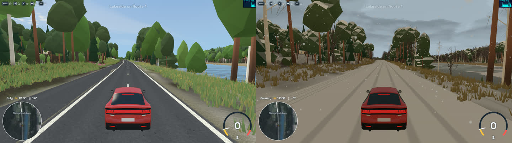
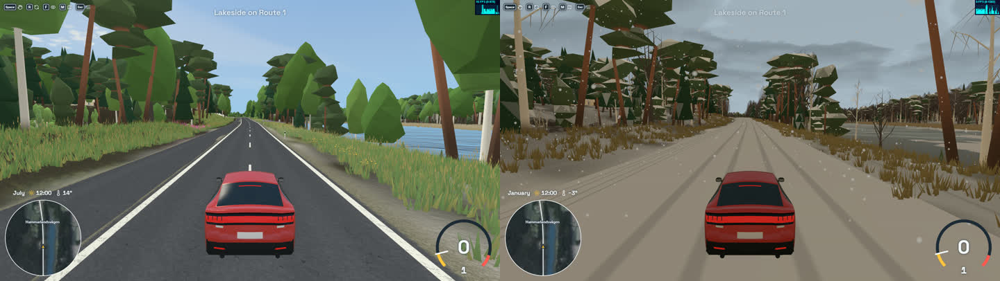
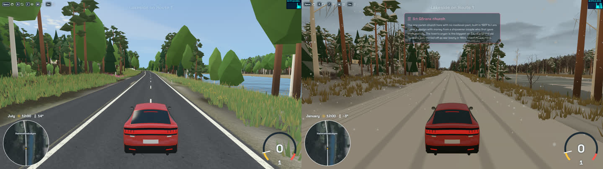
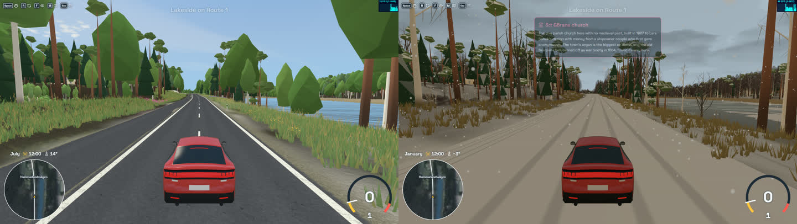

# Pine crowns

A known gap, and the record of four attempts to close it, none taken. The game's Scots pines keep their original shape. This doc says what the gap is, what each attempt was, what it cost, why it was rejected, and where its code is, so the next attempt starts from here rather than from nothing. Nothing in it is built in the game.

## The gap

A Scots pine in the game is the forest's turned shape (`render/tree-shapes.ts`, `render/forest.ts`): a long trunk going fox-red higher up, under a smooth, closed oval crown. That crown is a leafy broadleaf's shape, so a pine doesn't read as a pine. It shows most in winter: among bare broadleaves a green oval on a long trunk looks like a broadleaf that kept its leaves. The owner asked exactly that ("why are some trees still showing green full canopies even in January?"), and every green crown turned out to be a conifer (pines painted magenta, January, Mariehamn): nothing in the seasons was wrong, only the pine's shape.

A real Scots pine is a long clean trunk, grey-brown at the foot and fox-red above, with limbs further down than a pine deep in a wood shows, and a crown of separate tufts of needles that the sky and the branches show through. The owner's verdict on what any fix must do: a pine is seen through, "an opaque canopy will never match the look"; and it must sit in the game's flat-shaded, faceted style beside the spruces, birches and broadleaves. No attempt managed both. The owner chose to keep the original rather than ship a near miss: "I'd rather something that looks good really than a bad recreation of something that we can't get close enough to real."

Real photos of Åland's pines to judge against are on Wikimedia Commons, category "Forests in Åland" (a forest road through pines, "18-08-25-Åland RRK6588/6589.jpg") and the skerries west of Långbådan ("18-09-01-Schären westlich von Långbådan RRK7710/7712.jpg", rock pines).

## The attempts

Each picture is Lakeside on Route 1 at noon, in July and in January snowfall, from the same camera. The patches are each attempt's change against the branch it was built on (`claude/aland-seasons-art-ec04a0`), kept here so they stay in the repo; each was also kept on a branch of its own. They won't apply to a forest that has moved on without work, but they hold the shapes, the shaders and the measured numbers.

### The original (kept)

The turned shape: nine rings of an outline table per stage of life, 75 triangles near, 6 far, read by the forest's one model, so pines cost nothing of their own.

### 1. Three tiered clumps

The pine's rows of the outline table reshaped into three clumps with necks between them, splayed off the trunk on grown and old pines. No new model, triangle or pipeline. Rejected: it reads as a pagoda, and the crown is still full. Code: `pine-crowns/clumps.patch` (on branch `claude/pine-clumps-proposal`, built on 284c1e98).

### 2. Needle tufts on limbs

A pine model of its own near the camera (a list from the forest's compute pass, one draw): a trunk, eight limbs and 35 small flat three-cornered tufts with sky between them, 256 triangles near; the far crown narrowed and given a trunk, 12 triangles for every far tree. The handover passed the LOD check (old pines closest, FLIP 0.53 against 0.55). Rejected: "it looks like a bunch of small canopies went through a shredder." Many small pieces scattered over limbs read as broken, not as needles. Its code was reworked in place into attempt 3 and not kept; only the pictures and these numbers survive.

### 3. One cloud of cushions

The convention game asset packs use for a low-poly Scots pine (an ArtStation "Low-Poly Forest Assets" pack was the reference): a bare orange trunk forking near the top, carrying one lumpy, flat-topped cloud of six puffy bevelled cushions, three or four on a young pine, snow caps in winter. 164 triangles near, 12 far; 104 render pipelines on a cold page, one fewer than before. The handover passed with margin (outline at most 4.5 px, FLIP at most 0.36, worst spot 0.55). The owner: "much better, but still not right": real pines carry branches further down the trunk, and the cloud is still a solid canopy where a pine is seen through. Code: `pine-crowns/cushions.patch` (branch `claude/pine-cushions-proposal`, built on 492ec63e).

### 4. Cut-out needle cards

The industry's standard way to draw a see-through conifer: the crown built of flat cards whose shader cuts a spray of needles out of each card in its own coordinates (no texture), edges smoothed by alpha to coverage under the game's MSAA, fading to solid as needles get smaller than a pixel; plus whorls of limbs down the trunk, more and lower the more open the pine stands. 143 triangles near, 12 far, 106 pipelines. Rejected: up close the radiating tufts read as "a coronavirus under a microscope or a Venus flytrap", a different, illustrative vocabulary from the faceted trees beside them; and an old pine in the open failed the LOD check, its live lower whorls moving the outline 7.5 px at the handover against a limit of 6, since one far blob can't show them. Its pixel cost (the cards switch off early depth testing, so overlapping cards are all shaded) was never measured. Code: `pine-crowns/cards.patch` (branch `claude/pine-cards-proposal`, built on 492ec63e; it includes attempt 3's model, which it extends).

## What was learned

- **The problem that was asked is narrower than the one that was chased.** Telling a pine from a broadleaf at a glance is cheap (attempt 3 does it). Making a pine look like a real pine needs a see-through crown, which the game's flat, faceted style has no vocabulary for yet.
- **Few big pieces read as a tree; many small ones read as broken.** Attempt 2's scattered tufts were the worst received.
- **Opaque reads as a canopy whatever its shape.** Attempts 1 and 3 changed the outline but not the solidity.
- **See-through foliage is a pixel cost, not a triangle cost.** Triangles were never the limit (the forest is about a million at worst against several million a frame); cut-outs are paid per shaded pixel and per overlapping layer.
- **Lower branches need a far version that shows them.** A pine with live whorls down its trunk fails the handover to a single far blob.

## Coming back to it

Treat it as a style decision first, then a model. Start from the owner's two conditions (seen through, in the game's style) and the real photos. Directions not yet tried:

- **A see-through crown in the faceted vocabulary:** cut-outs whose shapes are the game's own (crisp polygonal needle tufts, flat-lit per facet) rather than radiating sprays.
- **Branches as the structure:** a pine drawn mostly as its limbs and a few dark needle masses along them, closer to the bare broadleaves (`render/bare-tree.ts`), which the owner accepted.
- **A far version that keeps the near one's gaps:** a few cut-out cards far off, or an open pine handing over later, so lower branches survive the LOD check.

Whatever is tried, measure its handover with the LOD check's measures (`art/lod-check/`), count its pixel cost before it ships, and show the owner stills beside the real photos before building further.
