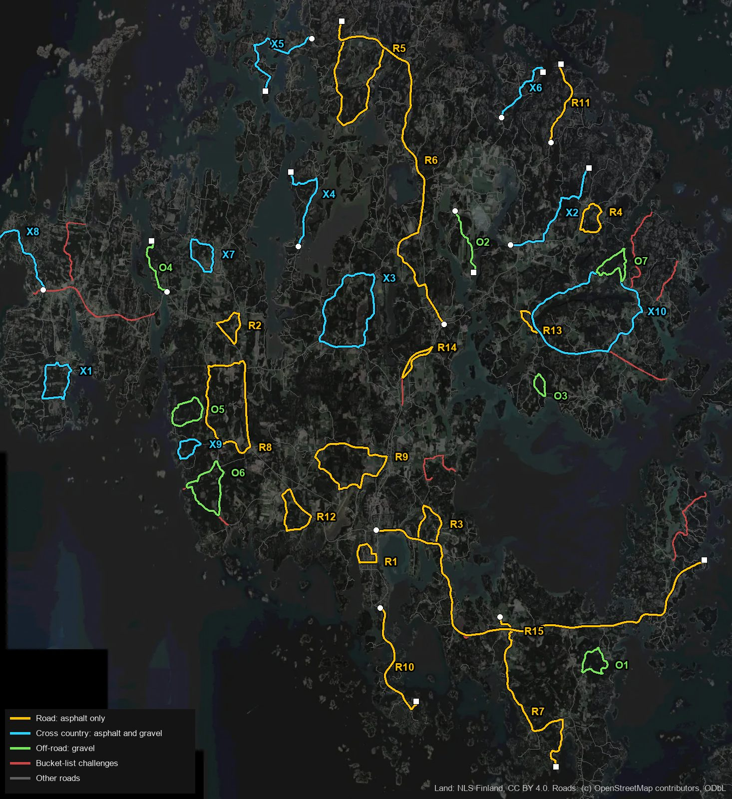
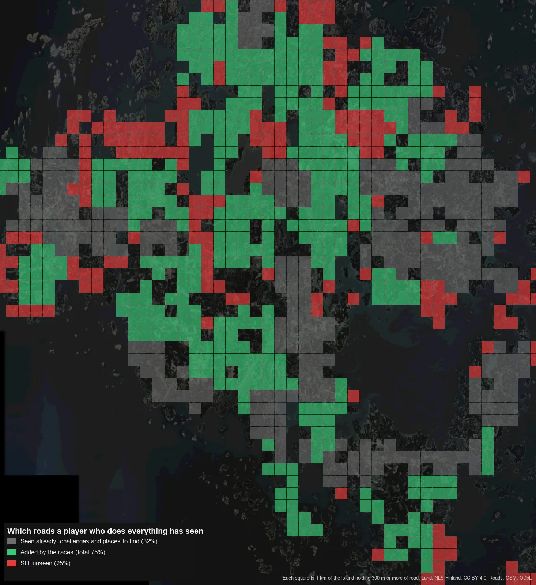

# Races

The plan for races in Åland Drive: what kinds there are, what makes a track worth racing, the real tracks on the map, how a player finds and plays one, and the order to build them in, before the AI racers of `ideas/traffic-and-racers.md` and after them. Step 1 of the build order, races on the map, is built (`challenge/CLAUDE.md`): with no racers yet, a finish is first. The rest isn't. The owner has taken the main decisions (see "The owner's decisions"); the numbers here are the plan's, measured from the game's own data, and `challenge/race-places.json` and `race-laps.json` hold each race as laid on the road.

The order of work is the owner's: plan, then races on the map, then the AI drivers.

## The short version

- **A race is a circuit or a sprint**: laps of a loop, or point to point. Every race is also one of three kinds by what's under the wheels: **road** (asphalt only), **cross country** (asphalt and gravel mixed) and **off-road** (gravel and loose ground).
- **A race shows no time.** Only the place counts: no stopwatch, best time or time to beat, which are the bucket list's.
- **Races are a way to explore.** A player who does every race and every bucket-list challenge and finds every place should have seen most of the island. Today the challenges and the places show about a third of its road; the 32 races here take that to three quarters.
- **32 tracks**: 15 road, 12 cross country and 5 off-road, in every parish the car can reach. Six of them share roads with bucket-list challenges, the island's most storied ones, and ask something different of them.
- **The race picks the car**, as a challenge does, so the first version needs no money and no garage, and the racers drive other cars of the same kind. How a player chooses a car comes later: then a race asks for a class and tier, and the list grows to 56 events on about 45–50 routes (section 9).
- **First, second and third are gold, silver and bronze**, and a solo result is kept apart from a co-op one. A co-op team is scored as Forza Horizon scores a team: on points for the racers its players beat.
- **Races are run in the world as it is**: its traffic, as TDU's are, and its hour, season and weather, so the AI racers must race every track in every condition and through traffic. Challenges set their own conditions instead, as Forza's bucket lists do.
- **Races reuse the challenges' machinery** (start ring, countdown, lines across the road, the panel, the result card, retry) and add laps, a grid and places.
- **Every track is driven by the simulation before any racer exists**, with a race version of the challenge par tool, so a track nobody can finish cleanly never reaches the racers.

*The 32 tracks by kind: road in yellow, cross country in blue, off-road in green. A circuit is a closed loop; a sprint has a white dot at its start and a white square at its finish. Red is the bucket list's roads. The pictures are the plan's: since then the four whose road the game lays differently (Out to Järsö, the Sund Ring, Lavö and Nötviken) have moved kind and every list is numbered again, as the tables below have them.*

Each track up close, on the aerial photo with its height profile: [road, 1 to 6](races-road-1.jpg), [road, 7 to 12](races-road-2.jpg), [cross country](races-cross-country.jpg), [off-road](races-off-road.jpg) and [the six on challenge roads](races-on-challenge-roads.jpg).

## 1. Race types

What the three games the owner judges against have, from their pages on Wikipedia, the publishers' news and guide sites (the series' Fandom wikis refused automated reading):

| | Test Drive Unlimited 1 and 2 | Forza Horizon 4 and 5 | The Crew 1, 2 and Motorfest |
|---|---|---|---|
| Circuit and sprint against AI | Race, against up to seven | Road, dirt, street and cross-country racing | Races in every discipline |
| Against the clock | Time challenge, speed challenge, speed trap | Speed trap, speed zone, trailblazer | Skill challenges, timed runs |
| One on one | Instant challenge: flash your lights at a player, bet, set your own finish | Head-to-head against an AI; honk at a player in FH4 | One-on-one, PvP sessions |
| Drag | No | Drag strips | Drag, in TC2 |
| Other | Car delivery, hitchhikers, couriers; Solar Crown championships | Showcases (against a train or plane), drift zones, jumps, the Eliminator battle royale, co-op championships | Drift, raids, police escapes, monster trucks, boats and planes |

**Decided: circuits and sprints.** Everything in the first row is one of the two, since a race is either loops or point to point. What changes between Forza's road, dirt and cross-country races is the ground, and that is how Åland's races are sorted too:

| Kind | Ground | Like |
|---|---|---|
| **Road** | Asphalt only | Forza's road racing, TDU's races |
| **Cross country** | Asphalt and gravel mixed, the grip changing under the car | Forza's dirt racing on mixed stages |
| **Off-road** | Gravel and loose ground (and ice, once the seasons bring it) | Forza's dirt and trail racing, The Crew's rally raids |

"Cross country" here means mixed surfaces on real roads, not Forza's driving across fields: the island's fields have stone walls and boulders that stop the car and forest it passes through, so a line across country would read as broken. Forest tracks (OSM's `highway=track`) are the obvious next ground for off-road, once the off-road list wants more than the gravel lanes.

Åland's own real events (the rallysprint's staggered starts, the Streetrace's 201 m drag, the Backrace's regularity rule, in `docs/DRIVING-CULTURE.md`) and the on-the-spot duel between players are left for later. TDU's races are open roads with traffic, Forza's road and dirt races closed ones; Åland's follow TDU (section 6).

## 2. What makes a track fun to drive

The criteria every track is scored on, with what the score is measured from.

| Criterion | Why it matters | Measured from |
|---|---|---|
| **Rhythm** | Bends of different speeds in a row that flows: a fast sweep into a tight one, a straight and then a braking zone. All slow is tiring, all fast is dull. | Bends per km, and their mix by tightest radius (under 25 m, 25–50, 50–100, 100–200). A loop's junctions are its square, slow corners. |
| **Elevation** | Crests, dips and climbs make a road feel alive and change the braking. Åland is low, so any relief counts. | Lowest and highest ground, and metres climbed, from the tiles' 16 m heights. |
| **Surface** | Grip changing under the car is the game's own feature (`ideas/surface-grip.md`), and it sorts the kinds. | OSM's surface, or the road class's where it says nothing, as the game lays it: untagged main roads are asphalt, untagged country lanes gravel. |
| **Length** | A circuit of 3–8 km makes a lap of two to four minutes; a sprint of 4–25 km is two to twelve. A race of five to ten minutes. | The route's length. |
| **Scenery and landmarks** | The game is a tour of a real place. A race past a castle or along the sea is remembered; one through forest isn't. | Real places from `docs/HISTORY.md` within 400 m, and sea or open views on the map. |
| **Overtaking** | Wheel to wheel needs places to pass: straights over 300 m, and hard braking into a slow corner after one. | Straights over 300 m, and the longest. |
| **Width** | Two cars side by side need a two-lane road. A gravel lane takes one car at a time. | The road's class: primary and secondary are two lanes, unclassified lanes one. |
| **What it shows** | Races are how a player comes to know the island. | The roads within a kilometre of the route that no challenge, place or other race already shows. A race on a challenge's road shows nothing new, and earns its place by the road itself. |

## 3. Where the loops and branches are

The road map (`pipeline/road_map.py`) holds every motor way OSM has. Taking the kinds a race can use (main roads, tertiary, unclassified and residential), the network was cut back to its loops by peeling off every dead end until none was left, and for each road left the shortest loop through it was found. What was peeled off are the branches, the island's sprints.

- **1,921 km of road, of which 841 km is on loops.** The rest is branches: a lane to a farm, a road out to a cape or over the bridges to an island.
- **About a hundred loops of 2.5–16 km**, most in the middle: Jomala, Finström, Hammarland, Sund and Saltvik. The west (Eckerö) and the south (Lemland, Lumparland) have fewer and smaller ones, and Vårdö has none the car can reach.
- **Loops on gravel are short and twisty**, on tarmac long and fast. A loop on a main road has two or three slow junction corners and long straights; on lanes it bends all the way.
- **The bucket-list challenges' roads are open to races too.** They are the island's most storied roads, and a race on one is a different thing from the challenge: laps instead of one run, racers and traffic instead of a target, another car or another way round. A race on a challenge's road must differ from the challenge in at least one of those.

### What a player who does everything will have seen

The island was cut into squares of a kilometre, and each square with 300 m of road or more counts. A square is seen when a challenge's road, a race's route or a place to find passes it or the square next to it. Most tracks were chosen to fill what the challenges and places leave unseen, a loop or a branch at a time, each where it showed the most new road, then balanced between the three kinds. The six on challenge roads are there for the roads themselves.

- **The challenges and the places show 32%** of the squares.
- **With the 32 races, 75%.**
- **The gaps left** are Hammarland's north coast, Saltvik's north-east, Lumparland and Lemland's south-eastern tip: where the list grows next.

## 4. The tracks

32 tracks. Positions are the game's scene metres (x east, z south of the world origin), as `docs/HISTORY.md` gives them. Each is a starting point: the map step lays it on the road as built and the vetting run drives it (section 7). A track with no story yet is there for what it shows, and gets its note when it is researched to `docs/HISTORY.md`'s standard.

### Road: asphalt only

| # | Track | Shape | Length | Bends | Ground | Longest straight | Story |
|---|---|---|---|---|---|---|---|
| R1 | Harbour to Harbour, Mariehamn | Circuit | 4.0 km | 7 | 1–15 m | 900 m | The town's sights, the summer cruise |
| R2 | Hammarbo, Hammarland | Circuit | 5.2 km | 6 | 5–21 m | 1,540 m | The Streetrace's straight, S:ta Katarina |
| R3 | The Painters' Loop, Önningeby | Circuit | 6.3 km | 6 | 2–37 m | 520 m | The artists' colony |
| R4 | Tengsöda, Saltvik | Circuit | 5.2 km | 8 | 13–38 m | 780 m | The driver's loop |
| R5 | Round Geta | Circuit | 14.2 km | 9 | 2–28 m | 780 m | Geta church, the north coast |
| R6 | Godby to Soltuna | Sprint | 24.2 km | 6 | 3–91 m | 2,450 m | The apple-orchard road to the first Backrace hill |
| R7 | Lemland to the Sea | Sprint | 13.7 km | 15 | 1–19 m | 350 m | Lemland church, Gustaf Erikson's parish |
| R8 | North Hammarland | Circuit | 15.0 km | 9 | 12–34 m | 1,560 m | To find |
| R9 | Jomala West | Circuit | 12.3 km | 13 | 3–27 m | 660 m | Near Jomala church |
| R10 | Hamnsund | Sprint | 5.4 km | 2 | 2–52 m | 350 m | To find |
| R11 | The Kungsö Road | Circuit | 6.9 km | 4 | 2–10 m | 720 m | Towards Kungsö's battery |
| R12 | Kastelholm, Sund | Circuit | 3.7 km | 6 | 1–22 m | 500 m | Round the castle |
| R13 | The Old Road and the New, Jomala | Circuit | 5.6 km | 2 | 3–23 m | 910 m | Old and new road 2, the Streetrace's 2021–22 road |
| R14 | The Night Ferry, Mariehamn to Långnäs | Sprint | 26.8 km | 2 | 0–32 m | 1,600 m | Catch the ship that calls in the night |
| R15 | The Sund Ring | Circuit | 19.6 km | 15 | 3–51 m | 1,200 m | The Backrace road, Kastelholm, Sund church |

**R1. Harbour to Harbour.** Storagatan from Österhamn to Västerhamn, north along the western harbour on Sjöpromenaden past Pommern and under Badhusberget's water tower, east by Elverksgatan and Västra Utfarten to Ålandsvägen, then along Styrmansgatan and back up the eastern harbour on Österleden, since Strandgatan, the plan's first way, runs one way the other way. Starts at (−1903, 6780). Square town corners, Storagatan's straight, the harbour front and nine of the town's sights within 150 m: Pommern, the Maritime Museum, S:t Görans, Gustaf Erikson's home, Sundblom, the empress's memorial, the town hall. **Story:** the summer cruise between the Eastern and Western harbours, and the wide streets Mariehamn was laid out with in 1861 as fire breaks, which make a street circuit possible at all. **Watch:** parked cars line some kerbs and the street lamps and lindens stop the car, and the roads stay open, so the vetting run checks the route can be raced past them. Some streets are one-way, so the route runs the way their traffic does.

**R2. Hammarbo.** Hammarlandsvägen, road 1, west through Hammarbo on its 1.5 km straight, then round by Skarpnåtövägen and Mejerigatan. Starts at (−10421, −6318). One long straight into a hairpin, then country bends. **Story:** the straight is the real Streetrace's site in 2025 and 2026, and Hammarland's church of S:ta Katarina, built bit by bit from the late 1200s, stands 180 m off.

**R3. The Painters' Loop.** Önningebyvägen through the village, Österkalmarevägen and the north end of Lemlandsvägen, east of Mariehamn. Starts at (1767, 5660). A climb to 37 m and down to the shore, on wide two-lane roads. **Story:** the Önningeby artists' colony, which Victor Westerholm began in 1886 to paint this light, and its museum, 60 m from the road. Lemlandsvägen's speed trap starts about 6 km further south.

**R4. Tengsöda.** Tengsödabyvägen and Långbergsödavägen, in Saltvik's east. Starts at (11370, −14668). The best rhythm of any tarmac loop: medium and fast bends in a row, a 9% grade, 62 m climbed a lap. Narrow, with one straight and no sight on it: the driver's loop, between Kvarnbo and Orrdalsklint.

**R5. Round Geta.** Getavägen north to Geta church, Gamla byvägen, and back south on Södravägen round the bay. Starts at Geta church, (−3817, −24611). One long lap of the north coast, six straights, 109 m climbed. **Story:** Geta's red-granite church and the villages that fought over where to build it, until an ox chose. It shares 2.8 km of Getavägen with R6.

**R6. Godby to Soltuna.** Getavägen the whole way from Godby to Geta, the "apple-orchard road", past Finström church, then up Getabergsvägen to the top. Starts at (2198, −7510), finishes at (−3980, −25729). The island's long race, TDU's long point-to-point: fast and open, then the climb to 91 m with the sea and, on a clear day, Sweden in view. About ten minutes. **Story:** Stallhagen's brewery at Godby, Finström church, often called Finland's best-preserved medieval building, the road where the Streetrace set its record of nearly 200 km/h in 2024, and Soltuna, built in the 1930s at the top of the hill where the Backrace began.

**R7. Lemland to the Sea.** From Lemland church south through the parish by Flakavägen and its villages to the shore at the parish's southern tip. Starts at (5544, 10061), finishes at (8892, 19066). Fifteen bends on a narrow tarmac road through farmland to the sea. **Story:** Lemland's church with its rediscovered medieval paintings, and the parish Gustaf Erikson, the sailing-ship king, came from. It crosses Lemlandsvägen at its start, where the speed trap runs, and uses none of it.

**R8. North Hammarland.** Torpvägen, Hammarlandsvägen and Vestmyravägen, a big lap of Hammarland's north. Starts at (−12006, −5000). Fast and open, a 1.6 km straight. Shows the most new road of any track.

**R9. Jomala West.** Södersundavägen, Norra Torpvägen, Norra Svibyvägen, Jomala Torpvägen and a piece of Nya Godbyvägen, round the farmland west of Jomala's church. Starts at (−4123, 2400). Thirteen bends, a lap of 12 km.

**R10. Hamnsund.** Hamnsundsvägen north through Saltvik's rock to Hamnsund. Starts at (8590, −18449), finishes at (9230, −23135). A climb to 52 m over bare granite, then down to the water.

**R11. The Kungsö Road.** Österskogsvägen, Kungsövägen, Hammarlandsvägen and Gottbyvägen, west of Mariehamn. Starts at (−7551, 2787). Flat and fast through fields. Kungsövägen is the road out to Kungsö's battery, Russia's gun pits of 1916.

**R12. Kastelholm.** Slottsvägen past the castle, Sundsvägen and Tosarbyvägen. Starts at (7814, −7168). Short and quick, with the castle, Vita Björn and Jan Karlsgården beside the road. **Story:** Åland's only medieval castle, the Swedish crown's seat here. It shares Slottsvägen and a little of Sundsvägen with the challenge from the castle to Bomarsund: the challenge is one run east to the fortress, the race laps the castle.

**R13. The Old Road and the New.** Out on Godbyvägen, old road 2, and back on Nya Godbyvägen, the new one, joined by two hairpin junctions. Starts at (1418, −6093). Nearly an oval: flat out, two heavy stops, the best overtaking on the island. **Story:** the main road north from Mariehamn, rebuilt alongside itself, where the Streetrace returned in 2021 and 2022. The road-2 speed trap is on the straight just south: the trap is one car's top speed, the race is laps and racers.

**R14. The Night Ferry.** From Mariehamn east along Lemlandsvägen, over the Lemström bridge, across Lemland and on to Långnäs harbour. Starts at (−1884, 4835), finishes at (17827, 6651). The longest race, a highway sprint across half the island. **Story:** the big ships still call at Långnäs, a very small place, in the night, because Åland sits outside the EU's tax area (the Long Night Runs of `docs/DRIVING-CULTURE.md`). It shares Lemlandsvägen with the Lemland speed trap and its last road with the V12's challenge to Långnäs: those are one car on one stretch, this is the whole way, against racers.

**R15. The Sund Ring.** Norra Sundsvägen east, Mångstektavägen past Nötviken, and back west on Sundsvägen past Bomarsund's turning and Kastelholm. Starts at (12078, −5969). The island's big circuit: 15 bends, 221 m climbed a lap, a 1.2 km straight. **Story:** Norra Sundsvägen is the Backrace's road, Sund church the largest medieval church on Åland, and Kastelholm the castle. It shares most of its road with two challenges, the Backrace road flat out and castle to fortress: each of those is one run one way in one car, the ring is all of it in laps, against racers. It was planned as cross country, for gravel on Mångstektavägen that the game lays as asphalt, a secondary road, so it races as a road race, in the Sund.

### Cross country: asphalt and gravel

| # | Track | Shape | Length | Asphalt | Bends | Ground | Story |
|---|---|---|---|---|---|---|---|
| X1 | Degersand, Eckerö | Circuit | 7.4 km | 37% | 17 | 1–34 m | Eckerö's sandy south-west |
| X2 | Kvarnbo to the Old Shore, Saltvik | Sprint | 8.2 km | 32% | 9 | 13–69 m | Viking Kvarnbo to the Stone Age shore |
| X3 | Emkarby and Svartsmara, Finström | Circuit | 13.8 km | 66% | 9 | 3–22 m | To find |
| X4 | Out to Bergö, Finström | Sprint | 6.8 km | 65% | 9 | 1–30 m | Along the water to Bergö |
| X5 | Geta's Islands | Sprint | 8.0 km | 53% | 9 | 0–22 m | Finnö, Hällö and Andersö, over the sounds |
| X6 | Toböle, Saltvik | Sprint | 4.8 km | 37% | 9 | 3–27 m | Saltvik's north coast |
| X7 | Bovik, Hammarland | Circuit | 5.7 km | 75% | 8 | 12–25 m | To find |
| X8 | Storby to Käringsund, Eckerö | Sprint | 8.5 km | 64% | 12 | 1–32 m | The post road's start to the fishing harbour |
| X9 | Tellholm, Hammarland | Circuit | 4.2 km | 18% | 6 | 2–21 m | Hammarland's west coast |
| X10 | Out to Järsö | Sprint | 7.9 km | 91% | 4 | 1–14 m | Island to island south of Mariehamn |
| X11 | Lavö, Finström | Sprint | 4.3 km | 64% | 7 | 1–26 m | Between two inlets |
| X12 | Nötviken, Sund | Circuit | 7.1 km | 36% | 14 | 9–51 m | The forest above the bay |

**X1. Degersand.** Skeppsviksvägen, Långnabbavägen, Degersandsvägen and Torpvägen, in Eckerö's south-west. Starts at (−21122, −5216). The twistiest loop found: seventeen bends, gravel and tarmac changing under the car, 9% grades. **Story:** Degersand, the sandy shore at Eckerö's tip, its note still to be checked against a source. Eckerö is past Marsund, so the drive there crosses the bridge the post-road challenge does.

**X2. Kvarnbo to the Old Shore.** From Saltvik church at Kvarnbo, past the Johannisberg grave field, out by Långbergsödavägen and the forest roads to the foot of Orrdalsklint. Starts at (6178, −12275), finishes at (10895, −16903). Climbing from 13 to 69 m. **Story:** the line of Märta's Round chapters 3 and 4 (`docs/HISTORY.md`), from Åland's Viking heart to the old shore where the first people camped, now high above the sea. It stops at the road's end, short of the forest track up Orrdalsklint that the challenge list left out for the scripted driver.

**X3. Emkarby and Svartsmara.** Emkarbyvägen, Åttbölevägen and Svartsmaravägen, a long lap of Finström's west. Starts at (−2956, −6141). Two thirds asphalt, the rest the gravel through Svartsmara.

**X4. Out to Bergö.** Bergövägen and Västanpåvägen north along the water on Finström's west. Starts at (−6573, −12189), finishes at (−7040, −16653). A climb to 30 m near the end.

**X5. Geta's Islands.** Finnövägen, Hällövägen and Andersövägen, west from Geta over the sounds between its islands. Starts at (−5754, −24674), finishes at (−8568, −21510). Down to the water and up again, nine times.

**X6. Toböle.** Tobölevägen, Ekholmsvägen and Glosholmsvägen, out along a narrow inlet on Saltvik's north coast. Starts at (5636, −19941), finishes at (8120, −22668).

**X7. Bovik.** Bovikvägen and Mellanåkersvägen, among Hammarland's northern fields. Starts at (−13037, −12438).

**X8. Storby to Käringsund.** From Storby, where the post road begins at the Post and Customs House, by Käringsundsvägen and Öjvägen round Eckerö's west to Rödklobben. Starts at (−21894, −9596), finishes at (−26046, −11584). **Story:** past Käringsund, whose little museum keeps the seine boats and seal-hunting gear. It starts beside the post-road challenge's start and shares none of its road.

**X9. Tellholm.** Tellholmsvägen, Träskviksvägen and Aludden, on Hammarland's west coast. Starts at (−13673, −112). Mostly gravel: the edge between cross country and off-road.

**X10. Out to Järsö.** Järsövägen south from Mariehamn over the bridges and causeways between islands. Starts at (−1647, 9513), finishes at (508, 15123). Water on both sides most of the way; the last of it gravel. It was planned as a road race, but its gravel end makes it cross country.

**X11. Lavö.** Hjortövägen, Lavövägen and Granhallsvägen, south down a ridge between two inlets. Starts at (2856, −14333), finishes at (3941, −10631). It was planned as off-road, but the game lays a third of it in asphalt, so it races as cross country.

**X12. Nötviken.** Norra Sundsvägen's gravel end, Kvarnsjövägen and Faderviksvägen, in the forest above Nötviken's bay. Starts at (12749, −10801). Fourteen bends, nothing straight longer than 180 m, 134 m climbed a lap. It shares 2 km with the rally car's challenge to Nötviken, and 2.5 km with R15. It was planned as off-road, but Norra Sundsvägen, a third of the lap, is laid in asphalt, so it races as cross country.

### Off-road: gravel

| # | Track | Shape | Length | Bends | Ground | Story |
|---|---|---|---|---|---|---|
| O1 | Vessingsboda Lanes, Lemland | Circuit | 5.6 km | 13 | 10–22 m | Beside the motor club's home ground |
| O2 | Båtvik, Sund | Circuit | 3.3 km | 4 | 5–38 m | Across the bay from Kastelholm |
| O3 | Småkärr, Hammarland | Sprint | 4.1 km | 8 | 2–15 m | Along the sound north of Marsund |
| O4 | Kullskär, Hammarland | Circuit | 5.8 km | 12 | 4–39 m | Hammarland's west coast |
| O5 | Djurvik, Hammarland | Circuit | 9.3 km | 20 | 3–34 m | Out to the shore at Djurvik |

**O1. Vessingsboda Lanes.** Norra Byvägen and Hagsviksvägen, gravel all the way, the lanes beside Mönbackavägen. Starts at (11905, 12711). Thirteen bends and nothing straight for more than 180 m: a rally loop. **Story:** Motorstadion, Ålands motorklubb's home ground at Vessingsboda, is half a kilometre west, where the folkrace runs every spring and autumn.

**O2. Båtvik.** Båtviksvägen's loop, across the bay south-east of Kastelholm. Starts at (7663, −4361). Short, steep (5 to 38 m) and fast for gravel.

**O3. Småkärr.** Småkärrsvägen north along the sound from the Marsund road. Starts at (−14451, −9480), finishes at (−15410, −12543).

**O4. Kullskär.** Kullskärsvägen, Alskog and Bankvikvägen, on Hammarland's west coast. Starts at (−14136, −1801). Twelve bends, a climb to 39 m and back to the shore.

**O5. Djurvik.** Djurvikvägen, Södra Bråkviken and Varggropsvägen, a loop of Hammarland's south-west down to the shore. Starts at (−11672, 3710). The most bends of any track, twenty, all gravel. It shares 2.9 km of Djurvikvägen with the four-by-four's challenge to Djurvik, which goes one way to the shore; the race laps the whole loop.

### Left out

- **The Ytterby stage**, the real Rallysprint's gravel: the challenge already runs it as the real event does, one car against the clock, and the stage's joining road is a service road the measuring left out. It comes back as a race in the rallysprint's own format, cars started apart.
- **Getabergen** as a race of its own: 1.3 km. It is R6's finish.

## 5. How many, and which first

**All 32 go on the map in the first step.** Races are mostly data once the system exists, and the whole list is what makes them a way to explore. The vetting run (section 7) drives all of them, so the system is proven on every kind of road at once: R1 Harbour to Harbour is the hardest to lay (kerbs, one-way streets), R14 the Night Ferry the longest, O5 Djurvik the twistiest.

After them, the gaps the coverage map shows.

## 6. Playing a race

### Finding and starting one

TDU put every race at a marker on the map that you drove to; Forza and The Crew did too, with fast travel on top. The challenges here already work that way, and races should too.

- **A race's start is a ring on the road, as a challenge's is**, with its own symbol and colour on both maps, and the kind (road, cross country, off-road) shown on it, and in the world the same posts and beam in the race's colour.
- **The world map shows the whole route** when the cursor is over a race: the loop or the line, its length, kind, laps and the player's medal. A pick routes the GPS to the ring, as a challenge's does.
- **In the ring, the race's button opens its card**: the track, kind, laps, the car, the medals and the best, then Start. Starting puts every car on the grid, as a challenge's retry puts it on its line.
- **The grid** is places two abreast on a two-lane road, single file on a lane, measured from the laid road like the challenges' start places: six cars on a main road, four on a lane.
- **Online**, a player in the ring with others can race with them, as a team against the racers (decided in `ideas/traffic-and-racers.md`). The challenges' invite, ready gate and synced retry grow from two players to a few.
- **No fast travel.** Driving to the race is the game, and the drive there shows the island too.

### What each race allows

- **Cars: the race picks the car**, as a bucket-list challenge does: a road or sports car for a road race, the rally car or a four-by-four off the tarmac. There is no money and no way in the game to change cars yet, so this needs neither. How a player chooses a car, as TDU did (a race names a class, any car of it may enter, and a player without one rents one), is for when cars are bought.
- **The racers drive other cars of the same kind**: road and sports cars on a road race, the rally car and the four-by-fours off it. A field of different cars is more interesting to race than one of copies, and a close race between them is the racers' difficulty to tune (section 8).
- **More cars of the loose kinds.** Of the fourteen cars, eight are road cars and three sports cars, but one is a rally car and two are four-by-fours, so an off-road grid of four or six is mostly copies. The cross-country and off-road races want more rally cars and four-by-fours, a car-art job of its own.
- **Traffic: on, as TDU's races have it.** A race is run on the island's open roads with whatever traffic the world has, as TDU's are, rather than Forza's closed road races. Until traffic is in the world (it is only in the lane lab now) the roads are empty, and races change nothing for it: they get traffic the day the world does. Racers pass traffic as they pass a slow racer, only with the oncoming lane clear, and traffic treats a racer as it treats the player (`ideas/traffic-and-racers.md`, "Races through traffic"). Other players in free roam stay solid, as they do in a challenge.
- **Time, season and weather: the world's.** The hour, the season and the weather are every player's at once, and a race is run in what the world has: a race at night, on wet roads or on winter ice is the same track in another condition. So the racers must race every track in every condition (dry, wet, snow, ice, by day and by night), reading their car's grip for that condition from the limits table, which already has a row for each.
- **Challenges are the other way round.** A bucket-list challenge sets its own hour, season and weather, as Forza's do, so its target holds; a race takes the world's. That is the challenges' change to make, once the world has its day, seasons and weather.

### What winning gets

- **Gold, silver and bronze for first, second and third**, kept per race, with the best place, in this browser as challenge passes are.
- **Solo and co-op are kept apart**: a race has a solo medal and a co-op medal, each with its own best.
- **A co-op team is scored as Forza Horizon scores a team**: each player scores 100 points for every racer they finish ahead of and 50 for winning, and teammates don't score off each other. The team's points per player are its medal: beating every racer on average is gold, all but one silver, all but two bronze, so a strong run carries a weaker one, as the bucket list's co-op average does.
- **Money and cars come later.** `docs/PLAN.md` has driving earn the money that buys cars and a house; when that exists, races pay by medal. The records are kept from the start, so nothing won before then is lost.

### Races and the bucket list

Two lists on the same machinery. A challenge is one car the game hands you, one road, one target, passed or failed, solo or with a friend, in conditions it sets. A race is the same handed car against racers and traffic, laps or a long road, a medal, in whatever the world has. Six races share roads with challenges and ask something else of them, their symbols and colours differ, and together with the places to find they are the island's map to explore.

### What is reused from `challenge/`

| From the challenges | In a race |
|---|---|
| The start ring, the board of what's near, and the symbols on both maps | The same, with a race's symbol, colour and kind |
| The route as the GPS's own route between waypoints | The same; a circuit's last waypoint is its first, and the route keeps to one-way streets' direction, since the roads are open |
| Measured start places, two abreast | A grid of four to six |
| Lines across the road, found by a car's path between two steps | Checkpoints and the finish, crossed once a lap |
| The run as a pure state machine: countdown, lines, results | Grown to laps and several cars, with places |
| The session: swap to the challenge's car, put it on the line, give the old one back | The same, with the race's car |
| The panel at the top, the menu's Retry and Leave, the result card | Plus place and lap, and a table of places with the medal |
| Passes kept with the best | Medals kept with the best, solo and co-op apart |
| Co-op's invite, ready gate and synced retry | Grown from two players to a few, with the team's points |
| The scripted driver and its speed plan | The racers' start, and the vetting tool's driver |

## 7. Vetting tracks by driving them

`tools/challenge-par.ts` drives every challenge through the simulation alone, in its car, with a driver that brakes as late as the car's grip allows, easing only the spots where it loses the road, and sets the target from that. A race version does the same for every race, before any racer exists:

- **Every race is driven in every car of its field**, for all its laps, from every place on the grid, **in every condition**: dry, wet, snow and ice, since a race is run in whatever the world has. A track that can't be finished cleanly on ice in its car is a finding, fixed by the car or tyres the race gives in winter, or by the track.
- **A clean finish is the test**: no reset, no stop, never more than the gates' margin off the laid road, and few eased spots. A track where the car fails is fixed (its line moved, its route changed) or dropped before the racers ever see it. This is how the challenge list lost Orrdalsklint's track and Bodkaröjvägen.
- **It measures what the plan needs**: the lap and race time (which sets the laps, for a race of five to ten minutes), the narrowest laid width on the route (whether two can race abreast) and the grid's places on the road.
- **Then the racing line.** Once piece 3 exists, the same tool drives the racing line instead of the road's middle and holds that it stays inside the laid edges with a margin, that the car finishes cleanly on it, and how much faster it is. Racers are built only on tracks that pass.
- **It counts, not times**: laps finished, spots eased, metres off the road. Like the challenge tool it runs in seconds a race on one core; with every car of each field in four conditions the whole list is tens of minutes on all cores, so it is a run to ask the owner about first.

## 8. The build order after the plan

1. **Races on the map.** The list (specs, then measured grids, lines and laps), the rings and symbols on both maps with the route on the world map, the race card, the run grown to laps, several cars and places, the panel and the result card, the medals kept solo and co-op apart. Playable at once against the clock, and with friends online. Needs only what the challenges have. **Done when** all 32 can be found, started, finished and retried.
2. **The race vetting tool**, above, with the scripted driver. Needs step 1's list. **Done when** every race is finished cleanly, or its track is changed.
3. **The racing line and speed plan** (piece 3 of `ideas/traffic-and-racers.md`), checked on these races rather than the challenges' stages: a line inside the laid edges that straightens the bends, and the car's speed plan along it from its measured limits, by surface and condition. Needs step 2 and the limits table. **Done when** every race is finished on the line in every condition, faster than on the middle.
4. **The racer** (piece 4): the driver of that plan, with its own reset to recover, and difficulty as how much of its car's limit it uses, how late it brakes and how often it slips. First as one rival, then a grid started apart. Needs step 3. **Done when** a race is run against racers whose times spread by difficulty, measured by count.
5. **Racecraft** (piece 5): racers seeing each other and the player, passing and defending, on a full grid. Needs step 4. **Done when** a grid of six finishes every race with passes made and no pile-ups the vetting tool can find.
6. **Racers online** (piece 6): the nearest player runs each racer and keeps it in a fight, the same rule traffic will use. Needs step 4. **Done when** two pages on the run's own relay race one racer and swap who runs it.
7. **Co-op races online** (piece 7): players as a team against the racers, scored on Forza's points. Needs steps 5 and 6. **Done when** two players finish a race against racers, both seeing the same race and the same team result.
8. **Races through traffic** (piece 16): racers passing traffic, and traffic reacting to racers. Needs step 5 and traffic in the world, shared online (pieces 11–14). Races on the map don't wait for it: they run on whatever the roads hold, and traffic arrives in them when it arrives in the world. **Done when** a grid of six races through the world's traffic with no pile-up the vetting tool can find.

After those: the gaps the coverage map shows; more rally cars and four-by-fours for the loose kinds' grids; choosing a car once cars are bought; money by medal once the economy exists; and Åland's own events and duels between players.

## 9. Events, classes and tiers, once cars are bought

The long-term shape of the race list and the garage, for when a player brings a car rather than being handed one. An **event** is anything that asks the player to bring a car that meets a requirement: a class and tier, as TDU2's championships did. The bucket-list challenges aren't events: they hand the player the car, and stay that way.

### Classes and tiers

TDU2's scheme, with each tier's performance moved to today's cars: TDU2's car list is from 2011, and today's Golf GTI is about as quick as an A4 car was then.

| Class | Tiers | What it is | Today's counterparts, fastest tier first |
|---|---|---|---|
| **A: Asphalt** | A1–A7 | Road and sports cars, A1 fastest | A1 hypercars (0–100 under 2.8 s, 350+ km/h), A2 supercars (about 2.8–3.2 s), down to A7 hot hatches (about 5.5–7 s) |
| **B: Gravel** | B1–B4 | Cars built for gravel: rally cars, fast everyday cars on loose roads, four-by-fours | B1 the rally specials |
| **C: Classic** | C1–C4 | Older cars, today's cut-off taking in the 1990s and early 2000s | |

B is TDU2's off-road class widened to gravel, and gets back the B1 tier TDU2 dropped after its beta, because gravel is most of Åland's road. Of the 2,072 km a race can use in the game's OpenStreetMap data, 716 km is tagged paved, 526 km gravel or dirt and 830 km untagged; laid by the game's rule for untagged roads, that is 37–47% paved, against about two thirds asphalt on TDU2's islands. The main roads are nearly all asphalt and the country lanes, the largest part of the network, mostly gravel.

Measured on today's tiers, the fourteen cars sit in the middle and below: Sund A4; Ankar, the Skerry GT and Ström A5; Fjärd, Sten and Bris A6; Grus B2, Holm B3, Berg B4; Vik C3 and Sälta C4. Ljus and Kobb are slower than any A tier, and stay everyday cars outside the tiers.

### How many

| Class | Events by tier | Events |
|---|---|---|
| A | A1 2, A2 3, A3 4, A4 4, A5 5, A6 4, A7 4 | 26 |
| B | 5 each in B1–B4 | 20 |
| C | C1 2, C2 2, C3 3, C4 3 | 10 |
| | | **56** |

- **The event count comes from the tiers, not the map.** A tier needs enough events for a short run of progress and a reason to own more than one of its cars: about four, as TDU2's two championships per class of several races each gave. Fourteen tiers at about four is 56.
- **Weighted to Åland's roads, not spread evenly.** Few hypercar events, since only the main roads give one room; the most in the middle A tiers and in B, where the island's tarmac lanes and gravel are; classics on both surfaces. Tarmac takes slightly more than its share of road, since the main roads make the fastest races.
- **About 45–50 routes**, one per event where the roads allow, about half circuits and half sprints. Most events get a road of their own: 56 at about 8 km is around 450 km, half the network's loops before the branch sprints. The 32 tracks above are candidates like any other route, kept, changed or dropped by how well they fit a tier.
- **About 38 cars**: two to three per tier, so about 18 in A, 12 in B and 8 in C, 24 more than today, most of them in A1–A3 and B1–B2.

Against the games the plan follows, 56 events is about 8 per 100 km² of land and one per 34 km of road: denser than TDU2's 25 championships and cups on about 2,100 km² and 3,000 km of road, far sparser than Forza Horizon's hundreds of championships on maps of under 100 km². Åland has more road per km² than any of them, 2.8 km against TDU2's 1.4 and The Crew's 2.0, being real countryside at full scale.

### Roads for the fastest tiers

Whether the main roads can carry five A1–A2 events was measured on the game's OpenStreetMap data, the 334 km of primary and secondary road joined road by road: a stretch counts as fast where no bend is tighter than a radius of 400 m, which a car holding 1.3 g takes at about 255 km/h.

- **109 km of fast road in 26 stretches of 1.5 km or more, 12 of them over 3 km**, on roads 1, 2, 3 and 4 above all: road 1's longest is 14.6 km, road 2 and 4's shared stretch 11.8 km, road 3's 11.0 km.
- **Flat out at a hypercar's top speed is rare**: with no bend under 800 m (about 360 km/h), 28 km in 11 stretches of 2 km or more, two of them over 3 km. A hypercar on Åland is a fast-sweeper car, never a top-speed car, as on TDU2's islands.
- **So five events on five roads of their own is enough**: west on road 1 towards Eckerö, north on roads 2 and 4 to Geta (R6), east on road 3 to Långnäs (R14), the old and new road 2 (R13), and road 1's circuits in Hammarland (R2, R8). The A1–A2 tiers don't need to share routes.

## The owner's decisions

- **Race types: circuits and sprints**, each of three kinds by ground: road (asphalt only), off-road (gravel, ground, ice) and cross country (a mix of both).
- **Races are a way to explore**: every race, every challenge and every place to find together show most of the map. All the tracks shown are in.
- **The race picks the car**, as a bucket-list challenge does, for a first race system with no money and no way to change cars. How a player chooses a car to enter, and what's allowed, is for later.
- **The racers drive mixed cars of the race's kind**, which may mean adding more racing cars, of the loose kinds above all.
- **All 32 tracks go on the map at once.**
- **Races may use the bucket-list challenges' roads**, as long as a race asks something different of the road: laps, racers and traffic, another car or another way round.
- **Races are run in the world as it is: traffic on, as TDU's are, and the world's hour, season and weather.** The AI racers must handle every track in every condition. Bucket-list challenges set their own conditions instead, as Forza's do.
- **Records are gold, silver and bronze** for first, second and third, and a solo record is kept apart from a co-op one.
- **A race shows no time**, only places: the time is the bucket list's. Until the racers exist, a finish is first, rather than timed stand-in rivals.
- **Co-op players are one team, scored on Forza Horizon's team points**, its medal from its points per player.
- **Once cars are bought, events ask for a class and tier**, TDU2's scheme with today's cars in each tier: A1–A7 asphalt, B1–B4 gravel (B widened from off-road, with B1 back), C1–C4 classic.
- **56 events on about 45–50 routes, and about 38 cars**, weighted to Åland's roads as section 9 sets out. Any of the 32 tracks may be kept, changed or dropped to fit.

## Sources

- The loops, branches, coverage, lengths, bends, heights and surfaces: measured from the game's own data (OpenStreetMap's roads as `pipeline/road_map.py` keeps them, © OpenStreetMap contributors, ODbL; heights from NLS Finland's elevation model in the built tiles, CC BY 4.0). The pictures' land is the game's overview and far ground images, from NLS's orthophotos.
- Åland's events, roads and places: `docs/DRIVING-CULTURE.md` and `docs/HISTORY.md`, which carry their own sources.
- The bucket list's roads: `challenge/specs.ts`.
- TDU's race types and car classes: [Wikipedia, Test Drive Unlimited](https://en.wikipedia.org/wiki/Test_Drive_Unlimited), [Test Drive Unlimited 2](https://en.wikipedia.org/wiki/Test_Drive_Unlimited_2), [Worthplaying's single-player preview](http://worthplaying.com/article/2006/6/28/news/34252-test-drive-unlimited-all-singleplayer-mode-detailed/), [gamepressure's TDU guide](https://gamepressure.com/testdriveunlimited/basic-information/z6a05) and its [race lists](https://www.gamepressure.com/testdriveunlimited/races/z19f2).
- Forza Horizon's events and team scoring: [Wikipedia, Forza Horizon 4](https://en.wikipedia.org/wiki/Forza_Horizon_4) and [Forza Horizon 5](https://en.wikipedia.org/wiki/Forza_Horizon_5), [gamepressure's FH4 guide](https://www.gamepressure.com/forza-horizon-4/types-of-races-and-activities/z4b6f6), [a design analysis of FH4's team score](https://evanbg42.github.io/2024/11/11/design-spotlight-forza-team-score.html), and Forza support's ranked scoring page (a search excerpt only).
- Section 9's comparisons: TDU2's classes, tiers and cars from [the Test Drive wiki's vehicle list](https://testdrive.fandom.com/wiki/Test_Drive_Unlimited_2/Vehicles), its championships and cups from [PSNProfiles' trophy guide](https://psnprofiles.com/guide/1985-test-drive-unlimited-2-trophy-guide), its road and surfaces from Wikipedia above; Forza Horizon 2's championships from [FutureFive](https://futurefive.co.nz/story/on-the-road-again-forza-horizon-2), Forza Horizon 3's from [GameFAQs](https://gamefaqs.gamespot.com/boards/191490-forza-horizon-3/74731793), and both maps' sizes from community estimates ([forzahorizon6.net](https://forzahorizon6.net/fh6/size-km/), [VideoGamer](https://www.videogamer.com/news/forza-horizon-2s-playable-area-3x-bigger-than-the-originals)); The Crew's map and road from [Softpedia](https://games.softpedia.com/blog/The-Crew-s-Open-World-Is-as-Big-as-GTA-5-Skyrim-Far-Cry-3-and-More-Combined-437560.shtml) and [MP1st](https://mp1st.com/?p=43947), its missions from [Nonfiction Gaming](https://www.nonfictiongaming.com/2014/12/09/crew-review/); the main island's area from [Wikipedia, Fasta Åland](https://en.wikipedia.org/wiki/Fasta_%C3%85land). Today's cars' figures are factory numbers as commonly quoted, not checked one by one.
- The Crew's: [Wikipedia, The Crew](https://en.wikipedia.org/wiki/The_Crew_(video_game)), [The Crew 2](https://en.wikipedia.org/wiki/The_Crew_2) and [The Crew Motorfest](https://en.wikipedia.org/wiki/The_Crew_Motorfest).
