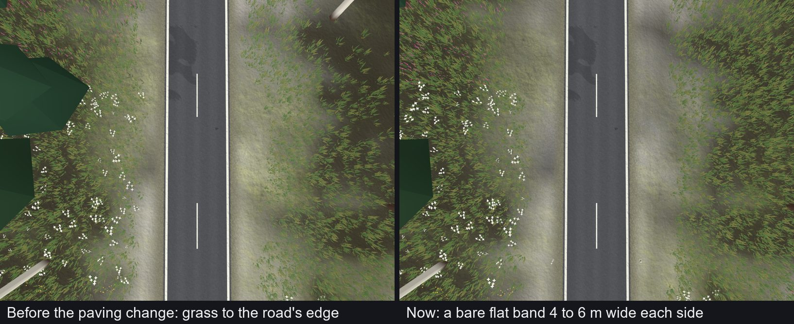
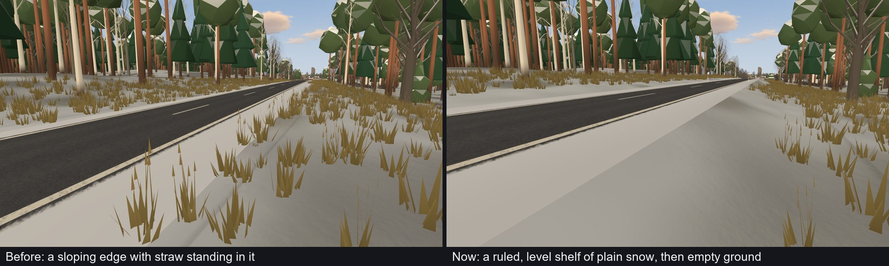
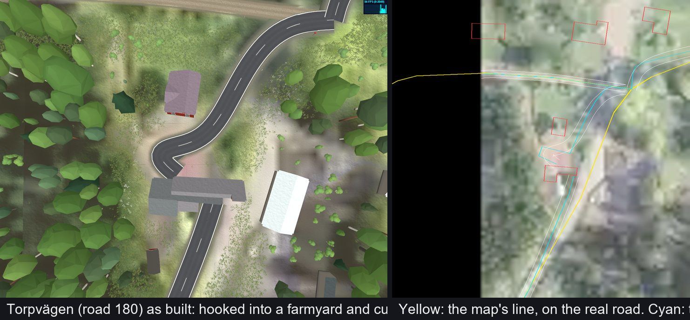
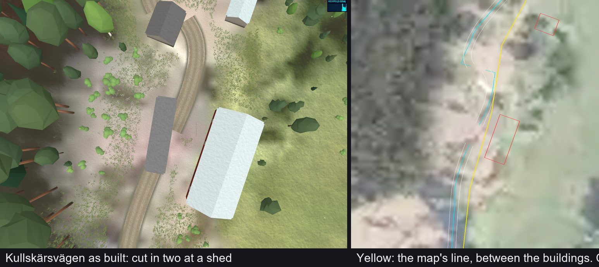
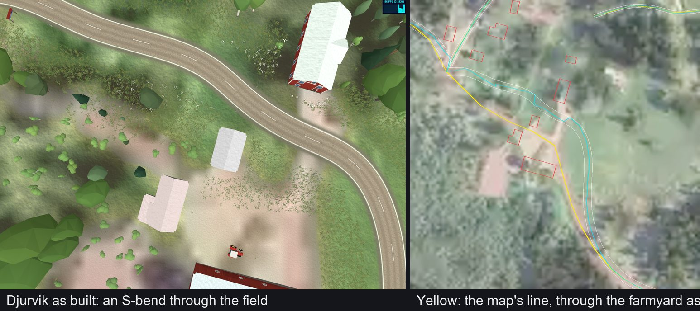

# Roads: the band at their sides, winter on them, and where they leave the map

An assessment for the owner, with a recommendation for each part. Nothing here is decided and nothing has been built. It answers three things the owner raised: a band at every road's side that makes it feel wider than it is, most plainly a fixed width of flat snow in winter; roads that are always perfectly ploughed, so snow tyres seem pointless; and how the roads are built from the data, look and drive overall.

Everything measured here was measured on the published island (tiles `43f1ca8c5567`), against a ribbon build of the same tile where a before is shown.

## 1. The band at the road's side

**What it is.** Every motor road has a shoulder each side of its carriageway, as wide as its class says. On the ribbon roads the shoulder was a strip that fell from the carriageway's edge to the land, and grass grew on it. On the paved island the shoulder is part of the paving: a level shelf at the carriageway's height, and the rest of the game is told the shelf is road. So:

- **Nothing grows on it or near it.** The road mask, which says where the verge's grass, the trees, the rock and the far painted road are, is drawn from every piece of paving, shoulders and junction corners included. It paints a main road 12.4 m wide where the ribbon build painted 8.9 m, and a lesser road 7.4 m against 4.9 m (L2343C; five more tiles read the same). The grass keeps a few metres clear of whatever the mask covers, so the bare band is about 4 to 5 m each side of a road whose carriageway is 5.6 m, where the ribbon build's grass began a metre or two from the edge line.
- **In winter the shelf is the "ploughed bank".** Once the season's snow lies, the road's own material paints its shoulder plain snow from the carriageway's edge to the paving's: one colour, level, with a ruled outer edge, as wide as the class's shoulder. That is the fixed width of flat snow.
- **It is a large share of the road.** On six tiles measured, 39% of all motor-road paving is shoulder.

**How wide the game's roads are, against Åland's.** Åland's road plans name a main road's cross-section as its whole paved width over its carriageway: the rebuilt main roads are "8/7", a 7.0 m carriageway with 0.5 m shoulders, and the next class down "7/6.5", with 0.25 m. Past the shoulder the land falls away at 1 in 3 or 1 in 4 into a ditch. The 2.5 m the game gives a main road matches the strip Åland mows beside its main roads, which is grass, not a level shoulder.

| Class | Carriageway | Shoulder, each side | Level width in the game | Åland |
|---|---|---|---|---|
| Primary | 7.5 m | 2.5 m | 12.5 m | 8 m in all: 7.0 m and two 0.5 m shoulders |
| Secondary | 7.0 m | 2.5 m | 12.0 m | 7 m in all: 6.5 m and two 0.25 m shoulders |
| Tertiary | 6.0 m | 2.0 m | 10.0 m | 6 to 6.5 m in all (the archipelago's road 880 is 6.5 m) |
| Unclassified, residential | 4.5 m | 1.5 m | 7.5 m | no Åland figure; Finland's gravel roads are 3.5 to 6 m in all by class |
| Service | 3.5 m | 1.2 m | 5.9 m | |
| Track | 2.5 m | 1.0 m | 4.5 m | |

**The same width costs more than the look.** Before a road is laid, it is moved clear of every building, and the room it is given is its carriageway, both shoulders and 2 m beyond each (`pipeline/give_way.py`): 11.5 m for a 4.5 m country road, 8.5 m at the least. Real farm roads pass between buildings a few metres apart. Where the room isn't there, the build moves the road out or cuts it at a wall:

- **Torpvägen**, the numbered road 180, passes between a farm's buildings. The build moved it up to 33 m west into the yard, hooked it back and cut it at a building's wall: a through road with painted lines ends at a wall and starts again behind it. The photo shows the real road on OpenStreetMap's line.
- **Kullskärsvägen** (the race `kullskar` runs along it) passes between a shed and a barn about 5 m apart at the narrowest. The build pushed it west off the barn, into the shed, and cut it there: the public road is in two pieces. The aerial photo shows the real road on OpenStreetMap's line, between the two.
- **Djurvikvägen** (near the end of the race `djurvik`) runs through a farmyard. The build moved it up to 26 m out into the field, which is the S-bend there now. The photo shows the real road in the farmyard, on OpenStreetMap's line.
- **Across the island**, of 2,067 km of public motor road, the line the tiles are built from stands more than 3 m from OpenStreetMap's along 20 km, and more than 8 m along 4 km, at about 75 places. Where the road is laid, it follows the line it was given closely (the laid middle is within 1 m of it on 95% of both races' routes), so the moves are the whole of the disagreement.
- **The map still has the raw line.** The world map, the GPS and the racers' fallback read `map.json.gz`, which `pipeline/road_map.py` makes from OpenStreetMap's ways as they come, not from the ways after they are moved or cut. So the GPS draws its route through the farmyard while the road is in the field, and routes along Kullskärsvägen as if it were whole.

**Options.**

1. **Roads at their real width (recommended).** A country road's shoulder becomes its real hard strip, 0.5 m on a main road and about 0.3 m on the rest; a town street keeps its kerb and paving, which is where the shoulder's width earns its place. The land beside the road becomes a verge: within a couple of metres of the paving it may fall or rise no faster than 1 in 4, and only then as a bank, so a wheel off the edge finds sloping grass, not a shelf and not a wall. A road's room beside a building is counted from that real width, and where the map's line passes between two buildings closer than the class's carriageway, the road narrows to fit, down to one lane, as the real one does, where today it is cut or sent round. Whether that mends each place pictured here is what the trial is for. The map's lines are made from the roads as built. The band goes because the shelf goes: the verge is land, with the land's grass and the land's snow, and the mask still means one thing, the paving. It needs the island rebuilt, and then every race's line drawn again, since the racers drive the shelf today.
2. **Dress the shelf.** Keep the paving as it is, draw the mask from carriageways only, so grass stands on the shelf as it stood on the ribbon's shoulder, and draw the shelf's snow as the land's. It is cheaper (the mask can be drawn again from tiles already built, with no rebuild of the roads), and it leaves the racers' lines alone. But the roads stay as wide as they are, the cut and detoured roads stay, and the mask would then mean "drawn as road" to the grass and "driven on" to the boulders that must keep off the shelf, which needs a second reading to keep apart.
3. **Leave it.**

**Recommendation: 1**, tried first on four tiles built beside the published ones, as the paving was: L2343C (the stretches pictured above), L2343D (Torpvägen), L2343A (Kullskär) and L2334D (Djurvik), judged by the owner on the same cameras before anything is published. It overturns one rule written for the racers, that a road is never narrowed to clear a building because its verges are part of what a racer drives: the price of that rule is public roads cut in two.

## 2. Snow on the road

**How it is decided now.** Two things carry snow, and only one reaches the road.

- **The season's snow** (`climate/season.ts`) lies on the land by the date and the weather before it, whole from mid-December to early April.
- **The road's snow** (`climate/weather.ts`) is fresh snow only: the hardest it has snowed in the last six game hours, fading to nothing as "the ploughs clear it", which is a little over six minutes of play. The ground's condition is snow while that is above a small share, ice where a wet road meets frost, and otherwise wet or dry.

The picture and the grip agree with each other, and both say bare. The carriageway is drawn clear but for a fresh fall, and the condition is one value for every surface at once, the weather's. Counted over forty game years:

| Month | Snow lying on the land | Road dry | Wet | Snow | Ice |
|---|---|---|---|---|---|
| December | 68% of the time | 84% | 10% | 7% | 0% |
| January | 97% | 88% | 4% | 7% | 0% |
| February | 100% | 94% | 2% | 3% | 0% |
| March | 95% | 71% | 25% | 2% | 2% |

So the owner's reading is right. Through a white January the road grips as a dry summer road nine hours in ten, and since a winter tyre is a little worse than a summer one on a bare road, summer tyres are the best tyres to have all winter. Two more things follow from the one shared condition: the land and the shoulder are drawn under snow and still grip as dry grass and dry gravel, and the season's snow never reaches the grip at all.

**How Åland keeps its roads.** From the government's own winter upkeep standard and its consultant's report on slipperiness:

- **The roads are not salted.** Grip is kept with ploughing, crushed-stone grit and scraping; salt is allowed only at roundabouts and a few sharp bends and steep hills.
- **Packed snow and ice are an accepted surface on every class of road.** The brief is to leave the thinnest layer of snow that makes a good winter road. Traffic packs a main road's snow into ice.
- **Ploughing goes by depth and class**: main roads (class I) at no more than 4 cm of loose snow and cleared within 3 hours of a fall ending; other government roads at 8 cm and 6 hours; municipal roads at 10 cm and 6 hours. Mariehamn ploughs its main streets at 5 cm and the rest at 7, and grits them: its streets are packed snow with grit, not bare.
- **Grit is local**: hills, junctions and bends, and whole lengths only when it is severe.
- **About four cars in five are on studs.**
- **The real winter is mild**: Mariehamn's winter normal is −0.6 °C, and Jomala has had snow on the ground on a median of 66 days a winter. The game's winter is already more wintry than Åland's, by the owner's ruling.

Finland's road agency gives the grip of each surface as a friction value: bare and dry 0.45 or more, bare and wet 0.30 to 0.44, packed snow 0.20 to 0.29, ice 0.15 to 0.19.

**Recommendation: a road is kept as its class is, and the land is under the snow that lies on it.** While the season's snow lies:

- **Main roads** (the game's main tier: primary, secondary and tertiary roads) are ploughed to the surface a few hours after a fall, as now, so in clear weather they are bare, wet in a thaw and icy when a wet road freezes.
- **Every other road and street** is ploughed to packed snow and stays packed snow until a thaw: white, with the wheel tracks worn darker and gritted. It grips as snow, and as ice after a thaw refreezes it, which is where studs pay.
- **The verge and the land** grip as snow wherever they are drawn white, and deep snow off the road drags at the car.

That makes the winter something to prepare for, as the owner's ruling on tyres asks: on summer tyres the main roads are still open on a clear day, and everything off them is a slide. It keeps the look and the grip one fact, read by each wheel. Real Åland would have the main roads hold packed snow in a cold spell too, being unsalted; that is a refinement to add if the bare main roads feel too easy.

**What it takes.** No tile is rebuilt for any of it.

- **The weather model**: how each kind of road is kept (how long after a fall it is cleared, and whether to the surface or to packed snow) and so each kind's condition, where today there is one.
- **The grip**: each wheel already reads its own ground, which is how sea ice is ice whatever the weather. A road triangle would carry how it is kept beside what it is made of, and the land its snow from the season.
- **The look**: the carriageway draws packed snow by the same value, and the far painted roads too, since the mask already keeps main and lesser roads apart.
- **The racers**: the speed plan reads the condition under each stretch of its route as it reads the surface now, and the racers fit the season's tyres, which the vetting tool already drives them on. A race takes the world's conditions as they are and is scored against those racers, so a winter race stays fair without new targets.
- **The numbers**: how much grip packed snow has against fresh, and how long a thaw takes to clear a road, are the owner's to judge by feel.

The rulings it needs from the owner: which roads are cleared to the surface (recommended: the main tier only), and whether a held challenge's weather, which today sets one condition, should set the road's or the world's.

## 3. What else is rough

- **Painted lines on gravel.** The edge and centre lines are drawn on every road of the main tier, sealed or not: about 21 km of gravel road carries white lines, Djurvikvägen among them. No tile changes to fix it.
- **The map and the road are two networks** (above): the GPS, the maps and the racers' fallback follow OpenStreetMap's raw ways.
- **The checks hadn't been run on the paved island**, which `docs/ROAD-SURFACES.md` lists as still to do. `tools/bridge-check.ts` read no cut ground and stopped on the first paved tile; it reads it now. What they say, each on today's code, since the simulation has changed enough since the ribbon island was last driven that its kept logs don't compare:

  - **Roads**: `tools/road-check.ts` drives each road at a speed for its class with a scripted driver, and on small roads it mostly counts the driver: on the roads with the most wheel drops the car had left the road by 30 to 140 m. Read as a pair it still says something. L2343C's roads on its ribbon build and on its paved one, with the same code: the median road's worst jolt is 0.36 g paved against 0.21 g, and 36% of roads jolt over 0.6 g against 26%, with about the same wheel drops a kilometre (7.6 against 7.1) and 6% of roads not finished against 4%. So the paved surface is a little rougher under this driver, not smoother. Across the whole paved island: 5,454 roads, 3,240 km, 1,996 of them over 0.6 g and 414 not finished.

  - **Junctions**: the three that jolted hardest on the ribbon surface (`docs/JUNCTIONS.md`) are far gentler paved. On L2334E, 5.58 g became 0.85 g with every movement through, and 5.34 g became 2.79 g with 5 of 24 movements stuck; on L3121C, 3.68 g became 0.56 g with every movement through.
  - **Bridges**: of 91 spans, 29 have a crossing that doesn't finish, and 17 of the 88 crossed jolt over 2 g. Seventeen of the 29 stop within 15 m of where the car is put down; the one looked at, Sandövägen's, is a road ending on a ferry ramp over the water, where the check starts the car at the end of the deck, so those are likely the check's start and not the bridge. The other twelve fail further along (Godby's 194 m Verkstadsgränd bridge both ways, and several decks on tracks and drives at 13 to 14 g) and want looking at one by one.

What `docs/ROAD-SURFACES.md` and `docs/JUNCTIONS.md` already list is still open and isn't repeated here.

## 4. A proposed order

1. **Try roads at their real width on four tiles**, with the verge, the room beside buildings and the map's lines from the built roads, built beside the published tiles and shot from the same cameras before and after. The owner judges it; nothing is published.
2. **Winter roads**, in the game alone: roads kept by class, the land under its snow, the racers on the season's tyres. Painted lines off gravel go with it.
3. **Rebuild and publish the island**, once the trial reads right, with whatever else of `docs/ROAD-SURFACES.md`'s list the owner wants in the same rebuild, since each rebuild is the heavy step.
4. **After the rebuild**: every race's line drawn again from the new roads (`tools/race-lines.ts`, which also reports a line passing nearer a wall than a car can), the racers read again on their ruler (`tools/race-vet.ts`), the challenges' targets measured again, and the paved island driven with the road, junction and bridge checks.

Steps 1 and 2 don't wait on each other. Step 2 needs no tiles, so it reaches players first.

## Sources

- Åland's winter upkeep standard (ATB Vinterväghållning, and its service levels): <https://regeringen.ax/sites/default/files/attachments/protocol/nr16-2022-enskild-i3.pdf>
- Slipperiness control on Åland's government roads (AFRY's report): <https://regeringen.ax/sites/default/files/attachments/page/Halkbek%C3%A4mpning%20p%C3%A5%20%C3%85land%20-%20Rapport_0.pdf>
- Mariehamn's winter upkeep programme: <https://www.mariehamn.ax/sites/default/files/attachments/page/VINTERV%C3%84GH%C3%85LLNINGSPROGRAM%202021-2022.pdf>
- Road plan for road 40, Bjärström to Emkarby (cross-sections): <https://www.regeringen.ax/sites/default/files/attachments/article/vagplan.pdf>
- Väylävirasto, winter upkeep of highways (friction values, bank heights): <https://hanko.fi/wp-content/uploads/2024/01/vo_2023-35_maanteiden_talvihoito_web.pdf>
- Tiehallinto, road structure design (slopes): <https://kaupunkisuunnittelu.turku.fi/kaavoitus/5597-2018TiehallinnonohjeID7003-Valmisteluehdotus.pdf>
- Trafi's tyre study, with the share of friction tyres on Åland: <https://traficom.fi/sites/default/files/32241-Trafi_10_2018_Henkiloautojen_renkaat_maaliskuun_talvikeleilla.pdf>
- Snow days: FMI's open daily observations for Jomala Jomalaby, counted over eighteen winters.
