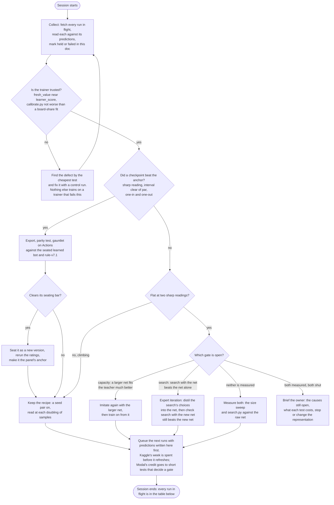

# The learned Risk bot: the plan

The design doc for the one line of Risk bots that learn. It is written to the `machine-learning` skill (`.claude/skills/machine-learning/`): the brief first, then the ruler, then the approach, then the plan of the next run with its predictions. It consolidates what the self-play, distillation and learned-evaluation lines found and says what they add up to. Those docs (`gpu-engine.md`, `self-play-league.md`, `distilled-v7.md`, `student-v1.md`, `rule-bot-v8.md`) stay as the record of their measurements; where their next-step sections differ from this doc, this doc is the plan. The direction is decided, and stage 1 has run: its report is under the first night's predictions.

## The loop: how the learned bot keeps improving

Every session that works on the learned bot starts here and follows this, whichever session started the runs. The rest of this doc is the record the loop writes to; the `machine-learning` skill is the method each box is done by.

The rules the chart rests on:

- **A run exists only if this doc says so.** Before a push, its plan and predictions are written here; after it, the table below names it, where it runs and the command that fetches it. A session that finds a run in the table fetches it before anything else.
- **Trust comes before strength.** The trainer's own explained variance is agreement with its own targets and has misled a diagnosis once. A recipe is trusted while `fresh_value` (the value on fresh deals) sits near `learner_score` in its log and `calibrate.py` on its checkpoint explains more of the real outcome than a fit on territory and army share does. A recipe that fails either is repaired before its strength is read.
- **Progress is one reading.** Sampling and argmax, alone among four of the anchor and four against one, at 4,096 games, read on the same deals. The anchor is the seated learned bot's checkpoint; a new seat moves it.
- **Flat means a gate, never more hours.** Two sharp readings within their interval of the anchor end a recipe. The next run is whichever gate's test is cheapest and unmeasured, then the gate that opened.
- **One change a run, beside its control,** on the same seed and session, so a host's precision or speed is never the difference.
- **Seating is the owner's ruling.** A checkpoint that clears the bar its design fixes before the gauntlet (`src/projects/risk/CLAUDE.md`, "Measuring bots") is a candidate for the seat, kept ready on a branch of its own. Everything else at a fork is briefed to the owner in the skill's form.
- **The quota is the session's to spend** (the owner's ruling): how Kaggle's hours and Modal's credit are used, up to their limits, is decided by the session working the loop, without asking. The owner is briefed at a fork of method or goal, not on a spend.
- **Spend what expires.** Kaggle's hours are lost at the week's refresh (`kaggle quota`): a week with no gate to test trains the current recipe's seed pair on. Modal's credit is for tests of an hour or two that decide a gate, and for a night the owner wants read by morning.

**Runs in flight.** Removed from here once fetched and read.

| Run | Where | Decides | Fetch, from `gpu/` |
|---|---|---|---|
| d4 to 900, d0c to 300, and their sharp panels | the spot machine (`infra/spot/README.md`), `runs/readings` (queued there by `runs/readings/day.sh`) | where the clock net's climb ends, and the control on seed 4 beside d4c | `npm run spot -- pull d4` (and `d0c`), from the main checkout; the readings by `ssh spot`, as tar of the folder |
| g0, g1, and their sharp panels with d4-500 an anchor | the spot machine (`~/novelty/risk-gpu2/runs/readings2`, the panel that knows d4-500) and the laptop's eGPU (`runs/readings2`) | the next rung: the clock recipe started again from d4-500, two seeds | `npm run spot -- pull g0` (and `g1`) |
| e2b: e2's recording at two shards, distilled again and read | the spot machine, `runs/distil/e2b`, `runs/readings/panel-e2b-g4096.json` | whether a longer recording carries more of the search into the net | by `ssh spot`, as tar of those folders |
| xd0, xd1 and yb0, yb1: the exploiters of d4-500 and of b1-100, 75 iterations and a sharp reading each | Kaggle's GPUs, sessions `risk-train-xd0-xd1` and `risk-train-yb0-yb1`, about 11.5 hours each from Sunday 01:50 local | how far a night of best response gets against the frozen net (predictions 10 to 13) | `python -m riskgpu.kaggle.launch status xd0` (or `yb0`), then `fetch xd0` and `fetch yb0` (each brings both its runs), then `report xd0` for the sharp readings |
| big-tpu-2: d4-500's own play copied into a 256x6 net from random weights | Kaggle's TPUs, session `risk-tpu-train-big-tpu-2`, queued Sunday 02:10 local (the queue is about a day, the session about an hour) | whether a larger net holds the clock net's play (predictions 15, 16, 18) | `python -m riskgpu.tpu.launch status big-tpu-2`, then `fetch big-tpu-2` (it prints the held-out agreement; `runs/tpu/big-tpu-2/read.json` has it by kind), then the sharp panel: `python -m riskgpu.selfplay.panel --ckpt runs/tpu/big-tpu-2/best.pt --games 4096 --out runs/tpu/big-tpu-2/panel-g4096.json` |
| d4-500's gauntlets, and the two at 2,400 turns | GitHub Actions, branch `risk/clock-gauntlet` | whether the clock net clears learned-v3's bar, and how it plays past the turn its clock runs out | `gh run download`, then `npm run risk:import`, on that branch |

**Not yet run.** big-tpu-2c (128x4, the control) and big-tpu-3 (384x8), pushed as one session once big-tpu-2's has ended, and read as big-tpu-2 is: `python -m riskgpu.tpu.launch train big-tpu-2c big-tpu-3 --task distil --source runs/own-records/d4-500 --clock --data-dataset bachnewton/risk-bundle-tpu-big-tpu-2 --run-args big-tpu-2c="--width 128 --layers 4" --run-args big-tpu-3="--width 384 --layers 8" --run-share big-tpu-3=3 --session-hours 2.5 -- --heads 8 --lr 5e-4 --warmup 500 --max-samples 100000000 --minibatch 4096`. The averaged checkpoint's panel (`runs/selfplay/avg-s2-2-150-225.pt`, test 3), now of little interest.

## The brief

1. **The goal.** The owner's ruling: a bot that masters the game, whose skill keeps rising as it is trained, until with enough training it beats any person. Not a bot better than rule-v7.1: v7.1 is the strongest hand-written bot, and the one expert who plays here beats it every time. As a measurement that goal is two curves and a judge. The first curve is strength against a fixed panel as a function of training compute, and the claim it has to keep making is that no ceiling is in sight: each doubling of samples gains on the panel by more than the interval. The second is the budget curve at play time, the same bot at several search budgets, because a bot that has mastered a game gets stronger when it thinks longer, and one that doesn't has stopped learning the game and started learning its opponents. The judge is people, the expert first, in logged games; a person reads a win share to about ±20 points in twenty games, so the panel carries the daily reading and must span up to and past the strongest things that exist here (rule-v7.1, native-v2, vulture-v1 as the model of the expert's play) and be shown to order bots as the expert's results do. The milestones (`gpu-engine.md`, and "Beyond M4" below) are rungs on that ladder; M4, better than v7.1 at every table in both mixtures, is one of them and not the goal.
2. **Who judges.** The harness (`risk:gauntlet`, on GitHub Actions for anything at v7.1's cost) is the judge; nothing read on the GPU decides anything about a seat. Every reading on the GPU is a proxy, and which proxy orders checkpoints as the harness does is itself measured before it is trusted (stage 0). The real judge after that is people, who have beaten every version: bot-only play is blind to what they do (`rule-bot-v9.md`, `vulture-v1.md`).
3. **What exists.** More than any learner here has used:
   - **Engines.** The reference engine (TypeScript, the one real games play on; 300, 210 and 150 greedy games a second at 3, 4 and 6 players on the pool). The native engine (Rust, exact against the reference, about a hundred times the games per game; `native-port.md`). The GPU engine (PyTorch, bit-exact against the reference on every fixture, 45,000 to 127,000 decisions a second on the RTX 4070 with the training step captured as one CUDA graph; `gpu-engine.md`).
   - **Teachers.** rule-v7.1, seated, the one to beat: v6.1's planner with a search over its opponents' sampled replies, about 2.5 seconds a turn, stall-free. native-v2 with `execute`, stronger than v7.1 at every table on train seeds at a tenth of the turn time, and not yet a teacher: it stalls in mirrors because it doesn't close games out, the native line's open bug (`roadmap.md`).
   - **Learners and pipelines.** net-v1 (`bots/net-v1/`): a transformer over the board's tokens, 128 wide, 4 layers, trained by PPO on the GPU engine from random weights; its best checkpoint, sw128b-450, is better than rule-v6 one-in and one-out and worse than rule-v7.1 (−64 win Elo, outlasting it without finishing). The trainer (`gpu/riskgpu/selfplay/`), its league, its export to TypeScript with a parity test, its mixed-table ladder and its noise-scale tool. student-v1 and its distillation pipeline (`eval/distill.ts`, `bots/rule-v8/train/distill.py`): v7's placement search copied into a small net over v6's candidates, keeping about a fifth of the teacher's edge at 10⁵ labels and gaining about five points a doubling. The position recorder and a game-record recorder (`risk:gpu-fixtures`) that keeps any TypeScript bot's games as seed and moves, which the GPU engine replays move for move.
   - **The ruler.** The harness: a game a pure function of seed and seating, both mixtures at every table, the Luce par, an SPRT as a pair of one-sided tests, a ladder played to a precision, a cache, and Actions' runners sharding a run into the same report a local run prints (`docs/actions.md`).
4. **The structure.** Three to six players; stochastic (dice, the deal); mild hidden information (other hands' cards, counts public); about 1,200 decisions in a 5-player game; a factored action (1,978 main choices and an amount bucket; `gpu/riskgpu/selfplay/actions.py`); a terminal reward, the win; no negotiation. The class is the skill's "three or more players, stochastic, long horizon": no equilibrium a single policy converges to, strength relative to the population it is read in, and a stalling equilibrium a real attractor.
5. **The budget.** Nights of 6 to 12 hours, a few at a time; the RTX 4070 for training; GitHub Actions' free runners (twenty 4-core machines at once, Linux, six hours a job) for every CPU job that splits into independent games: recordings, labels, gauntlets, ladders, native games; the laptop's 14 workers only for what the workflow can't carry or must answer in minutes. The CPU work runs on Actions while the GPU trains, so neither waits for the other. The owner wants a number every morning.
6. **Done, and not done.** There is no done: a line whose strength keeps rising with the compute it is given keeps earning nights, and is seated at each milestone it passes (which needs the runtime ruling below), so players feel every step. What ends it as a finding is a ceiling that holds: a curve that no change to the improvement operator, the league or the representation lifts, read on the panel over several nights. Each stage names its own kill reading; the line stops when a confirmed cause's fix is outside the budget the owner will give, never on "it didn't improve".

## What the record settles for this line

The measurements are in `self-play-league.md`, `gpu-engine.md`, `distilled-v7.md`, `rule-bot-v8.md` and `bot-log.md`. What they add up to, in the skill's terms:

- **The ruler read a ceiling and a moving field.** Training was read against GD's personas (500 to 700 Elo below the target, won at 70 to 90%) and on ladders among the run's own checkpoints (which moved a net by about 70 Elo between fields). Progress toward the target was read only in rare harness runs of hours each. Every "held" and "failed" in the self-play record was read against one run, never against the spread between two seeds of the same recipe, which is unknown.
- **The learner never met the target's class.** The league held greedy, GD's personas and the run's own nets; the rule bots can't be batched onto the GPU, so nothing of v6's or v7's play was ever in a training game. That is a bias between the training objective and the ruler's, the cheapest explanation of "stronger among nets, weaker against the target" and untested.
- **From scratch reached the planner's class in two nights, then wandered.** sw128b went from random weights to three times par against GD by iteration 225 and to better-than-v6 at 450; after that the checkpoints scatter (375 at −3, 450 at +95, 575 at −139, 825 at −45 on one ladder). Colder updates slowed the drift without stopping it, a longer cold run wandered, the gradient's noise scale was 1.8 million decisions against steps of a few thousand, and a shaping reward on army share taught stalling within 25 iterations. A cold run read at matched samples that doesn't climb says the expected gradient isn't pointing up the ruler, and the two causes above are exactly that.
- **The value head was never read.** Its explained variance was not logged, so whether the baseline was one is unknown.
- **Imitation was named and never run.** The design's arm 2, a warm start from the strongest bot, was set aside for "from scratch first, as the owner asked". The record doesn't show the owner was told that starting from the strongest existing policy is the standard practice in every comparable system (`risk-bot-ai.md` collects the Risk record: every from-scratch self-play attempt at this game failed or plateaued, at any compute). The fork is re-presented below.
- **Distillation carries edge and climbs with data.** student-v1 beat rule-v6 at 3 to 5 players on holdout seeds (+20 Elo) and was even at 6; its full-board students were still gaining about five points of the teacher's edge per doubling at 10⁵ labels, and the breakdown-feature students had flattened at 16%. So the raw board holds more of v7's judgement than v6's terms, given data.
- **An evaluation fit on one population carries it in.** rule-v8's net beat v6's hand evaluation on held-out log loss and played worse in numbers: among copies of the recording's bots, holding back wins.
- **Search is the improvement operator here.** v7's reply search is the largest gain the project has measured (+115 to +130 Elo over its planner), native-v2's is larger again, and both are capped by their candidates: v6.1's best four placements are near-copies, so more replies sharpen a choice between alike moves and can't add a better one.

## Mastery, and what stands between it and the method

Said once, as the skill asks of any ruling that reaches past what standard practice can promise, and then built to. No Risk program has shown expert play against good people at any compute (`risk-bot-ai.md`); the systems whose strength rose with compute until it passed every human were two-player and perfect-information (AlphaZero's line), and in the multiplayer alliance game closest to Risk, pure self-play converged to play that people beat (DORA), while what reached the top of human ladders was search anchored to a model of human play learned from tens of thousands of human games (Diplodocus, Cicero). So three things decide whether this goal is reachable here, and the plan is shaped by them:

- **The improvement operator is search.** Strength as a function of compute comes from a loop in which search makes better decisions than the net and the net learns them (expert iteration); it does not come from policy gradient alone, which here reached the planner's class and wandered. The size of the net and the budget of the search are then the knobs that compute buys, and both are re-measured at every order of magnitude of data.
- **Strength is relative to the table.** A bot that masters play among bots can lose to a person who plays differently, as every version has. So the league and the panel carry human-style play (vulture-v1 and its successors, imitated into the GPU league once the bot is at the rule bots' class), the bot is checked against best responses trained against its frozen self (the multiplayer stand-in for exploitability), and every logged human game is data: the expert's games are the test set, and a learned model of human play is the anchor once there are enough of them (six exist; the systems above used tens of thousands).
- **The judge is slow.** People read a win share to ±20 points in twenty games, so mastery is claimed on the proxies and confirmed in logged games over months, never the other way round.

## The direction

By the skill's decision procedure (`references/assessment.md`, "Choosing the approach"): a baseline exists, the engines exist and are fast enough, and **a strong teacher exists**, so the learner starts from an imitation of it, measures the student's ceiling against the teacher's own consistency, and improves from there. The improvement operator this game has rewarded is search, and the search's ceiling is its candidates, which is what a learned policy exists to lift. So the line is **expert iteration anchored on the strongest bot**: imitate it, improve on it, put the improvement inside the search, repeat, each iteration spending more compute for more strength. The imitation is a floor and not a ceiling: the systems that passed every human started from an imitation of humans and left it behind by search and self-play. From-scratch policy gradient stops being the main line; the same trainer is stage 2's improvement step from the warm start, judged on the ruler like any other.

### Stage 0: the ruler

Before any training is read, the reading is fixed:

- **A fixed panel on the GPU**, read on every checkpoint with the same deals, sampling as the bot plays, 1,024 games each (about ±3 points), both mixtures: GD Defensive at 5 players (the floor), net-v1 sw128b-450 (the planner's class), and the imitation net from stage 1 (the target's class), through the trainer's `--pair` checks. Progress is read on this panel only; ladders among a run's own checkpoints are read within one ladder and decide nothing.
- **The harness, on a schedule.** The exported best checkpoint against rule-v6.1 and rule-v7.1 at 5 players, both mixtures, on Actions, every few hundred iterations rather than every checkpoint: hours each, so they are planned, not skipped; and once the bot is at v7.1's class, against vulture-v1 (a native bot, seated through the native seam) and native-v2, the strongest things here. Once three checkpoints have both readings, the panel is kept only if it orders them as the harness does; as the bot climbs past a panel member, a stronger one is added and the old reading kept going, so the curve stays comparable.
- **The spread between seeds.** The first run of any new recipe is a pair of seeds; a one-change run is judged against their difference, not against one run.
- **Health, every iteration**: the value head's explained variance (added to the trainer's log), KL, clip fraction, entropy, capped and stalled rates, mean turns, per-opponent in-training win share, samples per second. The recipe's health table is in the skill's `references/recipes.md`.

### Stage 1: imitation of rule-v7.1

The first night. It answers the cheapest open question with the biggest consequence: **can this observation, this network and this action space copy v7.1-class play at all?** Its product is three things at once: the imitation ceiling (the skill's cause 4 test), a warm start that plays at the target's class from its first self-play iteration, and a stand-in for the target's class the GPU league can seat, since the real v7.1 can't be batched. The plan is in "The first night" below.

### Stage 2: improve from the warm start

PPO from the imitation net, with the imitation net pinned in the league beside sw128b-450 and GD's personas, the stage-0 panel, the win reward alone, and the cold recipe pf4 settled on (minibatch 32,768 in chunks, 2 epochs, learning rate 1e-4 falling). Two seeds first, read at matched samples. Its predictions are written when it starts; its kill reading is the pair against the imitation net falling below the start by more than the interval twice, which says the update is destroying what imitation gave (the learning rate, or the league), and sends the run to the diagnosis before another night. Each night's best checkpoint is exported and read in the harness against rule-v7.1 on Actions.

### Stage 3: the net inside the search, the engine of the goal

The stage the goal lives in: the loop whose every iteration turns compute into strength, and whose two curves (strength against training compute, strength against search budget) are the goal's measurement. Two routes, decided after stage 2's first harness read, with a fork briefing then:

- **The net as the search's candidate proposer and leaf.** native-v2's search with its candidates drawn from the policy head's most likely placements instead of v6.1's top four, and its leaf valued by the value head. This lifts the one ceiling every search here has hit, runs where the native search runs, and needs a forward pass in Rust (a small transformer, straightforward) plus a seat for a Rust bot.
- **A batched reply search on the GPU engine.** Every candidate played out over sampled replies with the net in every seat, thousands of games at once, the candidate of the best mean value chosen; the search's choices then distilled back into the policy (expert iteration on the GPU). The loop the assets were built for, and the larger build.

Whichever route, the improvement operator is measured before it is trusted: search-with-net must beat net-alone and the search-alone on the panel, or more iterations teach nothing (the skill's cause 7). From here the net's size is re-swept at each order of magnitude of data, since the sweep that chose 128×4 was read at a data scale the loop will leave behind, and the search budget curve is read at every iteration, since a bot that stops gaining from more search has stopped learning the game.

### Stage 4: people

The anchor and the judge. The expert's logged games are the test set from the first stage on (`risk:export`, `risk:agreement`: how often the bot makes his moves, by decision kind, beside every bot's). vulture-v1 is the model of his play until a learned one exists; it joins the league as an imitation net once the bot is at the rule bots' class, so training meets his style, and the harness reads the bot alone among vulture-v1s and vulture-v1 alone among the bot. A best response trained against the frozen bot (one night of the trainer with the bot pinned in every other seat) reads how exploitable it is, which win share against fixed bots never certifies. Beating the expert is read in his games, many of them: at a true win share near par-plus-twenty, twenty games can't tell it from par, and the site's logged games accrue at the pace people play.

### Beyond M4

The rungs past `gpu-engine.md`'s milestones, each fixed before the run that reads it:

| | Pass |
|---|---|
| **M5** | the curve has no ceiling in sight: over three doublings of training compute on one recipe, each gains on the fixed panel by more than its interval; and the budget curve rises: the bot at four times its search budget is better than itself by the gauntlet's margin |
| **M6** | better than native-v2 at its chosen switches at every table, both mixtures, once native-v2 closes its games; better than vulture-v1 alone among four of it and in numbers against one; a best response trained against the frozen bot for a night gains under 50 Elo a seat |
| **M7** | better than the expert in his logged games: a win share above par at a size the interval excludes par from, counted as the games accrue |

### Seating

A learned bot that passes M4 is seated as any bot is, after a ruling on its runtime: the TypeScript export of net-v1 fits a real turn (about 119 milliseconds a decision on one loaded core), and a bot that needs the native search needs the Rust seat the native line hasn't decided (`native-v2.md`, "Seating is a separate step").

**learned-v1 is seated** (`bots/learned-v1/`): net-v1's network with the weight set s2-2-150, playing its most likely move, on the TypeScript export at net-v1's cost, a runtime the owner ruled acceptable. Its export passed the parity test, and the game server bundles its weights. On the seatable ladder it rates 1694 (greedy 1000), first of every seatable bot and 64 above rule-v7.1, so it is the lobby's default (`bot-log.md`, "learned-v1 seated"). Later learned bots are seated beside it the same way, each a version of its own.

**learned-v2 is seated** (`bots/learned-v2/`): the weight set b1-100, iteration 100 of the first run with the carried bootstrap, playing its most likely move. On the seatable ladder it rates 1964, 252 above learned-v1 and first of every seatable bot, so it is the lobby's default and the panel's anchor (`bot-log.md`, "learned-v2 seated"). Tables of several learned-v2s sometimes reach the turn cap, which learned-v1's never did: the stall the c-runs are testing.

## The first night

The plan of the stage-1 run, in the skill's shape (`references/recipes.md`, "The plan before a run").

- **Hypothesis.** net-v1's observation and network, trained to copy rule-v7.1's decisions, reach an agreement with it that is a large fraction of the teacher's own consistency, and the copy plays at the planner's class.
- **Change.** There is no base run: this is the first imitation. What it is judged against is the teacher's agreement with itself across search budgets on the same positions, which is read beside it.

### What it builds

- **The teacher is native-v2 at its baseline**, v7.1's search on the native planner at v6.1's settings (`native-v2.md`): the same class as rule-v7.1 (it agrees with v7.1 on nine decisions in ten and matched v7's gain over v6.1 natively), at a tenth of the turn time, and stall-free where it is recorded (0.8% capped in 5-player mirrors; 1.8% at 6 players, where the recording is small). Not rule-v7.1, which the crate can't play and which costs eight times the runner time for the same class; not `execute`, which is stronger than v7.1 and stalls, so a copy of it would learn not to close games (it becomes the teacher once it does). rule-v7.1 stays the yardstick: the harness reads the imitation net against it whichever bot taught it.
- **The recording.** The teacher's games as game records, by the crate's `risk-native play` (`native/src/record.rs`: seed, every move, and the hashes the GPU replays against), on GitHub Actions' `native-play` tool (`docs/actions.md`, "Game records"): one recorder per core on twenty machines, each on its own run of seeds, the files gathered into one artifact and downloaded into `gpu/runs/records/native-v2/` in the main checkout (ignored by git, never in a worktree). Seatings, each a run of the workflow: the teacher in every seat at 5 players (seeds `imit-5m`, 3,200 games); two teachers among native v6.1 (`native-v2~{"replies":0}`), GD Defensive and GD Stacker at 5 players (`imit-5x`, 8,000), so its decisions cover both the positions its own class reaches and the ones the league's bots produce; mirrors at 6 and 3 players (`imit-6m`, 1,200; `imit-3m`, 3,200) and two teachers among GD at 4 (`imit-4x`, 4,000), so the net has seen every table. About 20,000 games and on the order of thirteen million teacher decisions, recorded in an evening with the laptop's CPU free; more is one more run away. A mirror game is dear where the search's replies seat more opponents: on the laptop a 3-player mirror takes 2 seconds and a 5-player mixed game 5, a 5-player mirror about a minute and a 6-player mirror two and a half, and a runner's core is slower again, so a machine's share is sized well inside the six-hour job limit, since a recorder writes its file only when its games are done. Every seating replays exactly on the GPU engine, checked before the runs were started. The GPU replays each record in lockstep; a record whose replay diverges (a blitz on one of the rare inputs where the runners' `pow` differs from the laptop's) is cut at the divergence, counted and reported.
- **The trainer**, `riskgpu.selfplay.imitate`, a new module beside `ppo.py`. It replays the records on the GPU engine as `lockstep.py` does, a batch of games at a time, and at every decision of a teacher's seat builds the observation (`obs.py`'s `observe`, with the turn-log tensors the runner keeps during play derived from the moves being replayed) and the target: the main choice from the move (a territory, the trade, an edge, end-attack, a move-in bucket, a pair, end-turn) and the amount bucket. A teacher amount that no bucket expresses exactly (v6.1 places the plan's own allocation and blitzes keeping the fewest armies that are as sure as all, neither of which is "all", "half" or "one") is mapped to the nearest bucket and flagged, and the flagged share is reported by kind: it is a measurement of the action space, not noise. The loss is cross-entropy over the legal main choices, cross-entropy over the amount where the group has buckets, and the value head fitted to the seat's score in the recorded game (the win reward's), so the warm start carries a baseline too. Held out by game: a recording's shard k is held out when k % 5 is 4, a fifth of the games, none split. Trained to the held-out plateau (the rate cut when a read on a fixed sample of held-out decisions stalls, training stopped when it stays stalled) with the best kept by held-out main agreement; the states are kept on the host (15.5 million decisions in about 6 GB) and the observations rebuilt from them on the GPU each minibatch, as PPO's update does. Tested first on the committed fixtures (`gpu/fixtures/rule-4p.jsonl.gz` holds rule bots' games), so the pipeline reads end to end before the night's data lands.
- **The reads.**
  - Held-out agreement with the teacher by decision kind (place, trade, attack, end-attack, move-in, fortify, end-turn) and overall, with intervals by bootstrap over games; the turn-start placement apart, since that is the search's own decision and every other is v6.1's.
  - The data curve: the same at a quarter, a half and all of the games.
  - The teacher's own consistency on the placement, read on the same positions by the crate's `agree`: native-v2 as the base and `native-v2~{"replies":32}` as the candidate on the base's own games. That is the ceiling the placement agreement is read against; on every other kind the ceiling is 100%, since every decision but the turn's first placement is the planner's.
  - The stage-0 panel on the GPU: the imitation checkpoint, sampling, against GD Defensive and against sw128b-450, one-in and one-out at 5 players, 1,024 games each (the trainer's evaluation classes, with a small entry point if it has none that reads a checkpoint without training).
  - The export (`riskgpu.selfplay.export`) as `net-v1~{"weights":"imit-1"}`, the parity test, and the harness one-in screen among four rule-v6.1 at 5 players on the laptop (about a thousand games in under an hour on the pool at the net's cost); one-out, and the 5-player read against rule-v7.1, on Actions the next day.

### The night's queue

The recording runs on Actions before the night (`gh` on the owner's own account), so its artifacts are ready when the night starts. The night's first job is reading them: each of the five runs checked for success (a lost machine only shrinks its recording; a failed run is read before anything is trained on it), each run's `risk-records` artifact downloaded into the records folder, and a sample of the records replayed in lockstep on the GPU engine. The imitation trainer is built and tested on the committed fixtures, then trained on the records by one PowerShell script, launched in the background from PowerShell (never Git Bash), its output redirected into the run's folder, with the data curve read at a sixteenth, a quarter, a half and all of the games. Every job that expects the eGPU asserts the device at its start and fails loudly otherwise, and the laptop stays on its charger. The laptop's CPU is taken only for the morning's reads (the agreement tool and the one-in screen, an hour or two on the pool); permission for that is the owner's "overnight run", written into the brief of any agent that runs this.

### Predictions

| # | Prediction | Confidence |
|---|---|---|
| 1 | Held-out main-choice agreement with the teacher over all its decisions reaches 60% or more at the full recording. | 65% |
| 2 | The curve is still climbing: agreement on all the games is above agreement on half of them by more than its interval. | 55% |
| 3 | On turn-start placements, the net agrees with the teacher at least half as often as the teacher at 32 replies agrees with itself at 8. | 50% |
| 4 | The buckets express fewer than 70% of the teacher's placement amounts and fewer than 40% of its attack amounts exactly. | 60% |
| 5 | On the GPU panel, the imitation net alone among four GD Defensive at 5 players wins 40% or more of decisive games (par 20%). | 55% |
| 6 | In the harness, `net-v1~{"weights":"imit-1"}` alone among four rule-v6.1 at 5 players is not worse (even or better at ±30 Elo a seat). | 35% |

### The first night's report

**In one paragraph.** The copy works, and the way it plays decides its strength. imit-1 makes the teacher's choice on 64.8% of held-out decisions. Played as net-v1 plays (sampling its moves), it is worse than rule-v6.1 alone among four of them: −136 win Elo. Played by its most likely move, it is better than rule-v6.1 by +110 win Elo, more than sw128b-450's +46 and about v7's own gain over its planner. But the same argmax copy stalls among its own copies, 4 of 10 five-player mirrors capped, where the teacher capped none of 160. Predictions 1 and 5 held; 3, 4 and 6 failed. 2 wasn't read that night: a second seed of the full run came out 2.1 points lower, more than the data curve's top gap, because of how the trainer's schedule cut its rate. Re-read the next night on a fixed schedule, it held, by half a point a doubling ("The day after", below). The argmax copy is better than rule-v6.1 one-out too, and even with rule-v7.1 one-in. It is worse than v7.1 one-out, where its copies stall. The next night is stage 2, from imit-1.

**What ran.** Five recordings on Actions, every machine of each succeeded: run 42405066556 (`imit-5m`, 3,200 games), 42400208888 (`imit-5x`, 8,000), 42405064040 (`imit-6m`, 1,200), 42400215077 (`imit-3m`, 3,200), 42400217997 (`imit-4x`, 4,000). Two earlier runs at the first sizes (5-player mirrors at `--count 150`, 6-player at 50) were cancelled and replaced by these. That makes 19,600 games, 18.96 million moves and 15.53 million teacher decisions. A sample of 245 games, one file per seating, replayed exactly in `lockstep.py`. The extraction then replayed every game on the GPU engine, comparing the state's hash every 32 decisions and at the end: **none diverged, none was cut**, in 20 minutes on the eGPU.

The trainer is `riskgpu.selfplay.imitate` (extract, train, read), with the stage-0 panel as `riskgpu.selfplay.panel`. 3,920 games (3.12 million decisions) are held out. The runs were imit-1 on all 15,680 training games and imit-1-f2, -f4 and -f16 on a half, a quarter and a sixteenth of them, each capped at 100 million samples. The full and the half both reached the cap still climbing, at 7.8 and 14.8 epochs; the quarter and the sixteenth stopped at their plateaus. In the morning, imit-1-s2 ran the full recipe again on seed 2. Every interval below is 95%: by bootstrap over games for agreement, Wilson for win shares.

**Held-out agreement with the teacher** (imit-1). "Main" is the choice of move and place; "move" is the whole move, its amount included.

| Teacher's move | Decisions | Main | Move |
|---|---|---|---|
| all | 3,119,327 | **64.8% [64.6, 65.0]** | 49.4% [49.2, 49.6] |
| turn-start placement (the search's own decision) | 305,750 | 41.5% [41.2, 41.8] | 28.0% [27.7, 28.3] |
| other placement | 100,510 | 70.4% [70.1, 70.7] | 65.0% [64.7, 65.4] |
| trade | 91,926 | 97.7% [97.6, 97.8] | 82.9% [82.7, 83.2] |
| attack | 1,259,710 | 65.2% [64.9, 65.5] | 33.8% [33.4, 34.2] |
| end the attack | 292,724 | 72.7% [72.4, 72.9] | the same |
| move in | 774,929 | 74.2% [74.0, 74.5] | 72.9% [72.6, 73.2] |
| fortify | 266,956 | 40.2% [40.0, 40.5] | 35.2% [35.0, 35.4] |
| end the turn | 26,822 | 59.5% [58.2, 61.0] | the same |

By seating, main agreement falls with the table: 72.4% at 3 players, 69.5% at 4 (two teachers among GD), 67.2% in the 5-player mixed games, 62.0% and 61.5% in the 5- and 6-player mirrors.

**The data curve**, main agreement on all held-out decisions:

| Training games | Main | Turn-start placement | Value head's explained variance |
|---|---|---|---|
| 980 (a sixteenth) | 56.5% [56.3, 56.8] | 35.4% [35.1, 35.6] | 40.5% |
| 3,920 (a quarter) | 61.5% [61.3, 61.7] | 39.5% [39.2, 39.7] | 41.3% |
| 7,840 (a half) | 63.1% [62.9, 63.3] | 40.6% [40.3, 40.8] | 41.9% |
| 15,680 (all) | 64.8% [64.6, 65.0] | 41.5% [41.2, 41.8] | 42.2% |

| 15,680 (all), seed 2 (`imit-1-s2`) | 62.7% [62.5, 62.9] | 40.2% [40.0, 40.5] | 41.9% |

At face value that is 2.5 points a doubling at the small end and 1.6 at the top. **The seed pair says the top of the curve isn't read yet.** `imit-1-s2` is the full recipe again on seed 2, allowed past the cap. It tracked imit-1 within 0.4 points at matched steps until the plateau rule cut its rate at step 9,500, on a read's noise. imit-1's first cut came at 19,500. Seed 2 then stopped at its plateau, at 90 million samples and 62.7%, 2.1 points under imit-1 and below the half-data run, whose first cut also came early (step 10,000). The spread between two seeds of this recipe is larger than the gap between half the data and all of it, and it comes from the trainer's schedule (a rate cut after two reads without a gain on a monitor sample whose own noise is about the late gains' size), not from the data. The fix is the standard one: a fixed schedule over a set sample budget, the held-out read only choosing the checkpoint. Then the half and the full are re-read on two seeds each. The value head explains 42% of the variance of a seat's final score on held-out games, so stage 2 starts with a baseline, which the from-scratch runs never measured.

**The teacher's own consistency**, read by the crate's `agree` on 40 held-out 5-player mirror games, the same 7,211 turn-start placements the net was read on. (`agree` gained the turn-start tally and the off-path rule `agree-log` already had: once the bot answers a reinforce phase's decision otherwise than recorded, the phase's later decisions aren't asked.)

| On the same positions | Turn-start placement, whole move |
|---|---|
| native-v2 at 32 replies, against its own choice at 8 | 65.0% [63.8, 66.2] |
| native-v2 at 0 replies (v6.1's planner) | 33.4% [32.5, 34.3] |
| imit-1 | 25.7% [24.3, 27.0] (the territory alone: 39.7% [38.3, 41.2]) |

Every attack, move-in and fortify the teacher makes is its planner's, deterministic: 100% at 32 replies as at 0. So the ceiling on every decision but the turn-start placement is 100%, and the net reaches about two thirds of it.

**The action space.** The buckets can't express 22.0% [21.9, 22.1] of the teacher's held-out moves: 11.7% [11.6, 11.8] of placements, 14.8% [14.6, 15.1] of trades (another set or bonus than the trade rule's), 45.8% [45.4, 46.2] of attacks, 4.2% of move-ins and 5.9% of fortifies. The attacks are all blitzes. Battles are always expressed: the teacher's fewer dice are always the most it may roll. In the 5-player mirrors, 57% of its blitzes keep back a count of armies that is neither one nor half the source, mostly seven or more. That is where the move agreement on attacks falls from 65% to 34%.

**The panel**, on the GPU at 5 players, 1,024 games each. It reads par on its own calibration: sw128b-450 against itself, one-in 20.7% [17.4, 24.4] (par 20%), one-out 82.0% [78.5, 85.1] (par 80%). sw128b-450 alone among GD Defensive wins 69.7% [66.8, 72.5].

| imit-1 | Sampling | Argmax |
|---|---|---|
| alone among four GD Defensive (par 20%) | 81.5% [79.0, 83.7] | 94.0% [92.4, 95.3], none capped |
| alone among four sw128b-450 (par 20%) | 13.7% [11.0, 16.9] | 29.3% [25.5, 33.4] |
| four against one sw128b-450 (par 80%) | 75.6% [71.7, 79.1] | 91.1% [88.3, 93.3], 5.5% capped |

**The harness.** imit-1 is exported as the net-v1 weight set `imit-1`. The parity test passed on a fixture of its own (4 games on the reference engine, all 736 network decisions within the test's tolerance, every move the same); the fixture isn't kept, since the committed fixtures already hold the network's code and the exporter. On train seeds, 5 players, alone among four rule-v6.1, by the gauntlet's SPRT (±30 Elo a seat):

- `net-v1~{"weights":"imit-1"}` (sampling): **worse**, 10.2% [6.8, 15.2] of 205 decisive games against par 20%, win Elo −136, finishing-order Elo −52, mean place 3.30, none capped.
- `net-v1~{"weights":"imit-1","pick":"argmax"}`: **better**, 32.0% [25.5, 39.2] of 175 decisive games, win Elo +110, finishing-order Elo +111, mean place 2.38, none capped.

**A replayed game.** Five argmax copies at one table (`risk:trace --mirror`). The traced game ended in 71 player-turns: a capture every turn, no idle turn, armies on the board kept to 50 or 60 and the cards cycling, the winner taking five continents. The survey of 10 such games tells the other half: 4 capped [Wilson 17%, 69%], the decided ones 279 turns on average, 409 armies on the board at turn 100. The teacher's 5-player mirrors capped 0 of 160, median 203 turns. Among rule-v6.1 the copy closes its games; among copies of itself it often doesn't, as net-v1's from-scratch checkpoints didn't when they played argmax.

**The predictions.**

| # | Reading | |
|---|---|---|
| 1 | 64.8% [64.6, 65.0] | **held** |
| 2 | on the plateau rule, all 64.8% [64.6, 65.0] against half 63.1% [62.9, 63.3], inside the seeds' 2.1-point spread; re-read on a fixed schedule, all 64.0% and 63.9% against half 63.4% and 63.3%, on two seeds each | **held**, on the re-read ("The day after", below): all is above half by 0.55 points on each seed, outside the reads' intervals and four times the seeds' spread, though at a sixth of the three points a doubling the plan set for another recording |
| 3 | 25.7% [24.3, 27.0] against half of 65.0%, 32.5% | **failed**: the net copies the search's own decision worse than v6.1's planner does (33.4%) |
| 4 | the buckets express 88.3% of placements and 54.2% of attacks | **failed**: they express more than predicted; the misses are blitz keeps, 57% of mirror blitzes |
| 5 | 81.5% [79.0, 83.7] (94.0% argmax) | **held** |
| 6 | sampling: worse, −136 win Elo | **failed** as written; the argmax copy is better, +110 |

**What it rules out.** The copy learned two thirds of the decisions and came out stronger than v6.1, from the raw board on net-v1 as it stands, so the observation and the network can learn the game. That is not the same as ruling out cause 4: the action space can't express 22% of the teacher's moves, so it caps how well any net on it can play, and nothing here measured where that cap is. (Read at the time as ruling cause 4 out; corrected once stage 2 had plateaued.) The rule for "6 fails while 1 holds" (a DAgger round, on the reading that the copy learned the wrong decisions) doesn't apply. The argmax read shows its most likely moves win; what loses is sampling from a copy that is unsure on a third of its decisions, over hundreds of decisions a game. The next step is stage 2 from imit-1: 1 holds, and the copy is already past v6.1, which is what a warm start needs. Whether more data pays is still open, since prediction 2 isn't read. But even the face-value slope, 1.6 points a doubling, is under the plan's three, so no second recording round until the curve is re-read. Prediction 4's rule (a count head) is not triggered as written. The blitz keeps are still the action space's one large miss, and a candidate once stage 2 has read.

**Two rulings for the line, from these readings.** How a learned bot plays (sampling, argmax, or a temperature between) is a measured choice per checkpoint, never fixed by a past one's result: argmax stalled the from-scratch nets and makes this copy strong. So every panel read of stage 2 is taken both ways. And the stall is a health reading of every checkpoint: the argmax copy's mirror cap rate, beside its strength.

**The next night: stage 2's seed pair from imit-1.** PPO (`ppo.py --init` from imit-1's weights), with imit-1 pinned in the league beside sw128b-450 and GD's personas, the win reward alone and pf4's cold recipe, two seeds. PPO samples and is paid only for the win, and a capped game scores below placing behind the survivors, so it attacks both of the copy's faults at once: sampling's noise and argmax's stall. Predictions, read at matched samples on the panel each 25 iterations:

| # | Prediction | Confidence |
|---|---|---|
| 1 | By the night's end, the sampled learner alone among four sw128b-450 reaches par (20%) or more, from 13.7%. | 60% |
| 2 | The argmax learner alone among four GD Defensive stays at 90% or more throughout: PPO doesn't unlearn the copy. | 65% |
| 3 | The argmax learner's 5-player mirror cap rate falls below 20%, from 40%. | 45% |
| 4 | The two seeds' best checkpoints are within 30 win Elo of each other on the panel's pair read. | 55% |

The kill reading is the plan's: the pair against imit-1 falling below the start by more than its interval twice. Then the update is destroying what imitation gave, and the standard fix, a KL penalty toward the imitation policy (AlphaStar's), is the diagnosis's first test. Before it, two things that take the GPU or the runners for hours, not a night:
- the reads the plan leaves for Actions: the argmax copy one-out among rule-v6.1, and one-in and one-out against rule-v7.1, at 5 players;
- the imitation trainer on a fixed schedule, with the half and the full re-read on two seeds each. That gives prediction 2 its reading and gives stage 2 a known spread for the imitation it starts from.

**Is another night worth it?** Yes. One night took the learned line from below the planner's class to a copy that beats rule-v6.1 by more than any net here has, and stage 2 is the first time policy improvement starts from the target's class.

#### The day after: the Actions reads and the curve on a fixed schedule

**The argmax copy one-out among rule-v6.1** (Actions run 42461754595, train seeds, 5 players, brought in by `risk:import`). Four `net-v1~{"weights":"imit-1","pick":"argmax"}` against one rule-v6.1 read **better**. The copies won 92.0% [86.8, 95.3] of 162 decisive games against a par of 80% (149 to 13), at win Elo +183 and finishing-order Elo +92, with the lone v6.1's mean place 2.99. But 48 of the 210 games (22.9%) reached the cap. Four copies at one table stall nearly as often as five, while the copy alone among four v6.1 never capped. So the stall belongs to the copy's own play meeting itself, not to the table.

**Against rule-v7.1, one-in and one-out** (run 42461757380, train seeds, 5 players, 7 rounds over 182 machine shards):

- **One-in: even.** The argmax copy alone among four rule-v7.1 won 20.0% [18.0, 22.3] of 1,352 decisive games, exactly the par of 20%. Its mean place was 2.66, and 1.7% of games capped.
- **One-out: worse.** Four copies against one rule-v7.1 won 76.9% [74.2, 79.3] against a par of 80%, the lone v7.1 placing 2.55 on average, and 29.4% of games capped.

The win Elo is −14 and the finishing-order Elo +35. So **the copy plays at the target's class when it sits among the target**. Where it falls short is where copies of it meet each other: the same stall the mirror reads, now costing it the one-out. That is what stage 2 is aimed at (prediction 3), so the read doesn't change stage 2. It does give stage 2's end its harness yardstick: the argmax one-out against v7.1, at 29% capped.

**The data curve on a fixed schedule.** `imitate.py` now trains on a fixed schedule over 100 million samples: 500 steps of warmup, then a cosine fall from 5e-4 to zero. The held-out read now only chooses which checkpoint is kept. Four runs used it: the half and the full recording, each on seeds 1 and 2 (`imit-2-f2`, `imit-2-f2-s2`, `imit-2`, `imit-2-s2`). Each was read on all 3.12 million held-out decisions:

| Training games | Main, seed 1 | Main, seed 2 | Turn-start placement, seeds 1 and 2 |
|---|---|---|---|
| 7,840 (a half) | 63.4% [63.2, 63.6] | 63.3% [63.1, 63.5] | 40.8%, 40.8% |
| 15,680 (all) | 64.0% [63.8, 64.2] | 63.9% [63.6, 64.1] | 41.1%, 41.0% |
| imit-1: all, on the plateau rule | 64.8% [64.6, 65.0] | | 41.5% |

- **The fixed schedule removed the spread between seeds.** Two seeds land 0.13 points apart on the full data and 0.10 on the half. Under the plateau rule they were 2.1 points apart.
- **More data still helps, but only a little.** The full data beats the half by 0.57 and 0.54 points on the two seeds, outside both reads' intervals and four times the spread between seeds. Prediction 2 holds. The slope is half a point a doubling, a third of what the plateau runs showed at face value and a sixth of the three points the plan set before another recording.
- **At full data, the trainer is short of steps more than of games.** On the same data, imit-1 beats both fixed-schedule runs by 0.8 points. It also fits its own training data better: 65.6% agreement on training decisions, against 64.7% for the full runs. The plateau rule happened to keep imit-1 at the full rate for 19,500 of its 24,415 steps, while the cosine spends half of them below half that rate. So the full runs are underfitted. The half-data runs are the opposite case: they agree 65.2% on training decisions against 63.4% held out, a 1.8-point gap, where the full runs' gap is 0.7. A longer schedule, not a new recording, is the cheaper next point of agreement. imit-1 stays the best copy and stage 2's start.
- **Throughput.** The four runs went in two pairs, each pair sharing the GPU while another session's builds shared the CPU. They trained 5,500 to 8,200 samples a second each, 11,000 to 16,300 a pair, against the 27,000 imit-1 managed alone. A timing on a shared machine can't say which contention cost the most, but the cost itself is clear: the curve took the whole night (23:20 to 07:51), and stage 2 didn't start. An imitation run takes the GPU on its own from now on.

### Stage 2's first night: the report

**In one paragraph.** PPO from imit-1 took the copy past the target within 50 iterations, and fixed its stall. At iteration 50, argmax and sampling play alike: each beats rule-v6.1 alone among four of them by about +280 win Elo, where imit-1's argmax play was +110 and its sampled play −136. In the harness, the argmax net is better than rule-v7.1 alone among four of it and even with it four against one. No argmax mirror game capped at any read from iteration 50 on, where imit-1's capped 37%. Predictions 1 and 3 held. 2 held on seed 2 and failed narrowly on seed 1. 4 failed: the two seeds agreed at iteration 50, but by 150 seed 1 had fallen back while seed 2 kept climbing. The best checkpoint is seed 2's at iteration 150 (`s2-2-150`). The next step is the M4 read, before another night: the best checkpoint against rule-v7.1 at every table, in both mixtures, on holdout seeds, on Actions.

**What ran.** PPO from imit-1 on pf4's cold recipe, as planned, with imit-1 and sw128b-450 pinned in the league. Each run was read on the panel every 50 iterations at 512 games, and the start and the best checkpoints at 1,024. Three things changed from the plan during the night:

- **The seeds ran one after the other, not side by side.** Two trainers and their panels didn't fit in the card's 12 GB. The overflow spilled into shared system memory, and every update took 490 to 950 seconds instead of pf4's 20 to 40. One at a time, a run trains at about 56,000 steps a second, an iteration every 50 seconds.
- **The runs stopped at iteration 150, not on a time budget.** That way the seeds read at matched iterations.
- **A third run, `s2-1-e0`, was added.** It repeats seed 1 with the entropy bonus off, a diagnostic for seed 1's fall (below).

So the night is three runs of 150 iterations each (157 million steps of play a run, about 50 million of them the learner's decisions), with four panels at 1,024 games and six harness reads on the laptop's CPU.

**The panel at matched iterations** (512 games; 95% Wilson intervals). "Alone among four" is one-in, par 20%:

| Run, iteration | Sampling alone among four sw128b-450 | Argmax alone among four sw128b-450 | Argmax alone among four GD Defensive | Sampling alone among four imit-1 | Argmax mirror capped |
|---|---|---|---|---|---|
| imit-1, the start (1,024 games) | 14.3% [11.5, 17.5] | 31.0% [27.2, 35.2] | 94.3% [92.7, 95.6] | 22.7% [19.3, 26.5] | 37.0% [34.1, 40.0] |
| seed 1, 50 | 37.9% [32.2, 44.0] | 35.5% [29.9, 41.6] | 96.3% [94.3, 97.6] | 67.2% [61.2, 72.7] | 0 of 512 |
| seed 1, 100 | 35.5% [29.9, 41.6] | 36.3% [30.7, 42.4] | 93.5% [91.1, 95.4] | 71.9% [66.1, 77.0] | 0 |
| seed 1, 150 | 30.5% [25.1, 36.4] | 23.1% [18.3, 28.6] | 89.3% [86.3, 91.6] | 64.8% [58.8, 70.4] | 0 |
| seed 2, 50 | 32.4% [27.0, 38.4] | 38.7% [32.9, 44.8] | 97.7% [96.0, 98.7] | 70.7% [64.8, 75.9] | 0 |
| seed 2, 100 | 36.3% [30.7, 42.4] | 39.8% [34.0, 46.0] | 97.9% [96.2, 98.8] | 71.5% [65.7, 76.7] | 0 |
| seed 2, 150 | 42.2% [36.3, 48.3] | 41.0% [35.2, 47.1] | 96.3% [94.3, 97.6] | 74.6% [68.9, 79.5] | 0 |
| seed 1 without the entropy bonus, 50 | 34.4% [28.8, 40.4] | 37.1% [31.4, 43.2] | 99.0% [97.7, 99.6] | 66.4% [60.4, 71.9] | 0 |
| the same, 100 | 35.9% [30.3, 42.0] | 32.8% [27.4, 38.8] | 94.1% [91.8, 95.9] | 71.9% [66.1, 77.0] | 0 |
| the same, 150 | 37.5% [31.8, 43.6] | 36.3% [30.7, 42.4] | 91.4% [88.7, 93.5] | 69.9% [64.0, 75.2] | 0 |

**The best checkpoints on the full panel** (1,024 games). The pair reads are also given as Elo a seat, by the Luce model, averaged over one-in and one-out:

| | imit-1 | s2-1-50 | s2-2-150 | s2-1-e0-150 |
|---|---|---|---|---|
| Sampling alone among four GD Defensive | 82.0% [79.6, 84.3] | 94.0% [92.4, 95.3] | 94.4% [92.9, 95.7] | 90.5% [88.6, 92.2] |
| Argmax alone among four GD Defensive | 94.3% [92.7, 95.6] | 97.5% [96.3, 98.3] | 95.9% [94.5, 97.0] | 91.1% [89.2, 92.7] |
| Sampling alone among four sw128b-450 | 14.3% [11.5, 17.5] | 33.8% [29.8, 38.0] | 40.8% [36.6, 45.1] | 34.4% [30.4, 38.6] |
| Sampling, four against one sw128b-450 (par 80%) | 74.8% [70.9, 78.4] | 81.5% [77.8, 84.6] | 91.2% [88.4, 93.4] | 86.5% [83.3, 89.2] |
| Argmax alone among four sw128b-450 | 31.0% [27.2, 35.2] | 35.7% [31.7, 40.0] | 36.7% [32.7, 41.0] | 34.4% [30.4, 38.6] |
| Argmax, four against one sw128b-450 | 88.8% [85.7, 91.4] | 82.4% [78.9, 85.5] | 89.4% [86.5, 91.8] | 88.3% [85.2, 90.8] |
| Pair against sw128b-450, Elo a seat, sampling and argmax | −61, +111 | +70, +83 | +171, +138 | |
| Pair against imit-1, Elo a seat, sampling and argmax | +10, +225 | +223, +241 | +317, +304 | |
| Argmax mirror capped | 37.0% [34.1, 40.0] | 0% [0, 0.4], 51 turns | 0% [0, 0.4], 63 turns | 0% [0, 0.4], 83 turns |

**The harness** (train seeds, 5 players, the gauntlet's SPRT at ±30 Elo a seat; the weight sets `s2-1-50` and `s2-2-150` are the exported snapshots):

| Candidate | Table | Verdict |
|---|---|---|
| s2-1-50, argmax | alone among four rule-v6.1 | **better**: 54.5% [41.5, 67.0] of 55 decisive games against par 20%, win Elo +272, finishing-order +261, mean place 1.73, none capped |
| s2-1-50, sampling | alone among four rule-v6.1 | **better**: 58.0% [44.2, 70.6] of 50, win Elo +297 |
| s2-2-150, argmax | alone among four rule-v6.1 | **better**: 60.0% [46.2, 72.4] of 50, win Elo +311, mean place 1.58 |
| s2-2-150, sampling | alone among four rule-v6.1 | **better**: 60.0% [45.5, 73.0] of 45, win Elo +311 |
| s2-1-50, argmax | alone among four rule-v7.1 | **better**: 43.5% [33.5, 54.1] of 85 decisive games against par 20%, mean place 1.89, none capped |
| s2-1-50, argmax | four against one rule-v7.1 | **even**: 80.3% [78.4, 82.1] of 1,745 against par 80%, lone v7.1's mean place 3.20, none capped |
| s2-2-150, argmax | alone among four rule-v7.1 | **better**: 56.4% [43.3, 68.6] of 55 decisive games against par 20%, win Elo +285 at this table, mean place 1.67, none capped |

s2-1-50 against rule-v7.1 is win Elo +15 and finishing-order Elo +43 over both tables. imit-1's argmax play was even one-in and worse one-out, with 29% of its one-out games capped. Every SPRT that stopped early did so on a large edge, so those intervals are wide; each one's lower bound is still above par, and above imit-1's own reading at that table.

**Health.**
- KL stayed between 0.003 and 0.006 a step, and the clipped share between 0.03 and 0.06, in every run.
- The value head explained 36% of the return's variance at iteration 1 (imit-1's value head, fitted to final scores) and 92% to 96% from iteration 25 on.
- The training games' cap rate stayed under half a percent.
- **Entropy is the reading that moved.** It fell from imit-1's 1.02 to about 0.5 by iteration 50 in both seeds, then rose: seed 1 to 1.93 by 150, seed 2 to 1.57. With the bonus off it fell all the way, to 0.28. pf4 and sw128b settled at about 2 under the same bonus, so 0.01 holds a policy near an entropy of 2, a long way above where imitation started.

**Seed 1's fall, and what the diagnostic showed.** After iteration 100, seed 1 lost 12 points against sw128b-450 (argmax alone among four, 36.3% to 23.1%) and 4 against GD Defensive, while its entropy rose. Seed 2's entropy rose almost as far, and it kept climbing. So the entropy bonus alone doesn't explain the fall. The same seed with the bonus off kept its entropy low and didn't fall against sw128b-450 (36.3% at 150). But it didn't gain either, and it lost as much against GD Defensive (91.4%). One run each can't separate the bonus from the seeds' own spread, which by iteration 150 is wider than the panel's interval. What the night does settle is that the best checkpoints come early (50 to 150 iterations), and that keep-best on the panel matters more than how long a run trains.

**The predictions.**

| # | Prediction | Reading | |
|---|---|---|---|
| 1 | The sampled learner alone among four sw128b-450 reaches par (20%) or more, from 13.7% | 32.4% to 42.2% at every read of every run; at 1,024 games, 33.8% [29.8, 38.0] for s2-1-50 and 40.8% [36.6, 45.1] for s2-2-150 | **held** |
| 2 | The argmax learner alone among four GD Defensive stays at 90% or more throughout | seed 2: 96.3% to 97.9% at every read; seed 1: 89.3% [86.3, 91.6] at iteration 150 | **held** on seed 2, **failed** narrowly on seed 1 (the point under 90%, the interval across it) |
| 3 | The argmax learner's 5-player mirror cap rate falls below 20%, from 40% | 0 of 512 at every read from iteration 50 on; 0 of 1,024 [0, 0.4] on the best checkpoints | **held** |
| 4 | The two seeds' best checkpoints are within 30 win Elo of each other on the panel's pair read | s2-1-50 and s2-2-150 are 55 to 100 Elo a seat apart on the pair reads; at matched iteration 50 the seeds agree within their intervals | **failed**: the seeds part after iteration 50 |

The kill reading never came close. The pair against imit-1 rose from +10 Elo a seat (sampling) at the start to +223 and +317 on the best checkpoints.

**What it rules out.** The worry behind the kill rule, that PPO would destroy what imitation gave, is ruled out for this recipe through 150 iterations. Both of the copy's faults are gone. Sampling no longer costs strength (sampling and argmax read alike in the harness). The stall is gone: none of the 3,072 argmax mirror games read on the full panels capped. The panel is running out of headroom, though. GD Defensive reads 91% to 98%, and the pair against imit-1 is several hundred Elo above it. Only the sw128b-450 reads still spread the checkpoints out, and those are below the target's class.

**The next step, before another night: the M4 read.** M4 is better than rule-v7.1 at every table in both mixtures. The checkpoint already meets it at one table and one mixture (better at 5 players one-in) and ties in the other (even one-out). The rest of the read is CPU work that splits into games: s2-2-150, argmax and sampling, against rule-v7.1 at 3, 4, 5 and 6 players, one-in and one-out, on train and holdout seeds, and the parity test on its export. That belongs on Actions, at a day's cost and with the laptop free. It decides what the next night is for:
- **If M4 holds**, the bot's seating is the owner's ruling (its runtime, "Seating" above), and the next night grows the panel instead. The best checkpoint goes in as a fixed anchor, since the panel can no longer resolve gains above it, and stage 2 runs a seed pair to 400 iterations from it.
- **If M4 fails at some table**, the next night's one change targets that table. The trainer already plays 3 to 6 players, so that means a heavier weight on the failing size in the league's mix, predicted to lift that table's harness read by its interval without costing the 5-player one.

**Is another night worth it?** Yes. One night of PPO took the learned line from a copy below the target to a net at or above rule-v7.1 at 5 players, with nothing about the method in question.

#### The M4 read: s2-2-150 passes

`net-v1~{"weights":"s2-2-150","pick":"argmax"}` was read against rule-v7.1 at 3, 4, 5 and 6 players, one-in and one-out, by the gauntlet's SPRT (±30 Elo a seat) on Actions. Run 42778024656 used train seeds and run 42778029527 holdout seeds, both from the branch `risk/s2-reads`. The verdict is **better at all 16 tables**, with no regression and no game capped:

| Table | Train seeds | Holdout seeds |
|---|---|---|
| 3 players, alone among two (par 33.3%) | 68.5% [55.3, 79.3] | 57.7% [46.6, 68.0] |
| 3 players, two against one (par 66.7%) | 76.3% [70.4, 81.4] | 79.7% [72.7, 85.3] |
| 4 players, alone among three (par 25%) | 59.6% [46.1, 71.8] | 62.5% [48.4, 74.8] |
| 4 players, three against one (par 75%) | 85.9% [80.1, 90.2] | 93.3% [86.8, 96.7] |
| 5 players, alone among four (par 20%) | 56.4% [43.3, 68.6] | 56.4% [43.3, 68.6] |
| 5 players, four against one (par 80%) | 90.5% [85.5, 93.9] | 93.6% [88.2, 96.6] |
| 6 players, alone among five (par 16.7%) | 46.7% [34.6, 59.1] | 54.2% [40.3, 67.4] |
| 6 players, five against one (par 83.3%) | 94.1% [89.7, 96.7] | 89.2% [85.6, 91.9] |
| Win Elo over rule-v7.1, finishing-order Elo | +174, +197 | +170, +197 |

The 5-player one-in pairing's tally is the same on both seed sets (31 to 24 in 55 decisive games). They are different games, averaging 128 and 118 player-turns, and the SPRT stops at the same tallies on any games. The train run also repeats the local read of that pairing exactly.

**Seed 2 trained on, iterations 150 to 228.** It ran on the same recipe in the eGPU's last hours before a two-week absence. The panel then also read against s2-2-150, where the run resumed. At iteration 200 it is even with that checkpoint:
- alone among four s2-2-150, 19.5% [15.1, 24.8] sampling and 19.9% [15.5, 25.2] argmax, against a par of 20%;
- four against one s2-2-150, 79.7% [74.3, 84.2] and 80.9% [75.6, 85.2], against a par of 80%.

Every other read stayed at iteration 150's level, and the entropy sat at about 2. The run was stopped at 228, with snapshots kept at 175, 200 and 225. So on this recipe, 50 more iterations past 150 bought nothing the panel can resolve, about 50 Elo a seat. Whether the curve has flattened or only slowed is the question a longer run with s2-2-150 as an anchor answers. The sw128b-450 and imit-1 reads can no longer tell.

**Seed 2 on Kaggle, iterations 225 to 250 (k1).** A copy of s2-2 at its iteration-225 checkpoint, trained on in full precision on a Kaggle T4 (`docs/kaggle.md`), the same recipe otherwise. At 250 it is still even with s2-2-150: alone among four, 18.4% [14.1, 23.6] sampling and 19.9% [15.5, 25.2] argmax; four against one, 79.3% [73.9, 83.8] and 76.2% [70.6, 81.0]. Every panel reading at 250 lies within the interval of the bf16 reading at 200, so the change of precision shows no effect the panel can resolve (about ±5 points a reading), though it was read across 50 more iterations of training, not on the same weights.

**Seed 2 to 275 and seed 1 from 150 to 225 (session k1-k2).** One Kaggle session trained both at once in full precision, each stopping when its headline reading, sampling alone among four s2-2-150 at 512 games, went flat: k1 (seed 2) resumed at 250, k2 (seed 1) started from s2-1-150. Both stopped flat, k1 at 275 and k2 at 225, after about 2.6 and 7 hours. The session then read each stopped run sharply (4,096 games a reading) and ran out of hours with two of k2's readings left: its reading at 200 was stopped half an hour past the deadline and the one at 175 never started, which is what Kaggle reports as an error. Every other output came back.

The headline readings (512 games; par 20%), with the verdict the trainer gave:

| Run, iteration | Sampling alone among four s2-2-150 | Verdict |
|---|---|---|
| seed 2, 200 (bf16, the 4070) | 19.5% [15.1, 24.8] | early |
| seed 2, 250 (k1's first session) | 18.4% [14.1, 23.6] | early |
| seed 2, 275 | 18.4% [14.1, 23.6] | flat: stopped |
| seed 1, 175 | 19.1% [14.8, 24.4] | early |
| seed 1, 200 | 18.8% [14.4, 24.0] | early |
| seed 1, 225 | 16.4% [12.4, 21.4] | flat: stopped |

The sharp readings (4,096 games; 2,048 decisive where a lone seat is read):

| | seed 2, 200 | seed 2, 250 | seed 2, 275 | seed 1, 225 |
|---|---|---|---|---|
| Sampling alone among four s2-2-150 (par 20%) | 21.5% [19.8, 23.4] | 18.9% [17.2, 20.6] | 19.3% [17.7, 21.1] | 19.6% [17.9, 21.4] |
| Argmax alone among four s2-2-150 | 22.4% [20.7, 24.3] | 19.0% [17.4, 20.8] | 18.4% [16.8, 20.2] | 18.6% [17.0, 20.4] |
| Sampling, four against one s2-2-150 (par 80%) | 81.2% [79.4, 82.8] | 78.1% [76.2, 79.8] | 77.2% [75.3, 79.0] | 79.5% [77.7, 81.2] |
| Argmax, four against one s2-2-150 | 80.7% [79.0, 82.4] | 77.7% [75.8, 79.4] | 78.6% [76.8, 80.4] | 78.7% [76.9, 80.4] |
| Argmax alone among four sw128b-450 | 39.1% [37.0, 41.2] | 33.3% [31.2, 35.3] | 35.1% [33.0, 37.2] | 35.1% [33.1, 37.2] |
| Argmax alone among four imit-1 | 79.1% [77.2, 80.8] | 76.1% [74.2, 77.9] | 76.0% [74.1, 77.8] | 70.1% [68.1, 72.0] |
| Argmax alone among four GD Defensive | 95.0% [94.2, 95.6] | 94.1% [93.3, 94.8] | 94.9% [94.2, 95.5] | 95.7% [95.1, 96.3] |
| Argmax mirror capped | 0% [0, 0.1] | 0% [0, 0.1] | 1.2% [0.9, 1.6] | 0% [0, 0.1] |

**What it settles: the recipe has flattened, not slowed, at about s2-2-150's strength.** Seed 2 is even with s2-2-150 at 200, and from 250 on it reads a point or two below it in all four mixtures, the sharp intervals just short of par; against sw128b-450 it fell six points from 200 to 250, intervals apart, and gained nothing back by 275. Seed 1 climbed from its own 150 (23.1% [18.3, 28.6] alone among four sw128b-450 at 512 games) to the same level as seed 2: at 225 every reading but imit-1's is within a point of seed 2's at 250 or 275, mostly inside their intervals. So the two seeds agree on where the recipe ends, if not on the path there: about s2-2-150's strength, reached at 150 to 200 iterations and not exceeded through 275. One caveat: seed 2's step down from 200 to 250 spans the change from bf16 on the 4070 to full precision on the T4. Seed 1 trained only in full precision and lands at the same level, so precision isn't needed to explain the plateau, but it isn't ruled out for that one step.

**Health.** KL stayed at 0.003 to 0.004 a step and the clipped share at 0.02 to 0.03, smaller steps than stage 2's first night; the value head explained 96% to 97% of the return's variance; the training games' cap rate stayed under a quarter of a percent. Seed 2's entropy rose again, from 1.8 at 225 to 2.2 at 275, and its games lengthened (66 player-turns on average at 200, 76 at 275), with its first capped mirror games at 275. Seed 1's entropy sat at 1.8 to 1.9. A resumed run starts fresh games, so its first ten or so iterations train on openings (entropy about 0.5, the value head explaining 71%), then return to where they were; the optimizer's state is restored.

**The diagnosis: k3 and k4, one session.** The causes the session's own records rule out (the skill's `references/diagnosis.md`): the ruler (sharp intervals of about ±1.8 points, the seeds' spread at the plateau about a point, the anchor at par rather than a ceiling), the infrastructure (a resume restores the optimizer), noisy targets (the value head explains 96% to 97%) and steps too large (KL about 0.003; the run is held cold). A run held cold that doesn't climb points at its data or its objective, and the records show a sign of each:

- **The league (cause 3).** About 38% of the non-learner seats in training are greedy and GD's personas, and the learner wins 97% to 99% of the games it plays them; only its own snapshots and the two anchors contest it.
- **The entropy bonus (cause 2).** Seed 2's entropy rose late, from 1.8 to 2.2, while its games lengthened and its strength dipped. The bonus of 0.01 holds a policy near an entropy of 2 (stage 2's first night), well above where its best checkpoints were.

Both runs are copies of k1 at 275 (seed 2 on the plateau, its optimizer and league intact), one change each, trained together on one session to iteration 350 at matched samples and read sharply there:

- **k3**: no greedy or GD personas in the league (`--gd-share 0 --snapshot-share 0.85`), their seats to the snapshots and anchors.
- **k4**: the entropy bonus at 0.003 (`--ent 0.003`).

| # | Prediction, at iteration 350 (sharp, 4,096 games) | Confidence |
|---|---|---|
| 1 | If the league is the cause, k3 alone among four s2-2-150, sampling, reads 22.5% or more (k1 at 275: 19.3% [17.7, 21.1]), its interval clear of par | 30% |
| 2 | If the bonus is the cause, k4 reads the same 22.5% or more | 30% |
| 3 | k4's entropy falls below 1.5 | 85% |
| 4 | k3, no longer trained against them, still wins 90% or more alone among four GD Defensive (argmax) | 80% |
| 5 | Neither clears 22.5%: both within two points of 19.3% | 45% |

What follows: a run that clears its mark is the next base, and its change goes into a seed pair before anything is built on it. A run that doesn't clear it doesn't rule its cause out on its own: the action space's buckets (below) may be the ceiling both runs meet, so a null result here is read again on the exact action space before either cause is dropped.

**k3 and k4: what they read.** Both trained from k1 at 275 to 350 on one session and were read sharply at 350 (k3 also at 325; the session's reading hours ran out before k3's 300). Against k1 at 275:

| Sharp, 4,096 games | k1, 275 | k3, 325 | k3, 350 | k4, 350 |
|---|---|---|---|---|
| Sampling alone among four s2-2-150 (par 20%) | 19.3% [17.7, 21.1] | 15.9% [14.4, 17.6] | 12.7% [11.3, 14.2] | 20.6% [18.9, 22.4] |
| Argmax alone among four s2-2-150 | 18.4% [16.8, 20.2] | 17.2% [15.7, 18.9] | 11.7% [10.4, 13.2] | 21.8% [20.1, 23.7] |
| Sampling, four against one s2-2-150 (par 80%) | 77.2% [75.3, 79.0] | 75.8% [73.9, 77.6] | 55.5% [53.3, 57.6] | 79.8% [78.0, 81.5] |
| Argmax alone among four sw128b-450 | 35.1% [33.0, 37.1] | 28.0% [26.1, 30.0] | 18.1% [16.5, 19.8] | 36.5% [34.5, 38.6] |
| Argmax alone among four GD Defensive | 94.9% [94.2, 95.5] | 88.9% [87.9, 89.8] | 75.6% [74.3, 76.9] | 94.6% [93.8, 95.2] |
| Argmax mirror capped | 1.2% [0.9, 1.6] | 0% | 0% | 0% |

| # | Prediction | Reading | |
|---|---|---|---|
| 1 | k3 reads 22.5% or more | 12.7% [11.3, 14.2] | **failed**: it fell |
| 2 | k4 reads 22.5% or more | 20.6% [18.9, 22.4] | **failed** |
| 3 | k4's entropy falls below 1.5 | 1.65 at 350, from 2.21 | **failed** narrowly |
| 4 | k3 still wins 90% or more alone among four GD Defensive | 75.6% [74.3, 76.9] | **failed** |
| 5 | neither clears 22.5%, both within two points of 19.3% | k4 within it; k3 seven points below | **failed** as written |

**What it settles.** The league's weak opponents are load-bearing, not wasted: without them the learner lost to everything, GD Defensive and its own anchor included, within 50 iterations, against only its own snapshots and two anchors. Training only among its own kind lets the policy drift into play that beats its recent selves and nothing else, the failure a fixed, diverse league exists to prevent. So cause 3 in that form is ruled out, and its opposite is confirmed: the league's breadth is what holds the policy. The entropy bonus at 0.003 kept everything as it was, with the argmax read three points up on k1's (21.8% against 18.4%, intervals just touching) and the mirror's capped games gone, a direction rather than a result. Neither change breaks the plateau, and both read on the bucket action space, whose cap the next line removes: the entropy reading is to be repeated there before it is dropped. The trainer's verdict called k3 climbing while it slid from 20.3% to 14.4% (a fall smaller than "falling" needs at 512 games); the verdict now calls such a run unsettled, as the daily contract always defined climbing.

**The action space, rebuilt (the representation, cause 4).** The buckets can't express 22% of the teacher's moves (46% of its attacks, 15% of its trades), and stage 2 has now plateaued, so the cap is a suspect in its own right, and the owner has ruled to remove it. A second action space, "exact", sits beside the buckets: the same main choices, then an exact number (armies placed, kept back by a blitz, moved in, fortified) or the trade's set and bonus, scored by one head over a fixed set of legal candidates. Old checkpoints keep the buckets, so the anchors and learned-v1 play as before: s2-2-150 decides exactly as it did on 1,889 positions, greedy and sampled, with the same probabilities and values. The TypeScript bot that plays it is `net-v2` (`bots/net-v2/`), a harness label only until a weight set is trained and measured.

Its first reading, the share of the teacher's moves it can express, on every held-out game of the recording (3,920 games, 3.1 million moves; `imitate.py measure`):

| Kind | Moves | Buckets can't express | Exact can't express |
|---|---|---|---|
| all | 3,119,327 | 22.0% [21.9, 22.1] | 0.03% |
| place | 406,260 | 11.7% [11.6, 11.8] | 0 |
| trade | 91,926 | 14.8% [14.6, 15.1] | 0 |
| attack: blitz | 1,122,570 | 51.4% [50.9, 51.9] | 0.08% [0.07, 0.09] |
| attack: battle | 137,140 | 0 | 0 |
| move-in | 774,929 | 4.2% [4.1, 4.3] | 0 |
| fortify | 266,956 | 5.9% [5.8, 6.0] | 0 |

The argument has 48 slots. A range wider than that (4% of blitzes, 5% of move-ins, 6% of fortifies, ranges up to 610 armies) keeps every count within twelve of either end, both halves, and the rest spread evenly between, so the misses left are mid-range keep-backs of very large stacks; every such decision is counted as `overflow` in training. Two things are unmeasured until it runs on a GPU: that its step still captures as one CUDA graph, and its memory at the trainer's batch. And its entropy is over up to 48 arguments where the buckets had three, so the entropy bonus weighs differently on it.

**The imitation on it: imit-x and imit-y (pushed, not yet read).** One Kaggle session (`risk-train-imit-x-imit-y`, 9 hours) trains a seed pair of exact-space nets on the same recordings (`runs/imitate/native-v2`), each started from imit-1's trunk and main heads with the argument head fresh (`--init runs/imitate/imit-1/best.pt`), in full precision, up to 100 million samples (imit-1's budget), seeds 1 and 2; then reads each one's held-out agreement and its panel at 1,024 games. `python -m riskgpu.kaggle.launch fetch imit-x` (from `gpu/`) brings both back once `kaggle quota` and `launch status imit-x` show the session over. They are read against imit-1's `read.json` and `panel.json`.

| # | Prediction | Confidence |
|---|---|---|
| 1 | Move agreement on attacks beats imit-1's 34% by ten points or more, on both seeds | 70% |
| 2 | Main-choice agreement stays within two points of imit-1's 65% (the trunk and main heads start from it) | 80% |
| 3 | Sampled alone among four sw128b-450 at or above imit-1's 14.3% [11.5, 17.5]: sampling no longer pays for amounts the buckets forced | 60% |
| 4 | The two seeds' attack agreements within two points of each other | 75% |

What follows: if 1 holds, stage 2 runs from the better seed on the exact space, base recipe (k1's league, the entropy bonus read again there, since k4's reading was on the buckets), against s2-2-150 as the headline anchor. If 1 fails, the amounts weren't what the copy got wrong, and cause 4 in this form is ruled out.

**Where it runs.** Kaggle's week refreshes on Saturday at 00:00 UTC (`kaggle quota`), so stage 2's first exact-space session belongs in the week the imitation lands. Modal's monthly credit (the skill's `budget.md`) runs this trainer at the eGPU's speed in bf16 on an A10; its launcher (`docs/modal.md`) runs detached on a chosen GPU, refuses a push whose worst case would take the month past $28, and was smoke-tested end to end; its imitation path and a push of committed code are untried. Still unmeasured on any host: the share of an iteration the GPU sits idle (`nvidia-smi`'s busy share through the rollout and the update), which decides whether two runs should share one GPU.

**A second reading of the plateau, and three tests of it.** Read from the runs' own logs, apart from the action space: stage 2's whole gain came in its first 15 to 50 iterations, while the policy's entropy fell from 1.02 to 0.6, so it was the copy sharpened and its stall fixed, errors with large advantages. From iteration 60 the entropy climbs to about 2 under a bonus of 0.01 with no change in strength, stays at 1.65 under 0.003, and with the bonus off falls to 0.28 with no gain either: the win's gradient is weaker than a small bonus, in either direction. And k3 moved 20 points in 75 iterations, so the policy isn't frozen; it has no direction up. Four candidate reasons, none yet measured:

- **The value head is the ceiling, and its 96% doesn't say otherwise.** GAE at λ = 0.95 over a seat's own decisions credits a move across about twenty decisions, less than a turn, and bootstraps from the value head past that, so the policy improves only as far as the value head ranks a turn's outcomes. The explained variance the trainer logs is against those bootstrapped returns, mostly the head's own predictions. Against real outcomes the only reading is imit-1's, 42%. So the diagnosis above ruled noisy targets out on a number that can't rule them out.
- **The network is small** (cause 8). imit-1-f16 agreed with the teacher on 60.0% of its own training decisions after 25 epochs of 780,000 of them: a net that can't memorise that is short of capacity or of steps, and every imitation here was 128 × 4. The size sweep that chose it was read on from-scratch PPO, where the gradient's noise hides a size's effect.
- **Exploration is per decision and skill is per turn.** A turn is twenty to forty linked decisions; sampling each alone rarely tries a better plan whole.
- **The buckets** (above). s2-2-150 is +170 win Elo over rule-v7.1 on them, so they didn't stop it passing its teacher's class; expected here to be a one-time gain on the exact space, not the plateau's cause. The exact-space stage 2 still runs on Kaggle's hours, which nothing else here needs, as the test of that expectation: predicted to gain quickly on its own start and flatten within 30 win Elo a seat of s2-2-150 (75%).

The tests, on Modal's credit, since the eGPU is away:

| # | Test | Prediction | Confidence |
|---|---|---|---|
| 1 | Capacity: the sixteenth of the recording at imit-1-f16's budget and schedule, at 128 × 4 (the control), 256 × 6 and 384 × 8 (`modalgpu`'s imitation runs) | The control repeats 60% ± 1 on training decisions; 256 × 6 reaches 70% or more | 60% |
| 2 | The value head against real outcomes: s2-2-150 in every seat of 5-player games, each decision's value joined to its seat's final score (`calibrate.py`) | Explained variance under 60% overall, and under 25% in the first third of a game | 65%, 60% |
| 3 | Averaged weights: s2-2's snapshots at 150 to 225 averaged (`average.py`), read on the panel | No gain: sampling alone among four s2-2-150 within two points of par | 60% |
| 4 | The improvement operator (cause 7): the net's top four moves each played out eight times to the turn's end with fresh dice, scored by the value head (`search.py`), alone among four of the raw net at its most likely move | 25% or more of decisive games, against a par of 20% | 55% |

**Test 2 read: held, and it found a defect.** `calibrate.py` on s2-2-150, 128 five-player games on the laptop's CPU, sampling, none capped, intervals by bootstrap over games. Against the real final score the value head explains 45.6% [43.7, 47.7] of the variance in the mirror (79,440 decisions) and 31.2% [19.2, 40.6] alone among four sw128b-450; in a game's first third 9.6% [7.3, 11.9] and 1.0% [−6.1, 8.1], in its first fifth 5.0% [3.0, 6.9] and −1.7%. A least-squares fit of the outcome on the seat's territory share and army share does as well in every bucket (46.7% overall in the mirror). And it is pessimistic: in the mirror's first fifth it predicts −0.61 where the outcome averages −0.18, and every calibration bin from −0.8 to 0 sits 0.2 to 0.5 under the outcome; on fresh 5-player deals its slots sum to −2.98 where a decisive game's scores sum to −1.

A cause is in the trainer's code, its effect on the plateau not yet measured: `Env.bootstrap` reads every seat's value from the acting seat's view at the rollout's end. When another seat is acting there (about four times in five at 5 players) the learner's bootstrap is an other-slot value, and the other slots are trained only on the final scores of the seats beside a deciding learner, mostly the league's weak bots, and only where a game ended inside the rollout. A game is ten to fifteen rollouts long, so nearly every return is chained through that reading, and the 96% the trainer logs is agreement with it. The cheapest test: bootstrap each learner seat from its own view (or carry its last decision into the next rollout, the usual way in a turn-based game), train on from s2-2-150 on one seed, and read the fresh-deal value and `calibrate.py` again before the panel.

**Test 1 read: held; the capacity gate is open.** On the sixteenth of the recording (980 games, 758,000 decisions), 18.8 million samples on today's cosine schedule, on Modal's A10s:

| Net | Weights | Fit on its own training decisions (main, move) | Held-out main, best checkpoint, 3,920 games |
|---|---|---|---|
| 128 × 4 (the control) | 842,000 | 61.5%, 47.2% | 56.3% [56.1, 56.5] |
| 256 × 6 | 4.84 million | 79.7%, 60.4% | 57.0% [56.8, 57.3] |

The control repeats the old trainer's 60.0% within a point and a half. The larger net fits eighteen points more of what it is shown, so the small net's two thirds was capacity, not steps. On this little data the larger net then overfits (its last checkpoint reads 54.3% held out, its best 57.0%), which is the data's size and not the net's fault: the full recording is sixteen times this one, and there the small net fits training and held-out decisions alike (65.6% and 64.8%), short of both. 384 × 8 was refused by the month's ceiling beside the runs in flight and isn't needed to open the gate.

**The gate's run: big-256x6.** One change from imit-1: the net's size, 256 × 6, on the whole recording, bucket space, 100 million samples, seed 1, on Modal, with its agreement and panel read as imit-1's were.

| # | Prediction | Confidence |
|---|---|---|
| 1 | Held-out main agreement 68% or more (imit-1: 64.8%; the fixed schedule's imit-2: 64.0%) | 65% |
| 2 | Turn-start placement 45% or more (imit-1: 41.5%) | 55% |
| 3 | Its fit on training decisions is above its held-out agreement by under three points: not yet overfitting at this data | 60% |
| 4 | On the panel, argmax alone among four sw128b-450, 36% or more (imit-1: 31.0% [27.2, 35.2]) | 50% |

What follows: 1 holds, the larger net is the base of the next learned bot: it is trained on by PPO with the carried bootstrap (if b1 reads trusted), its turn time in the TypeScript export is measured, and 384 × 8 is read on the full recording to see whether the curve is still rising. 1 fails with 3 holding, the teacher's remaining third isn't capacity at this size: the next read is what the net gets wrong by decision kind. 3 fails, more recorded games come before more weights.

**The bootstrap's test: b1 and b0.** One change, the bootstrap, on stage 2's recipe as k1 ran it, from s2-2-150, one seed, 100 iterations on Modal in bf16: b1 with a learner seat's bootstrap taken only from values the net gives for that seat, b0 the control with the old reading. The value head has to learn its targets again, about 0.4 higher early in a game, so the first tens of iterations may dip.

| # | Prediction, at iteration 100 | Confidence |
|---|---|---|
| 1 | b1's slot-0 value on fresh 5-player deals is within 0.15 of its learner seats' mean score there (s2-2-150: −0.56 against about +0.28 across the league's tables); b0's stays below −0.4 | 80% |
| 2 | `calibrate.py` on b1 in the mirror: 20% or more of the outcome's variance explained in a game's first third, from 9.6% | 55% |
| 3 | b1 is not below b0: sampling alone among four s2-2-150, b1's reading is not under b0's by more than their interval | 75% |
| 4 | b1 breaks the plateau: 23% or more alone among four s2-2-150, its interval clear of par, where b0 reads par | 35% |

What follows: 1 and 4 hold, the fix is the base of every later run and a seed pair runs on from b1. 1 holds and 4 fails, the defect was real and not the plateau's cause; the fix stays, and tests 1 and 4 above decide between size and search. 1 fails, the mechanism is wrong or the fix is, and the fresh-deal value is traced before anything else trains.

**b1 and b0 read: the bootstrap was the plateau.** Both trained 100 iterations (105 million decisions) from s2-2-150 on Modal's A10s, same recipe and seed, and were read sharply (4,096 games a reading) at 50, 75 and 100.

| Sharp, at iteration 100 | b1 (carried) | b0 (the old reading) |
|---|---|---|
| Sampling alone among four s2-2-150 (par 20%) | 44.9% [42.8, 47.1] | 17.6% [16.0, 19.3] |
| Argmax alone among four s2-2-150 | 45.5% [43.3, 47.6] | 17.0% [15.4, 18.7] |
| Sampling, four against one s2-2-150 (par 80%) | 96.3% [95.4, 97.1] | 68.2% [66.2, 70.2] |
| Argmax alone among four sw128b-450 | 77.7% [75.8, 79.4] | 29.1% [27.2, 31.2] |
| Argmax alone among four imit-1 | 92.3% [91.0, 93.4] | 75.3% [73.4, 77.1] |
| Argmax alone among four GD Defensive | 98.9% [98.5, 99.1] | 92.3% [91.4, 93.1] |
| Value on fresh deals, beside the learner seats' mean score | +0.41, +0.32 | −0.39, +0.31 |

b1's headline climbed at every sharp reading: 37.7% [35.6, 39.8] at 50, 42.0% [39.9, 44.2] at 75, 44.9% at 100, and was still climbing when the run ended. By the Luce model that is about +200 win Elo a seat over s2-2-150 alone among it and about +320 four against one. b0 slid below its start, as k1 did after 200. Health in b1: KL 0.005, the carried decisions 4% of each update and a rollout old on average (1.09), entropy 1.46 at 100 after 2.27 at 50. Two readings to watch: its training games lengthened (85 player-turns a game at 100, b0's 61) and 1.6% reached the cap (b0's 0.1%).

| # | Prediction | Reading | |
|---|---|---|---|
| 1 | b1's fresh-deal value within 0.15 of its learner seats' score; b0's below −0.4 | b1 +0.41 against +0.32; b0 −0.39 (−0.61 at 5 players) | **held** for b1; b0 a hundredth short of the mark |
| 2 | `calibrate.py` on b1: 20% or more explained in a game's first third | 2.2% [−4.8, 9.0] in the mirror's first third; 36.5% [30.1, 42.6] overall | **failed** |
| 3 | b1 is not below b0 | 44.9% against 17.6% | **held** |
| 4 | b1 reads 23% or more alone among four s2-2-150, its interval clear of par | 44.9% [42.8, 47.1] | **held** |

The value head on b1-100 (`calibrate.py`, 128 five-player mirror games on the laptop, sampling): the pessimism is gone, every calibration bin below zero within a tenth of the outcome where s2-2-150's sat 0.2 to 0.5 under, and it now beats the board-share fit overall (36.5% against 30.7%). It reads a little high between +0.2 and +0.6 (predicting +0.30 where the outcome averages +0.09), as a head trained among the league's weak bots would among its equals. And early in a game it still tells nothing apart: 2.2% in the first third, where the share fit explains 6.5% and the stage of the game alone 5%. Whether anything can be told there, among five equal seats, isn't known; a search that plays a turn out is one way to find out. The same games carry the stall's warning: b1-100's sampled mirror games run 1,580 decisions each, s2-2-150's 620, and 5 of the 128 reached the cap where none of s2-2-150's did.

What it settles: every PPO run of this line, the from-scratch ones included, trained on returns bootstrapped from another seat's view. The carried bootstrap is the base of every run from here, and s2-2-150's plateau was the defect's, not the method's, the league's, the entropy bonus's or the buckets'. b1-100 is the panel's new anchor beside s2-2-150, which it has nearly outgrown (four against one reads 96%).

**The search gate read: open.** `search.py` on s2-2-150, on the laptop's CPU: the net's top three moves at each placement and attack played out six times each to the searcher's own next turn, fresh dice and resampled hidden cards, scored by slot 0. The searcher alone among four of the raw net at its most likely move won 30.8% [28.0, 33.7] of 1,024 games; the control, the same seat and deals with no search, 20.2% [17.9, 22.8]. Prediction 4 of the tests above (25% or more) **held**: about +100 win Elo a seat from a shallow search, on a net whose value head was the defective one. The search overruled the net's first choice at 32% of the placements it searched and 25% of the attacks. It cost 535 net evaluations a searched decision, 26,000 a game.

**imit-x and imit-y read (the exact action space).** Held-out agreement with the teacher, both seeds within a tenth of a point:

| | imit-1 (buckets) | imit-x, imit-y (exact) | big-256x6 (buckets, 256 × 6) |
|---|---|---|---|
| Main choice, all decisions | 64.8% | 72.4% [72.2, 72.5] | 68.2% [68.0, 68.4] |
| Whole move, all decisions | 49.4% | 63.9% [63.7, 64.1] | 52.0% [51.8, 52.2] |
| Whole move, attacks | 33.8% | 66.7% | 36.2% |
| Turn-start placement, main | 41.5% | 42.2% | 43.2% |
| Argmax alone among four sw128b-450 | 31.0% [27.2, 35.2] | 29.9%, 31.5% | 32.0% [28.1, 36.2] |
| Argmax alone among four imit-1 | | 50.4%, 52.6% | 48.6% [44.3, 53.0] |
| Argmax mirror capped | 37.0% | 25.3%, 27.1% | 10.6% |

imit-x's predictions: 1 (attacks' move agreement up ten points or more) **held**, by 33; 2 (main within two points of 65%) **failed** upward, at 72.4%, the exact amounts and a second hundred million samples on imit-1's trunk together; 3 (sampling alone among four sw128b-450 at or above 14.3%) **held** on both seeds (19.0%, 15.6%); 4 (seeds within two points) **held**. big-256x6's: 1 (68% or more) **held**, at the mark; 2 (turn-start placement 45% or more) **failed**, 43.2%; 3 (fit within three points of held-out) **held**, 70.7% against 68.3%; 4 (36% or more alone among four sw128b-450) **failed**, 32.0%. So both levers copy the teacher better, the exact space by more, and neither copy plays much better than imit-1 by itself: a copy's strength is set by what PPO then makes of it, which is what b1 shows. Both remain what the next base is built from: the exact space at 256 × 6 is the copy to make next.

**The next runs, by the chart.** A checkpoint beat the anchor, so b1-100 goes to the gauntlet and, clearing its bar, is seated as a new version; and the recipe is climbing, so it trains on:

- **b1 resumed on Modal**, the same run, to iteration 400 or the month's cap, with b1-100 in the panel. Prediction: alone among four b1-100, sampling, 25% or more at its next sharp reading, its interval clear of par (60%); the training games' cap rate stays under 5% (65%).
- **b2 on Kaggle**: b1's recipe on seed 1, from s2-2-150, in full precision. The seed the result is checked on before anything is built on it. Prediction: 35% or more alone among four s2-2-150 at its last sharp reading (80%).
- **x1 on Kaggle**, beside b2: the same recipe on the exact action space, from imit-x, the run the plateau was once expected to wait for. Prediction: by its last reading it is above imit-x's own start against s2-2-150 (argmax 11.7% alone among four) by more than its interval (85%), and at or past par against s2-2-150 (50%): whether a better copy on a larger action space ends higher than b2 from a weaker one is the question its later sessions answer.

**The seating bar for b1-100**, fixed before its gauntlet (`src/projects/risk/CLAUDE.md`, "Measuring bots"): the TypeScript export passes the parity test, and `net-v1~{"weights":"b1-100","pick":"argmax"}` reads better than learned-v1 (s2-2-150) one-in and not worse one-out at 5 players on train and holdout seeds, and not worse than rule-v7.1 at any table of 3 to 6 in either mixture. It runs on GitHub Actions.

**Against learned-v1, train seeds: better in both mixtures** (Actions run 44082103385; its results are kept in `gpu/runs/gauntlets/b1-100-learned-v1-train/` and imported when the weight set reaches `main`). Alone among four learned-v1 it won 43.8% [33.4, 54.7] of 80 decisive games against a par of 20%; four against one learned-v1, 96.5% [91.4, 98.6] of 115 against 80%; win Elo +246, finishing-order Elo +26, no game capped. The harness reads what the GPU panel read (44.9% and 96.3%), on the reference engine and the TypeScript export, so the panel orders this pair as the judge does.

On holdout seeds (run 44092048811, kept in `gpu/runs/gauntlets/b1-100-learned-v1-holdout/`) the same: 43.5% [33.5, 54.1] of 85 alone among four, 97.3% [92.3, 99.1] of 110 four against one, win Elo +251, none capped.

**Against rule-v7.1, 3 to 6 players, train seeds: better at all eight tables** (run 44082108627, kept in `gpu/runs/gauntlets/b1-100-rule-v7.1-train/`). Alone among copies of rule-v7.1 it won 86.1%, 81.3%, 86.7% and 75.0% of decisive games at 3, 4, 5 and 6 players, against pars of 33%, 25%, 20% and 17%; in numbers against one, 93.1%, 95.6%, 97.2% and 98.4% against 67%, 75%, 80% and 83%. Win Elo +419, finishing-order Elo +230, 565 games. The capped games are its own tables': none alone among rule-v7.1, 2.2%, 0.9% and 6.1% with three, four and five of it at a table. **b1-100 clears its seating bar**, and is seated as learned-v2 once the parity test's tolerance is set from a measurement and the seatable ratings run has rated it.

**b1 resumed, 100 to 220: no gain past b1-100, a stall growing, and the losses NaN from iteration 194.** The run was stopped at 220 and fetched. Against b1-100 (sampling alone among four, 512 games, par 20%) it read 12.7% [8.9, 17.9] at 125, 24.0% [19.0, 29.7] at 150 and 20.3% [15.6, 25.9] at 175; against s2-2-150, 46.9%, 45.7% and 43.4%, b1-100's own level. Its training games lengthened from 85 player-turns to 130 to 150, their cap rate rose from 1.6% to 11% to 15% (20% to 24% near 135), and the argmax mirror capped 86% of its games at 125, 12.5% at 150 and 5% at 175. Held decisions were completed up to 84 iterations after they were taken. Every loss was NaN from iteration 194's update on, and the trainer ran on for 26 iterations on weights that weren't numbers: it has no stop on a loss that isn't finite. Both predictions written for the resumed run **failed** (25% or more against b1-100; a cap rate under 5%). So the carried bootstrap bought one step of about 250 Elo in a hundred iterations, and what follows it is the stall this game has drawn every learner here toward, with a second defect on top. By the chart the trainer isn't trusted until the NaN's cause is named and fixed and the trainer stops itself on one; the stall is the diagnosis after it (cause 2 and cause 9, `references/diagnosis.md`). b2 and x1, already on Kaggle on the same trainer for 100 iterations each, are read with this in mind: their cap rates and game lengths beside their strength.

**The NaN, named and fixed.** Each minibatch normalises its own advantages by their spread, and iteration 194 had 524,289 samples: sixteen minibatches of 32,768 and one of a single sample, whose spread isn't a number. That one sample's loss took every weight with it. It was reproduced on the CPU from snap-175 and it is the only iteration of the 220 whose count leaves a remainder of one; it came after the resume because the learner sat at its capacity of 524,288 decisions a rollout, a few either side of that count. An update's samples now split into minibatches of nearly equal size, the trainer stops before the optimizer's step on any loss or gradient that isn't finite and writes what reproduces it, and no snapshot is written from weights that aren't numbers. b2 and x1 on Kaggle run the trainer as it was and carry the same small risk.

**What is known about the stall, from the code and b1's log.** Proven: a capped game's score does reach the carried chain; the league didn't change at the resume; held decisions two or more updates old are under half a percent of the samples, too few to steer the policy (they now train the value only). And three facts about the trainer, each a candidate cause with a run of its own:

- **The cap's score pays for stalling.** A capped game's survivors score their place among the survivors less a half, so two survivors score −0.5 each, above the bottom half of real finishes: a seat that expects to lose does better by never finishing. The skill's rule is that a cap is never a result.
- **Under saturation the same games wait.** The learner acts on at most half the batch's rows a step, served lowest row first, and the rows are laid out by table size, so when more are due the 6-player and then the 5-player games freeze. They are under-sampled and their games span many more updates.
- **Every game is dealt at once** at a start and at a resume, so the first twenty iterations hold no late-game positions and then a wave of them; b1's first session shows the same wave after its own deal (games lengthening to 120 turns by iteration 55, the mirror capping 11.5% at 50, recovered by 75), the resumed one a larger one and a second rise at 165 to 193.

Not known: whether the stalling is a losing seat turtling, every seat growing passive, or argmax play alone; `stall.py` reads that on the checkpoints at 50 to 175 on the laptop. The runs that follow it, each one change beside a control from b1-100: capped survivors scored as a loss, the longest-waiting rows served first, and a start whose games are spread through their stages.

**What kind of stall: `stall.py`'s reading.** Seven checkpoints (s2-2-150, b1 at 50 to 175), 56 five-player mirror games each on the same deals, sampling and argmax, on the laptop; intervals by bootstrap over games; the tables are in `gpu/runs/readings/stall/`.

- **Not argmax alone.** b1-125 caps 79% [68, 89] of its sampled games and 86% [75, 95] of its argmax ones; b1-150 caps more sampled (38% [25, 52]) than argmax (5% [0, 12]). At every checkpoint the share of turns that end without an attack in argmax games equals the sampled policy's own probability of ending there to within three points.
- **Not a losing seat turtling.** Seats behind attack less than seats ahead at every checkpoint, the old net that never stalls included (a gap of 0.35 [0.29, 0.40] for s2-2-150, 0.28 [0.23, 0.34] for b1-125). And the net doesn't expect the cap's score: the survivors of b1-125's capped games read +0.27 and +0.39 on their last decisions and scored −0.77 and −0.66.
- **Not passivity, at 125.** b1-125 ends the fewest turns without an attack of any checkpoint (15.5% sampled, 10.7% argmax). Past turn 400 it makes about five attacks a turn and captures four to five territories a turn (b1-100: 1.7), and the armies on the board fall to 155 to 290 by turn 400, the opposite of hoarding. Most of its capped games end with two seats left (37 of 48 argmax, 23 of 44 sampled).
- **So b1-125's stall is a churn between two survivors**: territories change hands every turn and neither closes the game. Its value head reads +0.41 to +0.54 past turn 400, about what an even fight for the win is worth, in games that end at the cap. The net can't see the cap coming: a training game's cap is drawn between 150 and 600 player-turns so that a policy can't count to it. The elapsed turn is among its inputs (an earlier version of this line said it wasn't), but its own game's cap isn't, so the cap is a hazard it can't condition on, and nothing in the win reward prefers a win now to a win later.
- **b1-150 and b1-175 are a second change**: seats that aren't leading attack less (26.0% [23.1, 28.6] of turns without an attack at 150, 17.7% [15.4, 19.9] at 100; seats in the middle from 8% to 17%, seats behind from 23% to 43% or more, seats ahead unchanged), with a hundred more armies on the board at turn 100. Whether that is seats expecting to lose or a standoff among the non-leaders this reading can't tell.

Two changes the reading points at, beyond c1's: a preference for the sooner win (a discount on the terminal score by the game's length: a time preference on the goal itself, not a reward for a proxy), and the turn among the net's inputs, with the cap scored as a loss so that seeing it coming can only teach finishing. Each waits on c1's reading, since c1 tests the plainest of the three.

**The stall's runs: c0 to c3.** Each is b1's recipe from b1-100 for 100 iterations on a fresh optimizer, read against b1-100, with the repaired update: c0 the control (the cap scored as before, the lowest rows served first, one deal), c1 with a capped game's survivors scored −1 (`--cap-score loss`), c2 with the longest-waiting rows served first (`--serve oldest`), c3 with its games spread through their stages before training (`--deal-spread 30`). c1 runs first, alone, on what is left of Modal's month, for a direction by morning; c0 and c1 then run as a pair on one Kaggle session, the comparison that counts, and c2 and c3 on the session after.

| # | Prediction for c1 | Confidence |
|---|---|---|
| 1 | Its training games' cap rate over iterations 75 to 100 stays under 3% (b1 resumed: 6% to 15% over its matching stretch) | 60% |
| 2 | Its argmax mirror caps under 5% of its games at every panel reading (b1 resumed: 86% at its first) | 55% |
| 3 | Sampling alone among four b1-100, 25% or more at iteration 100 | 35% |

What follows: 1 and 2 hold, the cap's score was paying for the stall and `loss` is the base; whether strength then climbs is 3, and c0 beside it on Kaggle says how much of that is the change. 1 or 2 fails, the stall isn't a seat choosing the cap's score, and c2, c3 and `stall.py`'s reading say which of the other two it is.

**c1 read: all three predictions failed, behind a restart.** Modal restarted c1's container near iteration 49; it resumed from its checkpoint at 25 with every game dealt again, and ran out of its hours at iteration 86. Before the restart it showed the deal's usual wave: games lengthening from 60 player-turns to 135, 8.8% capped at 40 and 3.3% by 49, the argmax mirror capping 26% at 25. After it, the run collapsed: 51% to 80% of its training games capped from 50 to 75, 20 to 340 games finished an iteration where a thousand is usual, the mirror capped 99.6% at 50 and 85% at 75, and sampling alone among four b1-100 it won 2.2% [0.9, 5.0] at 50 and 4.5% [2.5, 8.2] at 75 (four against one: 8.5% and 14.5%, par 80%). From 80 it was recovering, 5% capped at 86 and games finishing again, at 250 player-turns a game. Prediction 1 (under 3% capped over 75 to 100), 2 (the mirror under 5% at every reading) and 3 (25% or more against b1-100) **failed**. With no control beside it and a restart inside it, it doesn't say what scoring the cap as a loss does. What it adds is a third stall that follows a deal: b1's first fifty iterations, b1 twenty-five iterations after its resume, and c1 twenty-five after its restart, each a stretch of updates on openings alone and then late games played badly. That is c3's cause, so c3 and its control are the next session on Kaggle, ahead of c1's pair; and a run on Modal now needs its games spread at every restart, since a restart there is a deal.

**c0 and c3, one Kaggle session.** Both from b1-100, b1's recipe, 75 iterations in full precision, the cap scored as before and the lowest rows served first in both; c3 alone spreads its games over 30 rollouts before training.

| # | Prediction | Confidence |
|---|---|---|
| 1 | c0 shows the wave: its argmax mirror caps 25% or more of its games at iteration 25 or 50 | 80% |
| 2 | c3 doesn't: its argmax mirror caps under 10% at 25 and at 50 | 55% |
| 3 | c3's training games cap under 3% at every iteration | 50% |
| 4 | c3 gains on b1-100: sampling alone among four, 25% or more at its last reading | 30% |

What follows: 1 and 2 hold, the deal is the stall's driver; every run spreads its games, at a start and at every resume, and whether the climb then resumes is 4 and the sessions after. 2 fails with 1 holding, the stall isn't the deal's alone and the cap's score and the service order are read next, as a pair each. 1 fails, the wave isn't a property of the recipe from b1-100 on these GPUs and b1's and c1's are read again before anything is concluded.

**The search reading on b1-100: held, and the gain is larger than on s2-2-150.** On the laptop's CPU, 1,024 games each, the searcher (three candidates, six rollouts, its own value head at the leaf) alone among four of the raw net at its most likely move. The control, searching nothing, read 21.1% [18.6, 23.7], par. The search read **40.8% [37.8, 43.9]**, against the prediction of 25% or more (60%). That is about +175 Elo a seat by the Luce model, where the same search on s2-2-150 read 30.8% (about +100). It overruled the net's choice at 30% of the decisions it searched, and 29 of its games capped against the control's 41. So a shallow search adds more on the net with the repaired value head, not less: the search gate is open wider, and stage 3 (the search's choices distilled back into the policy) is the line with the most measured headroom here. The reading took 12 hours on eight cores for about 139,000 searched decisions; recording those choices as training targets needs the GPU engine or the TPU, not the laptop.

**c3-75's gauntlets: stronger than learned-v2 everywhere, and it caps more games in numbers.** On Actions (runs 44264644199, 44264649767, 44264655212), `net-v1~{"weights":"c3-75","pick":"argmax"}`:

- **Against learned-v2 at 5 players: better alone and better in numbers, train and holdout.** Alone among four, 32.1% [25.5, 39.5] and 29.2% [23.7, 35.3] (par 20%); four against one, 88.9% and 88.1% (par 80%). Win Elo over learned-v2 +116 and +96; by finishing order +53 and +49. The panel's reading (29.0% and 85.2%) was the harness's.
- **Against rule-v7.1: better at all eight tables**, +433 win Elo (learned-v2's gauntlet read +419).
- **The cap.** In numbers against one rule-v7.1 its games cap 5.2%, 9.4%, 4.8% and 23.6% at 3 to 6 players, where learned-v2's capped 0%, 2.2%, 0.9% and 6.1%. Against learned-v2 at 5 players, 3% to 4% either way round.
- **Its provisional Elo is 2068 ± 14** from the three gauntlets (`risk:ratings -- --provisional`), about 100 above learned-v2's 1964.

So the bar's first three conditions hold and its last doesn't: several c3-75s at a table reach the cap about four times as often as several learned-v2s. **Ruled by the owner: c3-75 is held, not seated.** The next seat waits for the stall's fix (d0 to d2). The branch `risk/learned-v3-seat` keeps it (registered as learned-v3, its provisional Elo written, its checks green) in case it is wanted later; a bot seated after the fix takes the name learned-v3 instead.

**Stage 3's first piece is built: the search recorded, and distilled.** `record.py` plays the search with the net in every seat and keeps, for each searched decision, the state, the candidates with their rollout means and the policy's own probabilities, the choice, and every seat's final score. `distil.py` trains a net on a recording from a checkpoint: the policy to the search's choice (or, with `--target soft`, to the candidates' values), the value head to the real outcome, held out by game, on imitate's fixed schedule. It reports held-out agreement with the search split by whether the search overruled the net, which is the number that matters: at the start it is 0 on the overruled decisions and 1 on the kept ones by construction. A Kaggle reading can chain record, distil and panel in one session (`docs/kaggle.md`). By the search reading's own counts, a 5-player self-play game holds about 680 searched decisions at 485 network rows each; what a T4 records in an hour is an assumption until the first session's `record.json` says.

**e1, the first expert iteration, for the week's refresh**, on the second GPU of d2's session: record the search (three candidates, six rollouts) in self-play at 5 players on the seated net for about six hours with the skipped decisions kept, distil it into that net with the hard target, read the result on the panel.

| # | Prediction | Confidence |
|---|---|---|
| 1 | The recording's games cap under 10% | 65% |
| 2 | Held out, the distilled net makes the search's move at 30% or more of the decisions where the search overruled it, and at 90% or more of those it kept | 65% |
| 3 | The distilled net gains on its base: at its most likely move alone among four of it, 25% or more, its interval clear of par | 50% |
| 4 | Its argmax mirror caps no more than its base's | 55% |

What follows: 3 holds, the loop is closed once, and the next sessions repeat it on the new net (record, distil, read), with the recording grown as long as agreement on the overruled decisions keeps rising. 2 holds and 3 fails: the net copies the search's choices and doesn't play better, so the choices that matter are too rare or the six-rollout choice too noisy; the soft target and a recording with more rollouts are read next. 2 fails: the net can't fit the search's choices from this much data, and the recording is doubled before anything else changes.

**c0 and c3 read: the deal makes a wave, the spread removes it, and c3 gained on b1-100.** One Kaggle session, both to iteration 75, never restarted. The panel is 512 games, 256 where a lone seat is read; the week's hours ran out before a sharp reading.

| # | Prediction | Read | |
|---|---|---|---|
| 1 | c0's argmax mirror caps 25% or more at 25 or 50 | 68.0% [63.8, 71.9] at 25 | **held** |
| 2 | c3's caps under 10% at 25 and at 50 | 1.8% and 3.9% | **held** |
| 3 | c3's training games cap under 3% at every iteration | under 1.5% to iteration 45, then 3% to 5.9% | **failed** |
| 4 | c3 gains on b1-100: sampling alone among four, 25% or more at its last reading | 29.0% [23.7, 35.1] | **held** |

- **The deal's wave is real and it passes.** c0, dealt at once, finished no game for two rollouts, then its games lengthened to 148 player-turns with 12% capped at 40, and its argmax mirror capped 68% at 25. By 50 the mirror was at 18.6% and by 75 at 1.6%, with training back near 100 player-turns. It cost c0 its first fifty iterations: against b1-100 it read 13.0% sampling at 25 and never cleared par.
- **The spread removes it.** c3's training games ran 76 to 95 player-turns from the first rollout, and its mirror stayed under 5%.
- **c3-75 is past b1-100.** Alone among four b1-100: 29.0% sampling and 30.4% [24.9, 36.5] at its most likely move; four against one, 85.2% and 89.2% [84.7, 92.5] against a par of 80%. Alone among four s2-2-150 at its most likely move, 51.2%. It is the best checkpoint here, and a seating candidate.
- **The slow stall is still coming.** c3's training games lengthen from 90 player-turns at 55 to 112 at 75, and their cap rate rises from 1.4% to 4.9%: b2's drift, at b2's pace. The spread fixes the deal's wave, not the recipe's stall; d0 to d2 stand as planned, with the spread in all three.

**The seating bar for c3-75**, fixed before its gauntlet: the TypeScript export passes the parity test, and `net-v1~{"weights":"c3-75","pick":"argmax"}` reads better than learned-v2 (b1-100) one-in and not worse one-out at 5 players on train and holdout seeds, and not worse than rule-v7.1 at any table of 3 to 6 in either mixture. One more condition, new with this bot: at tables of several of it against one weak bot, it caps no more games than learned-v2 does (the ladder reads it). It is seated on its gauntlets at a provisional Elo, by `docs/actions.md`, "Seating a bot".

**b2 and x1 read: both predictions held, and b2 stalled with no deal behind it.** One Kaggle session, never restarted, ended by its hours at iteration 79 (b2) and 85 (x1). The panel is 512 games, 256 where a lone seat is read.

- **b2 held (80%).** Alone among four s2-2-150 it read 35.5% [29.9, 41.6] sampling at 50 and at 75, and 39.5% [33.7, 45.6] at its most likely move at 50. b1's gain repeats on a second seed. Against b1-100 it was still below par: 11.9% sampling and 17.4% argmax at 50.
- **Then b2 stalled, in one unbroken session.** At 75 its argmax mirror capped 86.5% [83.3, 89.2] of its games (0% at 25, 0.8% at 50), and its most likely move collapsed with it: 17.9% against s2-2-150 from 39.5%, and 1.0% against b1-100. Sampling held at 35.5%. In training the games lengthened from 72 player-turns at 50 to 127 at 75, and 2% to 3% capped from 65 on. Nothing was dealt again between 25 and 79. So **the stall is not the deal's alone**: it arrives on this recipe by itself, here between iterations 55 and 75, earlier than b1's. b1's and c1's stalls followed a deal, and a deal may still bring it on sooner, which is what c0 and c3 read; but spreading the deal can't be the whole fix.
- **x1 held both (85%, 50%).** On the exact action space from imit-x, alone among four s2-2-150: sampling 23.0%, 28.1% and 37.1% [31.4, 43.2] at 25, 50 and 75, and argmax 28.5%, 27.3% and 30.1% [24.8, 36.0], against imit-x's start of 11.7%. It was still climbing when the session ended. Against b1-100 it read 12.3% sampling at 75. Its argmax mirror caps 14% to 19% of its games at every reading, without growing: the copy's own habit, there from the start. Its training games lengthened slowly, 63 to 86 player-turns, 3% capped at the end.
- **What it adds up to.** The carried bootstrap's gain is real on two seeds and on both action spaces. The stall is the recipe's, and it is what stops every run within about a hundred iterations of its start; the best checkpoint of each run is the one before it. The exact space reached b2's level against s2-2-150 from a weaker start and hadn't flattened, so the next base trains on it. The stall's fix comes first: the two candidates already named (a score that prefers a sooner win; the game's remaining turns as an input with the cap scored as a loss) are the next test, as a pair beside a control, each read on the argmax mirror's cap rate past iteration 100.

**The two levers are built, off by default, the default path bit for bit as before** (`tests/test_stall_levers.py`). `--time-discount g` multiplies a winner's score by g^(the game's last player-turn / 100), in the terminal score and not in GAE's discount, which would also shrink a loss and so pay a losing seat to delay. `--obs-turn` adds one input, the player-turns left before this game's cap (the drawn cap in training, 600 in every evaluation); a net started from a checkpoint without it plays as that checkpoint at the start. A net with the clock exports like any other: the TypeScript observation builds the same input, counting down to the harness's cap of 600 (`bots/turn-cap.ts`).

**d0, d1, d2, the stall's test, for the week's refresh.** All three from b1-100 on b1's recipe with the games spread over 30 rollouts (unless c3 reads that the spread does harm), 125 iterations, the cap scored as before in d0 and d1. d0 is the control. d1 adds `--time-discount 0.9`. d2 adds `--obs-turn --cap-score loss`. One change each beside the control.

| # | Prediction | Confidence |
|---|---|---|
| 1 | d0 stalls: its argmax mirror caps 25% or more of its games at some reading by 125 | 75% |
| 2 | d1 doesn't: under 10% at every reading | 50% |
| 3 | d2 doesn't: under 10% at every reading | 45% |
| 4 | One of d1 and d2 gains on b1-100: sampling alone among four, 25% or more at its last reading with the mirror under 10% | 35% |

What follows: a lever that holds its mirror while d0 stalls joins the recipe, and the next base (the exact space, a larger net) trains with it; if both hold, the discount is preferred, since it needs no change to the seated bot's observation. Neither holds: the stall isn't the reward's or the clock's, and the two-survivor endgame is read directly (the league's share of endgame positions, the entropy bonus at two players) before another lever is built.

**The cap itself, read before the levers: most capped games are live, and slow** (`selfplay.stall --cap`, the argmax mirror on the CPU, 64 five-player games on the same deals to 600 player-turns and to 2400; `runs/readings/stall/`). The owner's question was whether 600 cuts off games that would have ended. Predicted: at least half of the games capped at 600 still cap at 2400 (60%). **Failed.** b2-75, the stalled checkpoint, caps 84% [75, 92] at 600 and 25% [16, 36] at 2400: 38 of its 54 capped games end given the turns, at a mean of 1007 player-turns, and every game still running at 2400 has two survivors (53 of the 54 at 600 did). The board holds 2100 armies at turn 400 where b1-100's holds about 500. c3-75, c3-25 and b1-100 cap 0 to 5% at 600 and none at 2400. So the stall is a two-survivor duel of hoarded armies that mostly ends, several times too late, and a quarter of the time not at all; it is not five seats waiting on each other. What it changes: a capped game is not proof of a dead position, so the mirror's cap rate at 600 overstates a deadlock and is read beside the same games' length at a longer cap; and the duel is where the levers must show their effect, so d0 to d2 are also read on the two-survivor games' length, not on the cap rate alone. The 600 cap stays as the harness's, since a game a person plays has to end, and what a longer one would do to training is not measured.

**d0 to d4 read: the control didn't stall and climbed furthest; neither lever earned its place.** Run on the spot machine's two A100s in bf16 (not the week's Kaggle refresh), with d2's two changes also run apart: d3 the cap scored as a loss alone, d4 the clock alone. All five from b1-100, seed 2, 125 iterations, never restarted. The panel is 512 games a check, so a lone seat's reading is ±5 points.

| Run | Argmax mirror capped at 25 / 50 / 75 / 100 / 125 | Sampling alone among four b1-100, at 125 | Its most likely move, at 125 |
|---|---|---|---|
| d0, control | 11% / 20% / 11% / 1% / 0% | 33.8% [28.1, 40.0] | 33.3% |
| d1, later wins worth less | 99% / 41% / 30% / 3% / 0% | 26.0% [20.9, 31.8] | 30.6% |
| d2, clock and cap as a loss | 12% / 14% / 4% / 37% / 0% | 19.6% [15.2, 25.0] | 27.2% |
| d3, cap as a loss | 6% / 6% / 2% / 1% / 36% | 21.9% [17.2, 27.5] | 22.3% |
| d4, clock | 6% / 1% / 3% / 5% / 0% | 28.9% [23.6, 34.8] | 35.4% |

1. d0 stalls, 25% or more at some reading (75%): **failed**, its worst 19.7% at 50, and it fell to none. 2. d1 under 10% throughout (50%): **failed**, and badly: 98.6% at 25, the discount's first effect the opposite of its purpose. 3. d2 under 10% throughout (45%): **failed**, 36.9% at 100. 4. One of d1 and d2 at 25% or more with its mirror under 10% at its last reading (35%): **held** by d1, at 26.0%, below the control.

What it says. **The mirror's cap rate is a wave, not a state**: every run but d4 passed 10% and came back, d2 and d3 from under 1% to over a third and (d2) back within 25 iterations, so one reading of it says little about a run, and the readings that ended b2 at 75 and judged b1 past 100 may have caught a wave's crest. With the cap's own reading above (capped games mostly end), the stall as a wall is not supported; what is left is that the two-survivor endgame is slow at times. **The control is the best run**: d0 rose at every reading (19, 23, 25, 29, 34% sampling against b1-100) and hadn't flattened at 125, past c3-75's 29.0%. Scoring the cap as a loss cost strength both times it was tried (d2, d3), the discount cost it early, and the clock alone neither helped nor hurt within the reading's width. So no lever joins the recipe; the recipe is b1's with the spread, and the question is how far it climbs.

**Next, on the spot machine while it lasts**: d0 and d4 continued to 300, and d0b, the control on seed 3 for 300, since one seed's 34% at 512 games is what everything above rests on. d0-125 and d4-125 are read again at 4,096 games.

| # | Prediction | Confidence |
|---|---|---|
| 1 | d0's sharp reading at 125 holds the gain: sampling alone among four b1-100, 28% or more | 70% |
| 2 | d0 climbs past 125: a reading between 150 and 300 above 125's on the same panel, by more than its interval's half-width | 45% |
| 3 | d0's mirror passes 25% at some reading between 150 and 300, and is under 10% again within 50 iterations | 40% |
| 4 | d0b at 125: sampling alone among four b1-100, 28% or more | 60% |

**e1's recording** ran beside them: one shard of 1,024 five-player games in about nine hours on a shared card, 1.07 million decisions, 499,000 searched and 30% of those overruled. Its prediction 1 **held**: 5 games of 1,024 capped.

**e1 read: one distillation of the search made the net stronger, with no self-play.** The hard target into b1-100, its best step at 3,500, then the 4,096-game panel. 2 **failed**, on its second half: held out, the distilled net makes the search's move at 34.1% [33.5, 34.8] of the decisions where the search overruled the net (30% asked) and at 87.8% [87.5, 88.1] of those it kept (90% asked); 95.4% of the skipped. 3 **held**: its most likely move alone among four b1-100, 26.8% [24.8, 28.8], and sampling 25.3% [23.4, 27.3]; four of it against one b1-100, 85.6% (par 80%). 4 **held**: its argmax mirror caps 3.4% [2.9, 4.1], b1-100's own 4.4% [3.8, 5.0]. So the loop closes once: about a quarter of the search's measured edge over the raw net (40.8% against 21.1% on this table) is in the weights after one shard. It is a smaller step than 125 iterations of self-play made on the same base (d0-125: 29.9% [28.0, 32.0] sampling, 34.0% at its most likely move, on the same sharp panel; d4-125 30.7% and 33.6%), and the two aren't exclusive: the search reads whatever net it is given.

**d0 past 125, so far** (512 games a reading): sampling alone among four b1-100, 33% at 150, 39% at 175, 40% at 200, 37% at 225, its mirror under 3% throughout; d4 35, 37, 33, 35%. The sharp reading at 125 holds prediction 1 above (28% or more: 29.9%).

**d0 to 300 and d0b to 125 read: the climb stopped near 200, and the second seed gained less.** d0 sampling alone among four b1-100 at 250, 275 and 300: 37%, 31%, 26% [20.9, 31.9]; its most likely move 32%, 35%, 35%. Of "Next, on the spot machine": 2 **failed**, narrowly: no reading past 125 cleared 125's by its half-width (39.5% at 200 against 33.8% and about 6), and the last three fall back. 3 **held**: the mirror capped 30% at 250 and 2.5% at 275, a wave again, with d4's at 56% at 250. 4 **failed**: d0b at 125 samples 23.4% [18.5, 29.1] alone among four b1-100, its most likely move 30.0%. So the control's gain is real on both seeds and smaller than d0's 512-game readings made it look; a run's best checkpoint is chosen on the sharp panel, not its last, and d0's at 175, 200, 250 and 300 are being read at 4,096 games for that.

**The sharp readings correct that: d0 peaked at 200, and the clock net is the strongest there is.** 4,096 games a check, alone among four b1-100 (par 20%), and four of it against one b1-100 (par 80%):

| Checkpoint | Sampling | Its most likely move | Four against one, at its most likely move | Argmax mirror capped |
|---|---|---|---|---|
| d0-125 | 29.9% [28.0, 32.0] | 34.0% [31.9, 36.1] | 85.2% | 0.2% |
| d0-200 | 36.3% [34.2, 38.5] | 41.1% [38.9, 43.3] | 89.8% | 3.4% |
| d0-300 | 25.9% [24.0, 27.9] | 36.1% [34.1, 38.3] | 91.2% | 0.0% |
| d4-125 | 30.7% [28.7, 32.8] | 33.6% [31.5, 35.7] | 88.6% | 0.4% |
| d4-300 | 40.5% [38.4, 42.7] | 42.6% [40.5, 44.8] | 93.6% | 0.7% |

d0 did climb past 125, to 200, and fell back by 300 in its sampled play while its most likely move held; the 512-game readings had the shape and not the sizes. **d4, the clock alone, kept climbing where the control turned**: level with d0 at 125, 14 points above it sampled at 300, and the only net past 50% alone among four s2-2-150. One seed each, so the clock's edge is a lead and not yet a finding; d4 was wrongly stopped at 300 and trains on to 600 beside d0. A seated bot plays its most likely move, so a candidate is chosen on that column: d0-200 is the best net that can be exported as the bot stands, and goes to the gauntlets as the learned-v3 candidate in c3-75's place; the TypeScript observation is given the clock so d4's can follow.

**d4b, the clock on seed 3**, 300 iterations beside d0b, the control on that seed: one seed each is all the clock's edge rests on. d0-175 read sharp at 33.8% sampled and 38.2% at its most likely move, so 200 stays d0's best; d0 from 300 to 400 is flat near 30% sampled. Prediction: at 300 on the sharp panel, d4b's most likely move alone among four b1-100 is above d0b's by more than the two intervals' overlap (50%). The same is asked of d4c against d0c on seed 4 (50%), and of d4 past 300: its most likely move alone among four b1-100 at 45% or more on a sharp reading between 400 and 900 (40%).

**Queued on the spot machine itself**, since the laptop's connection drops for hours and a step that waits on the laptop leaves the cards idle: d0 trains on from 300 to 600; and **e2**, the second expert iteration, on the strongest net there is: the search recorded on d0-300 at 5 players (4,096 games asked, shards of 512, ten hours), distilled into d0-300 with the hard target, read on the sharp panel. d4 was to stop at 300, on its 512-game readings to 225; its sharp reading at 300 reversed that (above).

| # | Prediction | Confidence |
|---|---|---|
| 1 | The search still overrules d0-300 at a quarter or more of its searched decisions (30% on b1-100) | 65% |
| 2 | e2's distilled net gains on d0-300: against b1-100 on the sharp panel, its most likely move alone among four above d0-300's own by more than the two intervals' overlap | 40% |
| 3 | d0 between 300 and 600: a 512-game reading of 45% or more sampling alone among four b1-100 | 35% |
| 4 | d0's mirror stays under 25% at every reading to 600 | 60% |

What follows: 2 holds, self-play and the search stack, and the recipe becomes a cycle of the two with the search recorded on each new best. 2 fails with 1 holding: the search's edge over a stronger net is there but one shard doesn't carry it, read next with the soft target and a longer recording before the cycle is dropped. 3 fails with d0 flat past 300: the 128x4 net on the bucket space has reached what this recipe gives it, and the next base is the exact space and a larger net, as planned.

**The day's queue read: the clock leads on every seed, clear of the control on two of three, and the clock net is past everything before it.** Every checkpoint on the sharp panel (4,096 games), at its most likely move alone among four b1-100, with its sampled play beside it:

| Seed | The control at 300 | The clock at 300 |
|---|---|---|
| 2 | d0: 36.1% [34.1, 38.3] (sampled 25.9%) | d4: 42.6% [40.5, 44.8] (sampled 40.5%) |
| 3 | d0b: 33.9% [31.9, 36.0] (sampled 30.0%) | d4b: 42.7% [40.5, 44.9] (sampled 38.2%) |
| 4 | d0c: 42.0% [39.8, 44.1] (sampled 37.0%) | d4c: 44.2% [42.1, 46.4] (sampled 39.1%) |

The clock's prediction on seed 3 **held** (d4b above d0b clear of both intervals, by 8.8 points) and on seed 4 **failed** (d4c above d0c by 2.2 points, inside the overlap: that control reached 42.0% by itself). So the clock's lead is clear on two seeds of three and 5.8 points on average, and what all three show is that the clock runs land within two points of each other where the controls wander over eight. d4 past 300 **held** its prediction (45% or more on a sharp reading): 46.0% [43.8, 48.1] at 400 and 45.5% [43.3, 47.7] at 500, where its sampled play peaks at 44.6% and four of it hold one b1-100 to 2.3%; then 41.9% and 42.0% at 600 and 700. So a run climbs for a few hundred iterations from its start and then drifts, the control's peak at 200 and the clock's at 400 to 500, and the best checkpoint is the one a sharp reading picks. d0 from 300 to 600 **failed** both its predictions: no reading of 45% sampled (its sharp readings 32.6% at 500 and 30.5% at 600, its most likely move 35% at both), and its mirror at 29% at 425 and 25% at 600. **The clock net plays long games and finishes them**: d4's argmax mirror runs 400 to 480 player-turns a game against the control's 160 to 260, with 1.5% to 16% capped; it knows how long it has. That is a reading of the harness's 600 and says nothing yet of a game with no cap, where its clock reads zero from 600 on.

**e2 read: the search still overrules the stronger net, and its distillation moved the sampled play, not the most likely move.** One shard of 512 games on d0-300, none capped. 1 **held**: the search overruled 29.3% of its searched decisions (30% on b1-100). 2 **failed** as written: the distilled net's most likely move alone among four b1-100 reads 37.9% [35.8, 40.1] against d0-300's 36.1% [34.1, 38.3], inside the overlap; its sampled play rose from 25.9% to 32.2% [30.2, 34.3], and held out it makes the search's move at 43.0% of the overruled decisions, 88.5% of the kept. Its best step was the first read (500): half a million decisions is little for the fit, which is what the grown recording (e2b) answers. The search and the recorder don't yet take a net with the clock, which is the next build there, since the nets worth searching now all have it.

**d0-200's gauntlets: it clears learned-v2 and rule-v7.1 at every table, capping about as learned-v2 does.** As the learned-v3 candidate (`net-v1~{"weights":"d0-200","pick":"argmax"}`, branch `risk/learned-v3-seat`), train and holdout against learned-v2 at 5 players: alone among four 34.3% and 37.7%, four against one 89.9% and 91.4%, +133 and +161 win Elo. Against rule-v7.1 at 3 to 6 players, alone: 70.6%, 89.3%, 89.7%, 75.0%; with one rule-v7.1 among its copies the games capped 0%, 4.8%, 1.1% and 10.3%, where learned-v2's capped 0%, 2.2%, 0.9% and 6.1% and c3-75's 5.2%, 9.4%, 4.8% and 23.6%. Its provisional Elo is 2101 ± 16, learned-v2's 1964. The seat is the owner's ruling.

**g0 and g1, the next rung**: the clock recipe (b1's, the games spread, the clock) started again from d4-500 on a fresh optimizer and league, seeds 2 and 3, 300 iterations, as c3 and the d-runs started from b1-100. The panel still reads against b1-100, where d4-500 itself stands at 45.5%; a rung past it needs d4-500 among the panel's anchors, built with the search's clock.

| # | Prediction | Confidence |
|---|---|---|
| 1 | Either run's best sharp reading, its most likely move alone among four b1-100, is 50% or more | 40% |
| 2 | Both runs' sharp readings at 300 are above d4-500's 45.5% | 35% |
| 3 | Neither falls below 40% at any sharp reading: a restart from a strong net doesn't lose what it had | 70% |

What follows: 1 or 2 holds, the recipe climbs by rungs, each started from the last one's best checkpoint, and the cycle is run until a rung fails to gain. Both fail with 3 holding: this net and action space have given what the recipe gets from them, and the next base is the exact space and a larger net, started from the clock net by distillation.

**The night the rung is read.** Each card of the spot machine is given to one of g0 and g1 until 300, so e2's recording stops at its two shards (1,024 games, 1.14 million decisions) and e2b is distilled from those. The search, the recorder and the panel take a net with the clock (`risk/clock-search`), and the panel has d4-500 among its anchors, so the rung is read against the net it started from: g0 and g1 at every 50 iterations from 100, on the laptop's eGPU as each snapshot is copied home and on the two cards once training ends. When the readings are done, card 1 records **e3**: the search (k3 r6, 5 players, shards of 512 games, no shard started past nine hours) on d4-500, the first recording on a net with the clock, distilled and read by the next session.

| # | Prediction | Confidence |
|---|---|---|
| 4 | Either run at 300, its most likely move alone among four d4-500, reads above 20% clear of its interval | 30% |
| 5 | Four of either run at 300 hold one d4-500 under par (above 80%, clear of the interval) | 35% |
| 6 | e2b, two shards: its most likely move alone among four b1-100 above d0-300's 36.1% by more than the two intervals' overlap (its interval's low end above 38.3%) | 30% |
| 7 | e2b's held-out agreement with the search where it overruled the net is above e2's 43.0% | 70% |
| 8 | d4-500 in its gauntlets at 2,400 turns: against rule-v7.1 it wins alone at every table size within three points of its share at 600 turns, and its one-out games cap no more than at 600 | 60% |
| 9 | e3: the search overrules d4-500 at a quarter or more of its searched decisions | 55% |

What follows. 4 or 5 holds: the rung gained, the next starts from its best snapshot, and the seat waits for a rung that doesn't. 4 and 5 fail with 3 holding: the plateau of this net and action space is read on two seeds, the candidate for learned-v3 is the best clock snapshot the sharp panel names (d4-500 unless a g snapshot is clear of it), and the next base is the larger net on the exact space. 6 fails with 7 holding: the net copies more of the search and plays no better for it, so the search's edge at this strength isn't in which bucket it picks, and e3 is read for the same before any cycle is built on it. 8 fails: a clock net isn't seated until its clock is given a meaning past the cap (the turns left before a horizon that moves with the game).

**learned-v3's seat, the owner's ruling**: the strongest net that has cleared its bar by the morning is seated as learned-v3. That is d4-500 if its gauntlets at 2,400 turns show it plays soundly past the turn its clock runs out (prediction 8), and d0-200, whose bar is cleared and whose seat is built (`risk/learned-v3-seat`), if they don't. d4 at 800 reads 48.4% [46.2, 50.6] at its most likely move alone among four b1-100 and 95.4% four against one, where d4-500 reads 45.5% and 97.7%: one check up and one down, so no better than d4-500, whose gauntlets are already played. A snapshot of g0 or g1 takes the seat only as a later version: its gauntlets are four hours on Actions after a sharp reading that is clear of d4-500.

**The clock past 600, read on the GPU engine's mirror.** Five d4-500s at a table, the game's cap raised to 2,400 and each net's clock still counting down to 600 and reading zero from there, as a seated net's does in a game with no cap (`stall.py`'s 64 deals, on the CPU). At its most likely move 1 game of 64 reaches 2,400 (1.6% [0, 4.7]) and the decisive games run 439 player-turns on average; sampling, none of 64 and 429. At the harness's 600 the same mirror caps 1.5% to 16% of its games, so the games the cap would have ended are played out after it; past turn 400 its seats attack more than before it (5.7 attacks a turn against 2.3 between turns 200 and 400), not less.

**Kaggle's week, pushed the same night**, on what the rung can't answer whichever way it reads. Both are read by the session that fetches them.

**The exploiters (Kaggle's GPUs): a best response to the frozen net**, the brief's stand-in for how exploitable a bot is, and a test of the league as a lever. The current recipe (b1's, the games spread, the clock) in full precision on a T4 pair, with one net the only opponent the learner meets: no copies of itself, no snapshots, no GD personas (`--league-fixed <it> --snapshots 1 --snapshot-share 1 --self-share 0 --gd-share 0 --snapshot-cap 1.0`: the frozen net holds the league's one slot and makes three quarters of the decisions, so its share of the batch a step is the whole of it). **xd0 and xd1** start from d4-500 and meet only d4-500, seeds 2 and 3. **yb0 and yb1** start from b1-100 and meet only b1-100, as d4 started from b1-100 into the usual league. Each plays 75 iterations, the most a T4 session's training hours hold beside the trainer's own panel (about 55 minutes a reading with five anchors), and its snapshot at 75 is then read on the sharp panel with d4-500 among its anchors. Their controls are on the spot machine in bf16 (g0 and g1's snapshots at 100 for xd, d4-125 and d0-125 for yb), so a difference under five points is not read as the league's.

| # | Prediction | Confidence |
|---|---|---|
| 10 | Either xd at 75, its most likely move alone among four d4-500, reads 25% or more: the clock net fails M6's best-response bar (50 Elo a seat) in one night | 75% |
| 11 | Either xd reads 30% or more there | 50% |
| 12 | The xd that gains most reads below d4-500's own 45.5% alone among four b1-100: what it learned is this opponent, not the game | 45% |
| 13 | Either yb at 75, its most likely move alone among four b1-100, reads above d4-125's 33.6% clear of both intervals | 45% |
| 14 | 125 iterations fit the session's training hours on a T4 | 60% |

14 **failed** before a session ran: from earlier sessions' logs an iteration of this league is about 150 s on a T4 and each of the trainer's panels most of an hour, so 125 iterations are 10.4 hours against the 8 a session trains for, and the runs were pushed at 75; 10 to 13 were written for 125 and are read at 75.

What follows. 10 holds with 12 failing (it gained on d4-500 and kept its strength elsewhere): meeting the frozen best is a better league than meeting oneself, and the next rung's league gives the best net a large fixed share. 10 and 12 hold: the clock net has a hole of its own, and the exploiters join the league as fixed members, so the line learns to close it; the hole is also what a person would find, so an exploiter's games against d4-500 are replayed and read before the seat. 10 fails: the clock net stands up to a night of best response, and the plateau isn't for want of opposition, which leaves capacity and the search.

**The clock net in a larger net (Kaggle's TPUs)**, the base the plan names for when a rung stops gaining, made during the day a TPU session waits in its queue. d4-500's own play is recorded on the eGPU with no search (every decision of every kind, at 3 to 6 players in the training mix, about 15 million decisions, the positions from its sampled play and the target its most likely move), and three nets are trained from random weights to copy it, in the bucket space with the clock, 100 million samples each: **big-tpu-2** at 256x6, **big-tpu-3** at 384x8, and **big-tpu-2c** at 128x4, the control that says what a copy alone loses.

| # | Prediction | Confidence |
|---|---|---|
| 15 | Every session returns a checkpoint the PyTorch tools load, without a fix (a new kind of recording, a net from random weights) | 50% |
| 16 | The 256x6 copy makes d4-500's most likely move at 90% or more of held-out decisions | 60% |
| 17 | Its held-out agreement is above the 128x4 control's by a point or more | 55% |
| 18 | On the sharp panel the 256x6 copy alone among four d4-500 reads 15% or more (a perfect copy reads 20%) | 45% |

**The recording and the sessions.** `runs/own-records/d4-500` (`selfplay/own.py`): 6,656 games, 14.9 million decisions, 324 player-turns a game, 8.4% of the games capped (none at 3 players, 29% at 6); the sampled move differs from the most likely one at 42% of the decisions (57% of placements, 52% of fortifies, 15% of move-ins). A net of 128x4 from random weights on a 512-game probe of it made 67.8% [66.6, 68.9] of held-out moves after 8 million samples, still rising, so the set can be learned from nothing. Kaggle runs one batch TPU session an account at a time and its CLI can't cancel a queued one, so big-tpu-2 is queued alone, and big-tpu-2c and big-tpu-3 go as one session of two nets when it ends (`tpu/launch.py train` with several names prepares once and trains each in turn).

What follows. 18 holds: the copy is the base of the next rung at the larger size, trained on by the rung's recipe, and its turn time in the TypeScript export is a ruling for the owner before it is seated. 16 holds with 18 failing: the copy agrees and loses, which is a copy drifting off the positions it was taught on; the recording is grown with positions from the copy's own play, each given the teacher's move, before more size. 17 fails: the size isn't what limits the copy at this data, and the larger net waits for the search's recordings.

Its export and parity: b1-100 is the net-v1 weight set `b1-100`, on the branch `risk/b1-reads`. On a fixture of its own (4 games, 798 network decisions) every observation, main choice, amount and move matched the trainer's; two of the logits checked sat 1.2e-5 and 1.6e-5 from the trainer's float32 pass, past the test's 1e-5 and inside 5e-5, at which all 873 checks pass. That is float32 rounding on a net whose logits have grown, not a difference in play; the test's tolerance is to be set from a measurement on this net before a learned bot past s2-2-150 is seated.

What follows. 1 holds: the next imitation is a larger net on the exact space, and its turn time in the TypeScript export is a ruling for the owner before it is seated. 1 fails with the control repeating: size isn't the lever at this data. 4 holds: stage 3 is the next line and `search.py` its first piece, with the hours going to distilling the search's choices. 4 fails while 2 holds: the search is no better than its leaf, so the value head is fitted to real outcomes (more of the loss, every seat's score, a larger net if 1 held) and 4 read again with rollouts to the game's end. 3 gaining three points or more says part of the plateau is a constant rate's jitter, and stage 2's recipe gets a falling rate.

So M4, better than rule-v7.1 at every table in both mixtures, holds for s2-2-150. That was measured on the TypeScript export, which plays at net-v1's cost (about 119 ms a decision on one loaded core). The goal remains the brief's ("Mastery"): M4 is a rung on that ladder, not the end of it. What followed, by "Seating" above: the owner ruled the runtime acceptable, the export passed the parity test, and the seatable ratings run put it first, so it is seated as learned-v1.

### Kill rule, cost, and what follows

- **Kill rule.** None for the recording, which is data whatever it shows, and none for the training, whose reading is the answer. The line's own reading: if the overall agreement at the full recording is under 40% and the curve has bent (under two points from half to all), the raw-board observation or the net can't copy the teacher, and that is fixed before any night of PPO (features the planner reads as extra tokens, or capacity), read by the same tool at an evening's cost.
- **Cost.** An afternoon of Actions for the recording, the laptop's CPU free; an hour or two of the GPU; the pool for an hour or two in the morning; Actions the next day for the one-out and v7.1 reads.
- **1 and 2 hold.** Stage 2 starts from `imit-1`. If the curve's slope is three points a doubling or more, another Actions round doubles the data while stage 2's first seed pair trains, and the imitation is read again on it.
- **4 holds.** The amount head is extended to a count head (a masked categorical over the armies a move may carry) before stage 2, since a warm start that can't place or blitz as its teacher does starts below it; a day's work on `actions.py`, `net.py` and the TypeScript bot, then the same reads again.
- **6 fails while 1 holds.** The student agrees and loses: it has copied the wrong decisions, the ones that matter being rare. One round of the teacher asked at the student's own positions (the agreement tool's machinery, which asks a base bot a candidate's positions), added to the data, before stage 2.
- **1 fails and the curve has bent.** Cause 4, as above.
- **3 fails alone.** The search's own decision is what the net copies worst, which is expected: the warm start still carries every other decision, and the placement is what stage 2 and stage 3 exist to improve.

### The morning report

The skill's shape: every reading above with its interval; the six predictions each marked held or failed; the flagged-amount share by kind; what a replayed game of the imitation net looks like; the one change proposed for the next night with its prediction, or the diagnosis that comes first; and whether another night is worth it, in a sentence.

## Forks for the owner

Briefed in the skill's form: the question, the options with their cost and what standard practice says, the recommendation and the one piece of evidence that would change it, and what is needed.

### Ruled: start the learned bot from an imitation of rule-v7.1, or keep training from scratch?

The owner ruled for imitation first by running stage 1. The briefing stays below as the reasoning.

- **Imitation first (recommended).** Cost: a few hours of Actions' runners and a day's build, then an hour or two of the GPU, with the laptop's CPU left free. Gain: the representation question answered before another night of policy gradient; a start at the target's class rather than below the planner's; a league anchor of the target's class, which the from-scratch runs never had. Risk: the action space's buckets can't express the teacher's amounts, which the test will show and a count head fixes. Standard practice: every system that reached strong play in a game of this kind started from imitation of the strongest play available (AlphaGo's supervised start, AlphaStar's, Cicero's and Diplodocus's human-anchored policies), and `risk-bot-ai.md` found no from-scratch self-play attempt at Risk that didn't fail or plateau.
- **Continue the from-scratch diagnosis.** Cost: two nights for the seed pair, then the bias tests `self-play-league.md` names. Gain: whether sw128b's recipe can climb at all. Risk: the ruler can't read progress toward v7.1 without the harness, the league still lacks v7.1's class, and the record already shows the net outlasting v7.1 without finishing. Standard practice does not favour it.
- **The evidence that would change the recommendation:** the imitation ceiling failing for a representation reason, in which case the fix comes before either.
- **Needed from the owner:** the go-ahead, and a night of the laptop.

A ruling the record holds: "from scratch first" was the owner's ask, made without the information above, and is re-presented here once. If the owner rules for it again, the line continues from scratch with the stage-0 ruler and a seed pair, and this doc records the ruling. The goal itself is the owner's ruling, recorded in the brief with what the record says about it ("Mastery, and what stands between it and the method"), and the plan is built to it; the imitation start serves it as a floor, as it did for every system that went past people.

### Later: where the net is improved, and where it plays

Two forks that wait on stage 2's first harness read: the route for stage 3 (the net inside the native search, or a batched search on the GPU), and the runtime a learned bot is seated in (the TypeScript export fits a turn; a bot that needs the native search needs the Rust seat). Each is briefed when its evidence is in.

## What each earlier doc is now

- `gpu-engine.md`: the GPU engine's design and verification, and phase 3's measurements. Its "from scratch first" is superseded by the fork above.
- `self-play-league.md`: the record of the from-scratch line's plateau, the best-kept experiment log in the repo. Its "What comes next" is superseded: the bias diagnosis it names comes after the cheaper tests this doc runs first.
- `distilled-v7.md` and `student-v1.md`: the distillation pipeline and its findings, which stand. Its next doubling of data is not pursued as a line of its own: stage 1 asks the same question (does the raw board carry the teacher's judgement, given data) of every decision at ten times the labels, and stage 3 is where distilling a search's choices returns. student-v1 stays registered as a research bot.
- `rule-bot-v8.md`: closed; its population lesson is in stage 0's panel and stage 2's league.
- `roadmap.md`: the map across every bot line; its self-play and distillation sections point here.
- `risk-bot-ai.md`: the research survey, still the evidence for search as the core, for imitation over from-scratch self-play, and for what mastery against people needs that nothing here has yet: human games as data.
